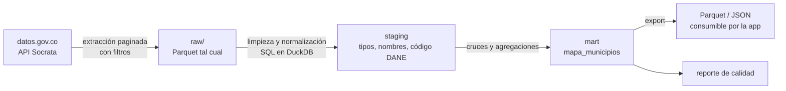

# ADR 0001: Ingesta de datos

> Tarea: [TASK-06 Establecer ingesta de datos: ADR y POC](https://github.com/EKOU-Solutions/EKOU-Elephants/issues/7) · Estado: **Propuesto** (pendiente de revisión del equipo) · Fecha: 2026-11-07

## Contexto

El primer corte vertical es el **Mapa Interactivo**: por cada municipio, el presupuesto asignado frente a pagado, el número de obras y su estado, y el nivel de alerta. Los datos salen de las APIs de [datos.gov.co](../fuentes-de-datos.md): SECOP II, CUIPO y DIVIPOLA.

**Restricciones que condicionan la decisión:**

| Restricción | Detalle |
|---|---|
| **Volumen** | Hay datasets de entre 5 y 23 M de registros, y CUIPO tiene 12 M |
| **API de origen** | Socrata: paginada, con límites de uso, y **las agregaciones grandes en el servidor se agotan por tiempo** (lo observamos con CUIPO en esta tarea) |
| **Calidad** | SECOP trae valores atípicos (la suma de obras da $6.500 billones), nombres de municipio sin código DANE y alrededor del 12 % de registros con "No Definido" |
| **Frecuencia** | SECOP se actualiza a diario y CUIPO cada trimestre. No hace falta tiempo real. |
| **Equipo** | Dos personas. Debe ser simple de operar y barato o gratuito. |
| **Despliegue de la app** | Vercel o Cloudflare (TASK-04). El stack de la app todavía está por definir (TASK-03). |
| **Proyecto open source y global** | Cualquiera debe poder reproducirlo localmente. A futuro habrá que exportar en OCDS. |

La ingesta se divide en **cuatro decisiones**, y cada una se evalúa por separado.

---

## Decisión 1: estrategia de acceso a los datos

| Opción | Ventajas | Desventajas |
|---|---|---|
| **A. Consultar la API en vivo desde la app** | Sin infraestructura; datos siempre al día | Las agregaciones se agotan por tiempo; límites de uso; no hay forma de limpiar los datos; cada visita depende de un servicio externo |
| **B. Extracción por lotes a un almacén propio (ELT)** ✅ | Controlamos la limpieza, los cruces y el rendimiento; la app no depende de datos.gov.co; se puede reproducir | Hay que operar un proceso periódico; los datos llegan con un rezago de horas |
| **C. Descarga masiva de los archivos CSV completos** | Simple; no depende de la paginación | Archivos de varios GB; descarga lenta y frágil; se baja mucho más de lo que se usa |

**Propuesta: B.** Se extrae con filtros (tipo de contrato, periodo, territorio) usando la API paginada, y las agregaciones se hacen localmente, no en el servidor de Socrata. La opción C queda como respaldo para cargas históricas completas.

---

## Decisión 2: lenguaje del pipeline

| Opción | Ventajas | Desventajas |
|---|---|---|
| **Python** ✅ | Es el estándar en ingeniería de datos; tiene el mejor ecosistema (DuckDB, Polars, pandas, dbt, librerías OCDS); facilita que contribuya la comunidad de datos abiertos y que se agregue análisis después | Es un segundo lenguaje si la app termina en TypeScript |
| **TypeScript / Node** | Un solo lenguaje con la app (si TASK-03 elige JS); mismos tipos | Ecosistema de datos más débil; procesar millones de filas es más difícil; hay menos herramientas para limpieza y análisis |
| **Solo SQL (dbt / SQLMesh)** | Transformaciones declarativas, probadas y documentadas | No resuelve la extracción; necesita otra herramienta para traer los datos |

**Propuesta: Python** para extraer y SQL para transformar (dentro del motor elegido en la decisión 3). Separa responsabilidades y no ata el pipeline al stack de la app.

---

## Decisión 3: almacenamiento y motor de transformación

| Opción | Ventajas | Desventajas | Costo |
|---|---|---|---|
| **DuckDB + Parquet** ✅ (POC) | Embebido, sin servidor; SQL analítico muy rápido sobre millones de filas; un archivo que cualquiera reproduce localmente; Parquet se puede leer desde casi cualquier stack | Un solo escritor a la vez; no sirve como base de datos de una app con muchas escrituras; para servirlo hay que exportar o usar una capa de API | Gratis |
| **PostgreSQL + PostGIS** (Supabase / Neon) | Base de datos estándar; consultas geográficas nativas; la app puede consultarla directamente; buena para los reportes ciudadanos | Hay que administrar un servidor y su esquema; las cargas masivas son más lentas; los planes gratuitos tienen límites de almacenamiento (~0,5 GB) | Gratis a ~US$25 al mes |
| **Cloudflare D1 / R2** | Integrado si desplegamos en Cloudflare; R2 sirve Parquet o JSON sin costo de salida | D1 es SQLite con límites de tamaño y no está pensado para análisis; nos ata a un proveedor | Gratis a bajo |
| **BigQuery / Snowflake** | Escala sin límites; analítica potente | Costo variable; nos ata a un proveedor; demasiado para el tamaño actual | Pago por uso |
| **MotherDuck** (DuckDB en la nube) | Mismo motor que la opción local, pero compartido y consultable desde la app | Es un servicio más reciente; nos ata parcialmente a un proveedor | Gratis a bajo |

**Propuesta:**
- **POC: DuckDB + Parquet.** Es lo más rápido de iterar y reproducir, y no exige decidir la infraestructura de la app.
- **Producción: a decidir con TASK-03**, según cómo consuma los datos la app:
  - Si el mapa usa **datos precalculados** (lo más probable en el MVP): se exportan Parquet o JSON por municipio y se sirven como archivos estáticos (Vercel o R2). No hace falta servidor de base de datos.
  - Si la app necesita **consultas dinámicas** (buscador, filtros combinados): DuckDB carga PostgreSQL/PostGIS como capa de servicio.

---

## Decisión 4: orquestación y programación

| Opción | Ventajas | Desventajas | Costo |
|---|---|---|---|
| **GitHub Actions (cron)** ✅ | Ya está en el repo; gratis en repos públicos; los registros de cada ejecución quedan visibles; no hay nada que operar | Límite de 6 h por job; tareas programadas sin garantía de exactitud de minutos | Gratis |
| **Dagster / Prefect** | Seguimiento de dependencias, reintentos, linaje de datos, interfaz web | Una plataforma más que operar; demasiado para 2 personas y pocos pasos | Gratis (self-hosted) a pago |
| **Airflow** | Estándar de la industria | Pesado de operar; curva de aprendizaje alta | Requiere servidor |
| **Cron de Vercel / Cloudflare Workers** | Integrado con el despliegue | Límites de tiempo de ejecución (segundos o minutos); no sirve para procesos de millones de filas | Gratis a bajo |

**Propuesta: GitHub Actions** con ejecución diaria (SECOP) y trimestral (CUIPO). Si el pipeline crece a muchos pasos con dependencias, se migra a Dagster o Prefect.

---

## Flujo propuesto

1. **Extracción:** cliente de la API de Socrata con paginación, App Token, reintentos con espera creciente y filtros en la consulta. Se guarda sin modificar en `raw/` (Parquet), con fecha de extracción.
2. **Limpieza y normalización:** tipos de datos; nombres de municipio normalizados (sin tildes, en mayúsculas) y cruzados con DIVIPOLA para obtener el código DANE; marca de valores atípicos; deduplicación.
3. **Cruces y agregación:** tabla `mapa_municipios` con código DANE, coordenadas, presupuesto asignado y pagado, número y valor de obras, y obras suspendidas o vencidas.
4. **Salida:** Parquet/JSON más un **reporte de calidad** con campos vacíos, duplicados, registros que no se pudieron vincular y valores atípicos.

---

## Consecuencias

**Positivas**
- La app no depende de la disponibilidad ni de los límites de datos.gov.co.
- La limpieza y los cruces se hacen una sola vez, de forma reproducible y probada.
- El pipeline queda desacoplado del stack de la app (TASK-03).
- Cualquiera puede reproducirlo localmente sin infraestructura.

**Negativas / riesgos**
- Los datos llegan con un rezago de horas (SECOP) o de un trimestre (CUIPO).
- Hay un segundo lenguaje (Python) si la app se hace en TypeScript.
- Habrá que mantener las reglas de normalización de nombres mientras SECOP no publique el código DANE.
- Pasar a producción exige decidir la capa de servicio (archivos estáticos o PostgreSQL) junto con TASK-03.

## Pendiente de decidir con el equipo

- [ ] Validar la propuesta de cada decisión (1 a 4)
- [ ] Capa de servicio en producción: archivos estáticos o PostgreSQL/PostGIS (depende de TASK-03)
