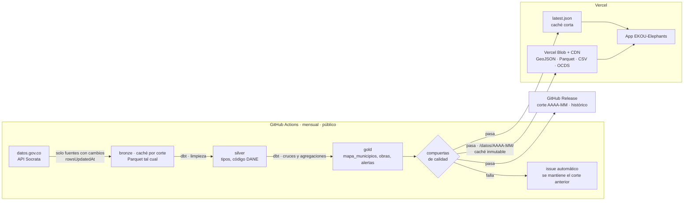

# ADR 0001: Ingesta de datos

> Tarea: [TASK-06 Establecer ingesta de datos: ADR y POC](https://github.com/EKOU-Solutions/EKOU-Elephants/issues/7) · Estado: **Propuesto** (pendiente de revisión del equipo) · Fecha: 2026-11-07

## Contexto

La evidencia detrás de este ADR (estabilidad de la API, significado de los campos, ubicación de los contratos, cobertura y datos personales) está en la [investigación de ingesta](../investigacion-ingesta.md).

EKOU-Elephants necesita un **pipeline de datos de producción**, no un prototipo. Cada mes debe procesar a **escala nacional** la contratación, el presupuesto y el registro empresarial de Colombia, y publicarlos como dato abierto verificable. El primer consumidor es el **Mapa Interactivo**, pero el pipeline se diseña para todas las funcionalidades del [README](../../README.md).

### Escala objetivo (por corte mensual)

| Fuente | Filas | Uso |
|---|---|---|
| SECOP II – Contratos ① | 5,7 M | Mapa, buscador, alertas |
| SECOP II – Procesos ① | 9,4 M | Valor inicial, único oferente, duración original |
| SECOP II – Ubicaciones de ejecución ① | 6,5 M | Municipio donde se ejecuta cada contrato |
| SECOP I – Procesos de compra ① | 7,0 M | Alcaldías que no contratan en SECOP II (278 municipios solo usan SECOP I) |
| SECOP II – Adiciones | 8,5 M | Sobrecostos |
| SECOP II – Ejecución de contratos | 7,7 M | Obras retrasadas |
| SECOP II – Suspensiones | 0,9 M | Obras paralizadas |
| CUIPO – Programación y ejecución de gastos | 19,5 M | Presupuesto por municipio |
| RUES – Confecámaras | 9,5 M | Alertas de contratistas |
| **Total** | **~75 M de filas** | |

① Primer corte: **~28,6 M de filas**. SECOP II Ofertas (~96,6 M filas en tres datasets) queda para una fase posterior.

### Mediciones de la API de origen (2026-11-07)

| Medición | Resultado | Decisión que provoca |
|---|---|---|
| Página de 50.000 filas (15 columnas) | ~52-63 s → **~800-1.000 filas/s por conexión** | El límite es el servidor, no la red: hay que **extraer en paralelo** |
| JSON frente a CSV (misma página) | 63 s frente a 67 s; el CSV pesa 15 % menos | El CSV no es más rápido y pierde los tipos de datos: **se usa JSON** |
| Paginación por `$offset` en la fila 5 M | **12,9 s** solo para posicionarse | El offset se degrada con la profundidad: **no escala** |
| Paginación *keyset* (`$where=:id > último`) | **0,66 s** para posicionarse a cualquier profundidad (página de 3 filas) | Sin costo creciente con la profundidad: **es la que se usa**. El tiempo de una página completa lo pone el volumen, no la posición. |
| Extracción nacional de SECOP II Contratos con keyset, 8 conexiones | 12 de 13 particiones (4.851.900 filas) idénticas a `count(*)`; una página de 67 MB llegó truncada con HTTP 200 | Páginas de 20.000 filas, validación del JSON y reintento desde el mismo cursor |
| Reemplazo diario del dataset en origen | SECOP II Contratos se recrea completo hacia las 07:43 UTC y cambian sus `:id` | Detectar el reemplazo durante la extracción y rehacer la partición |
| Agregación de 12 M de filas en el servidor (CUIPO) | Se agota por tiempo | **Las agregaciones se hacen localmente** |

**Implicación:** en secuencia, una sola conexión tardaría ~2 h solo en SECOP II Contratos y más de 20 h en el corte completo. Con extracción en paralelo por partición (8 conexiones) y saltando las fuentes sin cambios, el corte completo debe caber en **menos de 3 h**, dentro del límite de 6 h de GitHub Actions.

### Objetivos de nivel de servicio

| Indicador | Objetivo |
|---|---|
| Duración del corte mensual completo | < 3 h |
| Primera carga del mapa | < 1 s (datos desde el CDN) |
| Búsqueda en el buscador (p95) | < 300 ms |
| Corte publicado con compuertas de calidad aprobadas | 100 % |
| Reproducible por un tercero con un comando | Sí |

**Restricciones que condicionan la decisión:**

| Restricción | Detalle |
|---|---|
| **Volumen** | ~28,6 M de filas en el primer corte y ~75 M con todas las fuentes (ver escala objetivo) |
| **API de origen** | Socrata: paginada, con límites de uso, y **las agregaciones grandes en el servidor se agotan por tiempo** (lo observamos con CUIPO en esta tarea) |
| **Calidad** | SECOP trae valores atípicos por errores de magnitud (un contrato de $64 millones registrado por $6,45 × 10¹⁵), nombres de municipio sin código DANE, ciudad de la sede en vez del lugar de ejecución y 16 % de obras con ciudad "No Definido" |
| **Frecuencia** | **Actualización mensual en producción.** SECOP se actualiza a diario y CUIPO cada trimestre en origen, pero el proyecto publica un corte mensual. |
| **Proyecto productivo** | No es una demo de una sola vez: debe ejecutarse cada mes sin intervención manual, detectar sus propios fallos y conservar el histórico |
| **Equipo** | Dos personas. Debe ser simple de operar y barato o gratuito. |
| **Despliegue de la app** | **Vercel.** Sus funciones serverless tienen límites de tiempo (minutos, no horas), así que no pueden ejecutar procesos de millones de filas. |
| **Estándares globales** | El proyecto debe seguir estándares internacionales de datos abiertos, ser reproducible por cualquiera y poder llevarse a otros países |
| **Demostrable para las comunidades** | Los datos procesados, la metodología y cada ejecución del pipeline deben ser públicos y verificables, no una caja negra |

La ingesta se divide en **nueve decisiones**, y cada una se evalúa por separado.

---

## Decisión 1: estrategia de acceso a los datos

| Opción | Ventajas | Desventajas |
|---|---|---|
| **A. Consultar la API en vivo desde la app** | Sin infraestructura; datos siempre al día | Las agregaciones se agotan por tiempo; límites de uso; no hay forma de limpiar los datos; cada visita depende de un servicio externo |
| **B. Extracción por lotes a un almacén propio (ELT)** ✅ | Controlamos la limpieza, los cruces y el rendimiento; la app no depende de datos.gov.co; se puede reproducir | Hay que operar un proceso periódico; los datos llegan con un rezago de horas |
| **C. Descarga masiva de los archivos CSV completos** | Simple; no depende de la paginación; 5 a 7 veces más rápida por conexión que una página JSON | Archivos de varios GB; trae todas las columnas (incluidos datos personales); encabezados con nombres visibles, no técnicos |

**Propuesta: B.** Se extrae cada dataset **completo a escala nacional**, solo con las columnas necesarias, usando paginación *keyset* y extracción en paralelo por partición. Las agregaciones se hacen localmente, no en el servidor de Socrata. La opción C queda como respaldo ante fallas repetidas de la API, **usando SODA3** (`/api/v3/views/{id}/export.csv`): el endpoint SODA1 `/api/views/{id}/rows.csv` se retira entre el 16 y el 22 de diciembre de 2026.

---

## Decisión 2: lenguaje del pipeline

| Opción | Ventajas | Desventajas |
|---|---|---|
| **Python** ✅ | Es el estándar en ingeniería de datos; tiene el mejor ecosistema (DuckDB, Polars, pandas, dbt, librerías OCDS); facilita que contribuya la comunidad de datos abiertos y que se agregue análisis después | Es un segundo lenguaje si la app termina en TypeScript |
| **TypeScript / Node** | Un solo lenguaje con la app (si TASK-03 elige JS); mismos tipos | Ecosistema de datos más débil; procesar millones de filas es más difícil; hay menos herramientas para limpieza y análisis |
| **Solo SQL (dbt / SQLMesh)** | Transformaciones declarativas, probadas y documentadas | No resuelve la extracción; necesita otra herramienta para traer los datos |

**Propuesta: Python** para extraer y **SQL con dbt** para transformar. Separa responsabilidades y no ata el pipeline al stack de la app.

### 2.1 Herramienta de transformación

| Opción | Ventajas | Desventajas |
|---|---|---|
| **dbt-core + dbt-duckdb** ✅ | Estándar de la industria (*analytics engineering*); cada modelo SQL tiene **pruebas, documentación y linaje**; genera un **sitio de documentación con el grafo de linaje** que se puede publicar para las comunidades; el adaptador de DuckDB corre sin servidor | Una herramienta más que aprender; el modo incremental requiere cuidado |
| SQLMesh | Linaje a nivel de columna; entornos virtuales; detecta cambios que rompen | Comunidad más pequeña; menos conocido por reclutadores y colaboradores |
| Scripts SQL ejecutados desde Python | Sin dependencias extra | Sin pruebas, documentación ni linaje: todo eso habría que construirlo a mano |

### 2.2 Arquitectura de capas (medallion)

| Capa | Contenido | Formato |
|---|---|---|
| **Bronze** | Datos tal como llegan de la API, con metadatos de extracción (corte, fecha, fuente, consulta) | Parquet particionado |
| **Silver** | Tipos de datos correctos, nombres normalizados, código DANE asignado, duplicados eliminados, valores atípicos marcados | Modelos dbt |
| **Gold** | Tablas listas para el producto: `mapa_municipios`, `obras`, `contratistas`, `alertas` | Modelos dbt → GeoJSON, Parquet, OCDS, PostgreSQL |

---

## Decisión 3: almacenamiento y motor de transformación

| Opción | Ventajas | Desventajas | Costo |
|---|---|---|---|
| **DuckDB + Parquet** ✅ (POC) | Embebido, sin servidor; SQL analítico muy rápido sobre millones de filas; un archivo que cualquiera reproduce localmente; Parquet se puede leer desde casi cualquier stack | Un solo escritor a la vez; no sirve como base de datos de una app con muchas escrituras; para servirlo hay que exportar o usar una capa de API | Gratis |
| **PostgreSQL + PostGIS** (Supabase / Neon) | Base de datos estándar; consultas geográficas nativas; la app puede consultarla directamente; buena para los reportes ciudadanos | Hay que administrar un servidor y su esquema; las cargas masivas son más lentas; los planes gratuitos tienen límites de almacenamiento (~0,5 GB) | Gratis a ~US$25 al mes |
| **Cloudflare D1 / R2** | Integrado si desplegamos en Cloudflare; R2 sirve Parquet o JSON sin costo de salida | D1 es SQLite con límites de tamaño y no está pensado para análisis; nos ata a un proveedor | Gratis a bajo |
| **BigQuery / Snowflake** | Escala sin límites; analítica potente | Costo variable; nos ata a un proveedor; demasiado para el tamaño actual | Pago por uso |
| **MotherDuck** (DuckDB en la nube) | Mismo motor que la opción local, pero compartido y consultable desde la app | Es un servicio más reciente; nos ata parcialmente a un proveedor | Gratis a bajo |

**Propuesta: DuckDB + Parquet para procesar, y archivos estáticos en Vercel para servir.**

Con la app en Vercel, la capa de servicio se elige así:

| Necesidad | Solución en Vercel | Cuándo |
|---|---|---|
| **Mapa** (datos precalculados por municipio y departamento) | Archivos **GeoJSON/JSON** en el CDN de Vercel, o en **Vercel Blob** si son pesados | MVP |
| **Descargas de datos abiertos** | Archivos **Parquet y CSV** en Vercel Blob | MVP |
| **Buscador y filtros combinados** (millones de contratos) | **PostgreSQL** desde el Marketplace de Vercel (Neon o Supabase), cargado por el pipeline | Cuando se construya el buscador |
| **Exploración avanzada en el navegador** (opcional) | **DuckDB-WASM**: consulta los Parquet directamente en el navegador, sin servidor | Fase 2 |

- **Por qué archivos estáticos primero:** el mapa es de solo lectura y cambia como mucho una vez al día. Servirlo desde el CDN es lo más rápido y gratuito, y no tiene base de datos que se pueda caer en una demostración.
- **Por qué no procesar en Vercel:** sus funciones tienen límites de minutos. El pipeline corre fuera (decisión 4) y Vercel solo sirve el resultado.

---

## Decisión 4: orquestación y programación

| Opción | Ventajas | Desventajas | Costo |
|---|---|---|---|
| **GitHub Actions (cron)** ✅ | Ya está en el repo; gratis en repos públicos; los registros de cada ejecución quedan visibles; no hay nada que operar | Límite de 6 h por job; tareas programadas sin garantía de exactitud de minutos | Gratis |
| **Dagster / Prefect** | Seguimiento de dependencias, reintentos, linaje de datos, interfaz web | Una plataforma más que operar; demasiado para 2 personas y pocos pasos | Gratis (self-hosted) a pago |
| **Airflow** | Estándar de la industria | Pesado de operar; curva de aprendizaje alta | Requiere servidor |
| **Cron de Vercel / Cloudflare Workers** | Integrado con el despliegue | Límites de tiempo de ejecución (segundos o minutos); no sirve para procesos de millones de filas | Gratis a bajo |

**Propuesta: GitHub Actions** con una **ejecución mensual programada**, y también ejecución manual (`workflow_dispatch`) para reprocesar un mes. CUIPO se toma del último trimestre disponible en cada corte. Al terminar, publica los archivos en Vercel Blob y dispara un nuevo despliegue con un *Deploy Hook* de Vercel.

Además de ser gratis, cada ejecución queda **pública en la pestaña Actions del repo**, con sus registros y su reporte de calidad. Cualquiera puede comprobar cuándo y cómo se generaron los datos, y eso es clave para la credibilidad ante las comunidades.

Si el pipeline crece a muchos pasos con dependencias, se migra a Dagster o Prefect.

---

## Decisión 5: operación en producción (corte mensual)

### 5.1 Carga completa o incremental

| Opción | Ventajas | Desventajas |
|---|---|---|
| **Recarga completa del periodo vigente cada mes** ✅ | Simple; recoge las correcciones que SECOP hace a contratos antiguos (cambios de estado, adiciones, suspensiones); cada corte es una foto consistente | Descarga más datos cada mes |
| Incremental (solo lo nuevo o modificado) | Descarga menos | SECOP no garantiza una fecha de modificación confiable en todos los datasets; si se pierde un cambio, el error queda para siempre |

**Propuesta: recarga completa** de la ventana de análisis (por ejemplo, contratos firmados en los últimos 5 años). Un mes de tiempo entre ejecuciones da margen de sobra.

### 5.2 Histórico de cortes mensuales

Cada mes se publica una **foto versionada** (`2026-11`, `2026-12`…) y no se sobrescribe la anterior. Esto permite mostrar la evolución en el tiempo, por ejemplo: "esta obra lleva 4 meses suspendida" o "el avance no ha cambiado desde marzo". Es la prueba más fuerte de que una obra está estancada.

| Opción para guardar el histórico | Ventajas | Desventajas |
|---|---|---|
| **GitHub Releases** ✅ | Gratis; público; cada corte queda como una versión con fecha, notas y archivos descargables; está junto al código | Límite de tamaño por archivo; no está pensado para consultas |
| **Vercel Blob** | El mismo proveedor que la app | Tiene costo por almacenamiento a medida que crece el histórico |
| **Zenodo** | Asigna un **DOI** a cada versión: los datos se pueden citar en investigaciones y periodismo; preservación a largo plazo (CERN) | Publicación más lenta; mejor para cortes trimestrales o anuales que mensuales |
| **Hugging Face Datasets** | Muy visible para la comunidad de datos e IA; versionado con git | Menos conocido entre periodistas y veedurías |

**Propuesta:**
- **GitHub Releases** para cada corte mensual: es la fuente de verdad del histórico.
- **Vercel Blob** solo para el corte vigente que consume la app.
- **Zenodo** para un corte anual con DOI, más adelante.

### 5.3 Controles para que no se publiquen datos malos

| Control | Qué hace |
|---|---|
| **Compuertas de calidad** | Si un corte cae fuera de lo esperado (por ejemplo, una partición con 0 filas o más de 1 % menos que el corte anterior, o más del 20 % de municipios sin vincular), **no se publica** y se mantiene el corte anterior. Caso real: las vistas de SECOP II Ofertas 2022 y 2023 quedaron vacías sin dar error. |
| **Contrato de esquema** | Antes de extraer se comparan las columnas, sus tipos y el `tableId` de cada dataset con el corte anterior. Columnas que desaparecen o cambian de tipo detienen el corte; columnas nuevas solo generan aviso. |
| **Cobertura de particiones** | Antes de extraer se verifica que las particiones sumen exactamente el `count(*)` del dataset, y al terminar, que cada partición tenga las filas esperadas |
| **Validación de esquema** | Los archivos de salida se validan contra su `datapackage.json` antes de publicarse |
| **Idempotencia** | Ejecutar dos veces el mismo mes produce el mismo resultado; se puede reprocesar sin efectos secundarios |
| **Aviso de fallos** | Si la ejecución falla, se abre automáticamente un issue en el repo con el registro del error |
| **Reintentos** | La extracción reintenta con espera creciente y aleatoria ante 429 (respetando `Retry-After`), 5xx, fallas de red, JSON truncado y peticiones que superan su tiempo máximo total |
| **Secretos** | El App Token de Socrata y los tokens de Vercel se guardan en GitHub Secrets, nunca en el código |
| **Registro de cambios** | Cada release incluye un resumen del corte: registros procesados, descartados y diferencias con el mes anterior |

---

## Decisión 6: caché

El corte cambia una vez al mes, pero se lee miles de veces. La caché se define en tres niveles, cada uno con un objetivo distinto.

### 6.1 Caché de extracción (pipeline)

**Objetivo:** no volver a descargar de datos.gov.co lo que no cambió, y poder retomar una ejecución que falló a mitad.

| Opción | Ventajas | Desventajas |
|---|---|---|
| **Saltar fuentes sin cambios** usando `rowsUpdatedAt` de los metadatos (`/api/views/{id}.json`) ✅ | CUIPO solo cambia cada trimestre: en 2 de cada 3 meses no hace falta descargarlo; consulta barata | Solo sirve a nivel de dataset completo |
| **Capa bronze como caché por consulta** (dataset + filtros + fecha de corte) ✅ | Si la ejecución falla, al reintentar solo se descarga lo que faltaba; base de la idempotencia | Ocupa disco durante la ejecución |
| **`actions/cache` de GitHub** para la capa bronze entre ejecuciones | Conserva lo descargado entre reintentos del mismo mes | Límite de almacenamiento por repo; las entradas sin uso se borran |
| Sin caché | Simple | Cada reintento vuelve a bajar millones de filas y se expone más a los límites de la API |

**Propuesta:** saltar las fuentes sin cambios con `rowsUpdatedAt`, y usar la capa bronze versionada por corte como caché, persistido con `actions/cache` durante el mes. También se cachean las dependencias de Python en CI.

### 6.2 Caché de publicación (Vercel)

**Objetivo:** que el mapa cargue rápido desde el CDN **sin servir un corte viejo** después de publicar uno nuevo.

| Opción | Ventajas | Desventajas |
|---|---|---|
| **Rutas versionadas por corte + caché inmutable** ✅ (`/datos/2026-11/mapa.geojson` con `Cache-Control: public, max-age=31536000, immutable`) | El navegador y el CDN guardan el archivo para siempre sin riesgo, porque un corte nuevo usa otra ruta; no hay que invalidar nada | Hace falta un puntero al corte vigente |
| **Puntero `latest.json` con caché corta** ✅ (`s-maxage` bajo + `stale-while-revalidate`) | La app descubre el corte nuevo en minutos; si el origen falla, se sigue sirviendo el anterior | Una consulta extra y muy liviana al cargar |
| Sobrescribir los mismos archivos e invalidar la caché | Una sola ruta | Riesgo de servir datos viejos o mezclados entre cortes; Vercel Blob sirve con caché de CDN de larga duración, así que sobrescribir un archivo puede seguir mostrando la versión anterior |
| Sin caché (siempre al origen) | Siempre fresco | Lento y costoso; no aprovecha el CDN |

**Propuesta:** rutas versionadas inmutables más un puntero `latest.json`. Además, el *Deploy Hook* regenera las páginas que muestran cifras del corte, para que todo cambie al mismo tiempo.

### 6.3 Caché de consultas (buscador, fase posterior)

**Objetivo:** que las búsquedas frecuentes no golpeen PostgreSQL cada vez.

- Las respuestas de la API del buscador llevan `Cache-Control` con `s-maxage` en el CDN de Vercel. Como los datos solo cambian una vez al mes, se pueden cachear por días.
- La caché se invalida al publicar un corte nuevo, o se incluye el corte en la clave de caché.
- Si el uso crece, se puede agregar una caché de aplicación (Redis desde el Marketplace de Vercel). No hace falta en el MVP.

---

## Decisión 7: diseño físico y rendimiento

Cómo se organizan los datos para que la extracción, la carga mensual y las consultas sean rápidas. Cada capa tiene su propia técnica.

### 7.1 Extracción desde Socrata

| Técnica | Qué gana |
|---|---|
| **`$select` solo con las columnas necesarias** | SECOP II Contratos tiene más de 90 columnas y el mapa usa unas 10: se descarga mucho menos |
| **Paginación *keyset*** (`$order=:id` + `$where=:id > último`) con páginas de 20.000 filas | Costo de posicionarse constante (0,66 s frente a 12,9 s del offset profundo); sin filas repetidas ni perdidas, verificado contra `count(*)` |
| **Extracción en paralelo por partición** (por año de firma; por primer dígito de `id_contrato` en datasets sin fecha), con un límite de concurrencia | Divide decenas de millones de filas en consultas que no se agotan por tiempo; si una falla, solo se repite esa |
| **Filtros simples en el servidor, agregaciones en local** | Socrata filtra bien pero se agota al agregar millones de filas (lo observamos con CUIPO) |
| **JSON con gzip** | Medido: el CSV no fue más rápido por página y pierde los tipos; gzip reduce la transferencia |

### 7.2 Archivos Parquet (bronze, silver y gold)

| Opción | Ventajas | Desventajas |
|---|---|---|
| **Partición estilo Hive por corte y fuente** ✅ (`corte=2026-11/fuente=secop_contratos/anio_firma=2025/`) | Las consultas leen solo las carpetas que necesitan (*partition pruning*); el reproceso de un mes no toca otros meses | Si se particiona de más, aparecen miles de archivos pequeños y se pierde rendimiento |
| Partición por municipio | Lectura directa por municipio | ~1.100 particiones por fuente y corte: demasiados archivos pequeños ❌ |
| Sin partición | Simple | Cada consulta lee todo |

**Además de la partición:**
- **Ordenar por `cod_dane` y fecha antes de escribir.** Parquet guarda el mínimo y el máximo de cada bloque de filas (*row group*), y DuckDB salta los bloques que no coinciden con el filtro. Así se consigue el efecto de un índice sin crearlo.
- **Compresión ZSTD** y row groups de ~100.000 a 1.000.000 de filas.
- **En DuckDB no se crean índices** para análisis: usa automáticamente los mínimos y máximos por bloque (*zone maps*). Los índices ART de DuckDB solo sirven para búsquedas puntuales y hacen más lenta la carga.

### 7.3 PostgreSQL (buscador, fase posterior)

**Qué guarda:** solo el **corte vigente**. El histórico vive en Parquet (GitHub Releases), así la base se mantiene pequeña y barata dentro de los límites de los planes del Marketplace de Vercel.

**Índices según la consulta:**

| Consulta del buscador | Índice | Tipo |
|---|---|---|
| Por contrato | `id_contrato` | B-tree único |
| Por territorio (filtro territorial global) | `cod_dane` | B-tree |
| Por contratista (NIT) | `nit_proveedor` | B-tree |
| Por nombre con errores o sin tildes ("alcaldia medelin") | `nombre_entidad`, `proveedor`, `objeto` | **GIN con `pg_trgm`** sobre texto normalizado con `unaccent` |
| Búsqueda de texto completo en el objeto del contrato | `objeto` | **GIN sobre `tsvector`** en español |
| Por rango de fechas | `fecha_firma` | **BRIN** (muy pequeño, porque los datos se cargan ordenados por fecha) |
| Obras con alerta activa | `WHERE nivel_alerta > 0` | **Índice parcial**: solo indexa las filas con alerta |
| Listados que siempre muestran las mismas columnas | `(cod_dane) INCLUDE (valor, estado)` | **Índice de cobertura**: responde sin leer la tabla |

**Partición en PostgreSQL:**

| Opción | Cuándo |
|---|---|
| **Sin partición** ✅ (MVP) | Con un solo corte y unos pocos millones de filas, los índices bastan |
| Partición por rango de `fecha_firma` (por año) | Si la tabla supera ~10–20 M de filas o las consultas casi siempre filtran por año |
| Partición por lista de `corte` | Solo si se decide guardar varios cortes en la base |

### 7.4 Carga mensual en PostgreSQL (migración sin cortes de servicio)

| Opción | Ventajas | Desventajas |
|---|---|---|
| **Tabla nueva + intercambio atómico** ✅ | La app nunca ve datos a medias; si algo falla, se descarta la tabla nueva y no pasa nada; se puede revertir | Necesita el doble de espacio durante la carga |
| `DELETE` + `INSERT` sobre la misma tabla | Simple | Lento; la app ve datos incompletos durante la carga; la tabla queda llena de espacio muerto |
| `UPSERT` fila por fila | Solo cambia lo necesario | Muy lento con millones de filas |

**Pasos del intercambio atómico:**
1. Crear `contratos_nuevo` **sin índices** (las inserciones son mucho más rápidas sin ellos).
2. Cargar con **`COPY`**, no con `INSERT`. Es la forma más rápida de cargar en PostgreSQL, y DuckDB puede escribir directo con su extensión `postgres`.
3. **Crear los índices después de cargar** y ejecutar `ANALYZE` para que el planificador tenga estadísticas.
4. Validar la tabla con las compuertas de calidad.
5. **Intercambio atómico** en una sola transacción: `contratos` pasa a `contratos_anterior` y `contratos_nuevo` pasa a `contratos`.
6. Borrar `contratos_anterior` en la siguiente ejecución, para tener un mes de margen para revertir.

### 7.5 Datos del mapa (lo que descarga el navegador)

| Técnica | Qué gana |
|---|---|
| **Agregados precalculados** por municipio y departamento | El navegador no calcula nada; recibe cifras listas |
| **Carga por niveles:** un archivo liviano de departamentos y uno de municipios **por departamento**, que se descarga al hacer clic | La primera carga es pequeña; no se descargan los ~1.100 municipios de una vez |
| **Geometrías simplificadas** (TopoJSON o simplificación con mapshaper) | Los polígonos oficiales pesan varios MB; simplificados bastan para el mapa y pesan una fracción |
| **Compresión** gzip o brotli | La aplica automáticamente el CDN de Vercel |

> **Fuente nueva necesaria:** DIVIPOLA solo trae el punto central de cada municipio. Para dibujar las fronteras de municipios y departamentos hace falta el **Marco Geoestadístico Nacional (MGN) del DANE**, que tiene los polígonos oficiales. Hay que agregarlo al [inventario de fuentes](../fuentes-de-datos.md).

---

## Decisión 8: estándares de ingeniería

El pipeline es código de producción open source. Estos son los estándares que se aplican desde el primer commit:

| Área | Estándar | Herramienta |
|---|---|---|
| **Gestión del proyecto Python** | Dependencias fijadas con lockfile, versión de Python declarada | `uv` + `pyproject.toml` (PEP 621) |
| **Estilo y errores comunes** | Lint y formato automáticos | `ruff` |
| **Tipos** | Tipado estático estricto | `mypy --strict` |
| **Configuración** | Validada al arrancar; secretos solo por variables de entorno | `pydantic-settings` |
| **Pruebas** | Unitarias, de integración con HTTP simulado y de contrato con la API real | `pytest` + `respx` + cobertura mínima del 80 % |
| **Calidad de datos** | Pruebas en cada modelo (no nulos, únicos, relaciones, rangos) | pruebas de `dbt` |
| **Registros** | Logs estructurados en JSON con el corte y la fuente en cada línea | `structlog` |
| **Reproducibilidad** | Mismo entorno local, en CI y para colaboradores | Dev Container + `Makefile` |
| **CI** | Lint, tipos, pruebas y `dbt build` en cada PR | GitHub Actions |
| **Commits y versiones** | Conventional Commits, SemVer y CHANGELOG automático | `release-please` |
| **Open source** | LICENSE (código Apache-2.0, datos CC BY-SA 4.0), CONTRIBUTING, CODE_OF_CONDUCT, SECURITY, plantillas de issues y PR | Recomendaciones de la Linux Foundation y OpenSSF |
| **Seguridad de la cadena de suministro** | Dependencias actualizadas, acciones fijadas por SHA, permisos mínimos en los workflows | Dependabot + OpenSSF Scorecard |

---

## Decisión 9: estándares de publicación

Para que el proyecto sea de estándar global y verificable por las comunidades, todo lo que produce el pipeline se publica como **dato abierto** siguiendo estándares internacionales:

| Estándar | Para qué | Alternativa descartada |
|---|---|---|
| **[OCDS](https://standard.open-contracting.org/latest/es/)** (Open Contracting Data Standard) | Exportar los contratos en el estándar internacional de contratación abierta. Permite que el motor de alertas funcione en cualquier país que publique OCDS. | Formato propio: nos encierra en Colombia |
| **[Frictionless Data Package](https://datapackage.org/)** | Describir cada archivo publicado con un `datapackage.json`: esquema, tipos, licencia y fuente. Validable automáticamente. | Solo un README: no se puede validar por máquina |
| **[GeoJSON](https://datatracker.ietf.org/doc/html/rfc7946)** (RFC 7946) | Datos del mapa; lo leen todas las librerías de mapas (MapLibre, Leaflet, D3) | Formato propio de coordenadas |
| **Códigos DANE + ISO 3166-2:CO** | Identificar municipios (DANE) y departamentos (ISO 3166-2) | Nombres de texto: ambiguos |
| **ISO 8601** para fechas y **COP** explícito en montos | Que no haya ambigüedad en fechas ni en moneda | — |
| **CC BY-SA 4.0** | La misma licencia de las fuentes, con atribución en cada archivo | — |

**Verificabilidad:**
- **Metodología pública:** cada cifra y cada alerta enlaza a su fórmula ([TASK-07](https://github.com/EKOU-Solutions/EKOU-Elephants/issues/8)) y a su fuente original en SECOP.
- **Reproducible con un comando:** cualquiera puede clonar el repo y regenerar los mismos datos.
- **Reporte de calidad publicado** en cada ejecución: qué se descartó, qué no se pudo vincular y por qué.

---

## Flujo propuesto

1. **Extracción:** cliente de la API de Socrata con paginación, App Token, reintentos con espera creciente y filtros en la consulta. Se guarda sin modificar en la capa bronze (Parquet), con fecha de extracción.
2. **Limpieza y normalización:** tipos de datos; nombres de municipio normalizados (sin tildes, en mayúsculas) y cruzados con DIVIPOLA para obtener el código DANE; marca de valores atípicos; deduplicación.
3. **Cruces y agregación:** tabla `mapa_municipios` con código DANE, coordenadas, presupuesto asignado y pagado, número y valor de obras, y obras suspendidas o vencidas.
4. **Salida:** GeoJSON para el mapa; Parquet, CSV y OCDS para descarga, cada uno con su `datapackage.json`; y un **reporte de calidad** con campos vacíos, duplicados, registros que no se pudieron vincular y valores atípicos.
5. **Compuertas de calidad:** si el corte no las pasa, se detiene y se abre un issue.
6. **Publicación:** se crea un GitHub Release del mes (histórico), se sube el corte a Vercel Blob en su ruta versionada (`/datos/AAAA-MM/`), se actualiza el puntero `latest.json` y se dispara el Deploy Hook de Vercel.

---

## Consecuencias

**Positivas**
- La app no depende de la disponibilidad ni de los límites de datos.gov.co.
- La limpieza y los cruces se hacen una sola vez, de forma reproducible y probada.
- El pipeline queda desacoplado del stack de la app (TASK-03).
- Cualquiera puede reproducirlo localmente sin infraestructura.

**Negativas / riesgos**
- Los datos tienen hasta un mes de rezago (corte mensual), y CUIPO un trimestre adicional en origen.
- Hay un segundo lenguaje (Python) si la app se hace en TypeScript.
- Habrá que mantener las reglas de normalización de nombres mientras SECOP no publique el código DANE.
- El buscador va a necesitar una base de datos (PostgreSQL en Vercel Marketplace), lo que agrega un costo y algo que operar.
- Publicar en varios estándares (OCDS, Data Package) implica mantener esos esquemas.

## Pendiente de decidir con el equipo

- [ ] Validar la propuesta de cada decisión (1 a 9)
- [ ] Agregar el Marco Geoestadístico Nacional (MGN) del DANE al inventario de fuentes para los polígonos del mapa (verificar vigencia, formato y licencia en el geoportal)
- [ ] Registrar el App Token de datos.gov.co como secreto `EKOU_SOCRATA_APP_TOKEN`
- [ ] Confirmar con TASK-07 (#8) y TASK-08 (#9) las reglas de silver que afectan alertas y datos personales
- [ ] Medir en la POC los tiempos de extracción y consulta con y sin partición y orden, para confirmar las técnicas de la decisión 7
- [ ] Definir la ventana de análisis (¿últimos 5 años?) y los umbrales de las compuertas de calidad
- [ ] Confirmar con TASK-03 (#4) que la app consume los archivos estáticos publicados en Vercel
