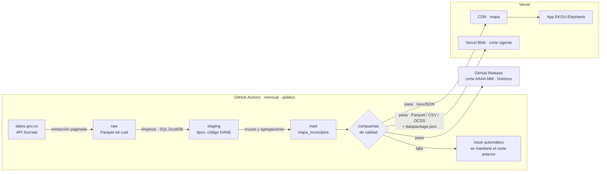

# ADR 0001: Ingesta de datos

> Tarea: [TASK-06 Establecer ingesta de datos: ADR y POC](https://github.com/EKOU-Solutions/EKOU-Elephants/issues/7) · Estado: **Propuesto** (pendiente de revisión del equipo) · Fecha: 2026-11-07

## Contexto

El primer corte vertical es el **Mapa Interactivo**: por cada municipio, el presupuesto asignado frente a pagado, el número de obras y su estado, y el nivel de alerta. Los datos salen de las APIs de [datos.gov.co](../fuentes-de-datos.md): SECOP II, CUIPO y DIVIPOLA.

**Restricciones que condicionan la decisión:**

| Restricción | Detalle |
|---|---|
| **Volumen** | Hay datasets de entre 5 y 23 M de registros, y CUIPO tiene 12 M |
| **API de origen** | Socrata: paginada, con límites de uso, y **las agregaciones grandes en el servidor se agotan por tiempo** (lo observamos con CUIPO en esta tarea) |
| **Calidad** | SECOP trae valores atípicos (la suma de obras da $6.500 billones), nombres de municipio sin código DANE y alrededor del 12 % de registros con "No Definido" |
| **Frecuencia** | **Actualización mensual en producción.** SECOP se actualiza a diario y CUIPO cada trimestre en origen, pero el proyecto publica un corte mensual. |
| **Proyecto productivo** | No es una demo de una sola vez: debe ejecutarse cada mes sin intervención manual, detectar sus propios fallos y conservar el histórico |
| **Equipo** | Dos personas. Debe ser simple de operar y barato o gratuito. |
| **Despliegue de la app** | **Vercel.** Sus funciones serverless tienen límites de tiempo (minutos, no horas), así que no pueden ejecutar procesos de millones de filas. |
| **Estándares globales** | El proyecto debe seguir estándares internacionales de datos abiertos, ser reproducible por cualquiera y poder llevarse a otros países |
| **Demostrable para las comunidades** | Los datos procesados, la metodología y cada ejecución del pipeline deben ser públicos y verificables, no una caja negra |

La ingesta se divide en **cuatro decisiones**, y cada una se evalúa por separado.

---

## Decisión 1: estrategia de acceso a los datos

| Opción | Ventajas | Desventajas |
|---|---|---|
| **A. Consultar la API en vivo desde la app** | Sin infraestructura; datos siempre al día | Las agregaciones se agotan por tiempo; límites de uso; no hay forma de limpiar los datos; cada visita depende de un servicio externo |
| **B. Extracción por lotes a un almacén propio (ELT)** ✅ | Controlamos la limpieza, los cruces y el rendimiento; la app no depende de datos.gov.co; se puede reproducir | Hay que operar un proceso periódico; los datos llegan con un rezago de horas |
| **C. Descarga masiva de los archivos CSV completos** | Simple; no depende de la paginación | Archivos de varios GB; descarga lenta y frágil; se baja mucho más de lo que se usa |

**Propuesta: B.** Se extrae con filtros (tipo de contrato, periodo, territorio) usando la API paginada, y las agregaciones se hacen localmente, no en el servidor de Socrata. La opción C queda como respaldo para cargas históricas completas.

---

## Decisión 2: lenguaje del pipeline

| Opción | Ventajas | Desventajas |
|---|---|---|
| **Python** ✅ | Es el estándar en ingeniería de datos; tiene el mejor ecosistema (DuckDB, Polars, pandas, dbt, librerías OCDS); facilita que contribuya la comunidad de datos abiertos y que se agregue análisis después | Es un segundo lenguaje si la app termina en TypeScript |
| **TypeScript / Node** | Un solo lenguaje con la app (si TASK-03 elige JS); mismos tipos | Ecosistema de datos más débil; procesar millones de filas es más difícil; hay menos herramientas para limpieza y análisis |
| **Solo SQL (dbt / SQLMesh)** | Transformaciones declarativas, probadas y documentadas | No resuelve la extracción; necesita otra herramienta para traer los datos |

**Propuesta: Python** para extraer y SQL para transformar (dentro del motor elegido en la decisión 3). Separa responsabilidades y no ata el pipeline al stack de la app.

---

## Decisión 3: almacenamiento y motor de transformación

| Opción | Ventajas | Desventajas | Costo |
|---|---|---|---|
| **DuckDB + Parquet** ✅ (POC) | Embebido, sin servidor; SQL analítico muy rápido sobre millones de filas; un archivo que cualquiera reproduce localmente; Parquet se puede leer desde casi cualquier stack | Un solo escritor a la vez; no sirve como base de datos de una app con muchas escrituras; para servirlo hay que exportar o usar una capa de API | Gratis |
| **PostgreSQL + PostGIS** (Supabase / Neon) | Base de datos estándar; consultas geográficas nativas; la app puede consultarla directamente; buena para los reportes ciudadanos | Hay que administrar un servidor y su esquema; las cargas masivas son más lentas; los planes gratuitos tienen límites de almacenamiento (~0,5 GB) | Gratis a ~US$25 al mes |
| **Cloudflare D1 / R2** | Integrado si desplegamos en Cloudflare; R2 sirve Parquet o JSON sin costo de salida | D1 es SQLite con límites de tamaño y no está pensado para análisis; nos ata a un proveedor | Gratis a bajo |
| **BigQuery / Snowflake** | Escala sin límites; analítica potente | Costo variable; nos ata a un proveedor; demasiado para el tamaño actual | Pago por uso |
| **MotherDuck** (DuckDB en la nube) | Mismo motor que la opción local, pero compartido y consultable desde la app | Es un servicio más reciente; nos ata parcialmente a un proveedor | Gratis a bajo |

**Propuesta: DuckDB + Parquet para procesar, y archivos estáticos en Vercel para servir.**

Con la app en Vercel, la capa de servicio se elige así:

| Necesidad | Solución en Vercel | Cuándo |
|---|---|---|
| **Mapa** (datos precalculados por municipio y departamento) | Archivos **GeoJSON/JSON** en el CDN de Vercel, o en **Vercel Blob** si son pesados | MVP |
| **Descargas de datos abiertos** | Archivos **Parquet y CSV** en Vercel Blob | MVP |
| **Buscador y filtros combinados** (millones de contratos) | **PostgreSQL** desde el Marketplace de Vercel (Neon o Supabase), cargado por el pipeline | Cuando se construya el buscador |
| **Exploración avanzada en el navegador** (opcional) | **DuckDB-WASM**: consulta los Parquet directamente en el navegador, sin servidor | Fase 2 |

- **Por qué archivos estáticos primero:** el mapa es de solo lectura y cambia como mucho una vez al día. Servirlo desde el CDN es lo más rápido y gratuito, y no tiene base de datos que se pueda caer en una demostración.
- **Por qué no procesar en Vercel:** sus funciones tienen límites de minutos. El pipeline corre fuera (decisión 4) y Vercel solo sirve el resultado.

---

## Decisión 4: orquestación y programación

| Opción | Ventajas | Desventajas | Costo |
|---|---|---|---|
| **GitHub Actions (cron)** ✅ | Ya está en el repo; gratis en repos públicos; los registros de cada ejecución quedan visibles; no hay nada que operar | Límite de 6 h por job; tareas programadas sin garantía de exactitud de minutos | Gratis |
| **Dagster / Prefect** | Seguimiento de dependencias, reintentos, linaje de datos, interfaz web | Una plataforma más que operar; demasiado para 2 personas y pocos pasos | Gratis (self-hosted) a pago |
| **Airflow** | Estándar de la industria | Pesado de operar; curva de aprendizaje alta | Requiere servidor |
| **Cron de Vercel / Cloudflare Workers** | Integrado con el despliegue | Límites de tiempo de ejecución (segundos o minutos); no sirve para procesos de millones de filas | Gratis a bajo |

**Propuesta: GitHub Actions** con una **ejecución mensual programada**, y también ejecución manual (`workflow_dispatch`) para reprocesar un mes. CUIPO se toma del último trimestre disponible en cada corte. Al terminar, publica los archivos en Vercel Blob y dispara un nuevo despliegue con un *Deploy Hook* de Vercel.

Además de ser gratis, cada ejecución queda **pública en la pestaña Actions del repo**, con sus registros y su reporte de calidad. Cualquiera puede comprobar cuándo y cómo se generaron los datos, y eso es clave para la credibilidad ante las comunidades.

Si el pipeline crece a muchos pasos con dependencias, se migra a Dagster o Prefect.

---

## Decisión 5: operación en producción (corte mensual)

### 5.1 Carga completa o incremental

| Opción | Ventajas | Desventajas |
|---|---|---|
| **Recarga completa del periodo vigente cada mes** ✅ | Simple; recoge las correcciones que SECOP hace a contratos antiguos (cambios de estado, adiciones, suspensiones); cada corte es una foto consistente | Descarga más datos cada mes |
| Incremental (solo lo nuevo o modificado) | Descarga menos | SECOP no garantiza una fecha de modificación confiable en todos los datasets; si se pierde un cambio, el error queda para siempre |

**Propuesta: recarga completa** de la ventana de análisis (por ejemplo, contratos firmados en los últimos 5 años). Un mes de tiempo entre ejecuciones da margen de sobra.

### 5.2 Histórico de cortes mensuales

Cada mes se publica una **foto versionada** (`2026-11`, `2026-12`…) y no se sobrescribe la anterior. Esto permite mostrar la evolución en el tiempo, por ejemplo: "esta obra lleva 4 meses suspendida" o "el avance no ha cambiado desde marzo". Es la prueba más fuerte de que una obra está estancada.

| Opción para guardar el histórico | Ventajas | Desventajas |
|---|---|---|
| **GitHub Releases** ✅ | Gratis; público; cada corte queda como una versión con fecha, notas y archivos descargables; está junto al código | Límite de tamaño por archivo; no está pensado para consultas |
| **Vercel Blob** | El mismo proveedor que la app | Tiene costo por almacenamiento a medida que crece el histórico |
| **Zenodo** | Asigna un **DOI** a cada versión: los datos se pueden citar en investigaciones y periodismo; preservación a largo plazo (CERN) | Publicación más lenta; mejor para cortes trimestrales o anuales que mensuales |
| **Hugging Face Datasets** | Muy visible para la comunidad de datos e IA; versionado con git | Menos conocido entre periodistas y veedurías |

**Propuesta:**
- **GitHub Releases** para cada corte mensual: es la fuente de verdad del histórico.
- **Vercel Blob** solo para el corte vigente que consume la app.
- **Zenodo** para un corte anual con DOI, más adelante.

### 5.3 Controles para que no se publiquen datos malos

| Control | Qué hace |
|---|---|
| **Compuertas de calidad** | Si un corte cae fuera de lo esperado (por ejemplo, 30 % menos contratos que el mes anterior, o más del 20 % de municipios sin vincular), **no se publica** y se mantiene el corte anterior |
| **Validación de esquema** | Los archivos de salida se validan contra su `datapackage.json` antes de publicarse |
| **Idempotencia** | Ejecutar dos veces el mismo mes produce el mismo resultado; se puede reprocesar sin efectos secundarios |
| **Aviso de fallos** | Si la ejecución falla, se abre automáticamente un issue en el repo con el registro del error |
| **Reintentos** | La extracción reintenta con espera creciente ante los errores y límites de la API de Socrata |
| **Secretos** | El App Token de Socrata y los tokens de Vercel se guardan en GitHub Secrets, nunca en el código |
| **Registro de cambios** | Cada release incluye un resumen del corte: registros procesados, descartados y diferencias con el mes anterior |

---

## Decisión 6: estándares de publicación

Para que el proyecto sea de estándar global y verificable por las comunidades, todo lo que produce el pipeline se publica como **dato abierto** siguiendo estándares internacionales:

| Estándar | Para qué | Alternativa descartada |
|---|---|---|
| **[OCDS](https://standard.open-contracting.org/latest/es/)** (Open Contracting Data Standard) | Exportar los contratos en el estándar internacional de contratación abierta. Permite que el motor de alertas funcione en cualquier país que publique OCDS. | Formato propio: nos encierra en Colombia |
| **[Frictionless Data Package](https://datapackage.org/)** | Describir cada archivo publicado con un `datapackage.json`: esquema, tipos, licencia y fuente. Validable automáticamente. | Solo un README: no se puede validar por máquina |
| **[GeoJSON](https://datatracker.ietf.org/doc/html/rfc7946)** (RFC 7946) | Datos del mapa; lo leen todas las librerías de mapas (MapLibre, Leaflet, D3) | Formato propio de coordenadas |
| **Códigos DANE + ISO 3166-2:CO** | Identificar municipios (DANE) y departamentos (ISO 3166-2) | Nombres de texto: ambiguos |
| **ISO 8601** para fechas y **COP** explícito en montos | Que no haya ambigüedad en fechas ni en moneda | — |
| **CC BY-SA 4.0** | La misma licencia de las fuentes, con atribución en cada archivo | — |

**Verificabilidad:**
- **Metodología pública:** cada cifra y cada alerta enlaza a su fórmula ([TASK-07](https://github.com/EKOU-Solutions/EKOU-Elephants/issues/8)) y a su fuente original en SECOP.
- **Reproducible con un comando:** cualquiera puede clonar el repo y regenerar los mismos datos.
- **Reporte de calidad publicado** en cada ejecución: qué se descartó, qué no se pudo vincular y por qué.

---

## Flujo propuesto

1. **Extracción:** cliente de la API de Socrata con paginación, App Token, reintentos con espera creciente y filtros en la consulta. Se guarda sin modificar en `raw/` (Parquet), con fecha de extracción.
2. **Limpieza y normalización:** tipos de datos; nombres de municipio normalizados (sin tildes, en mayúsculas) y cruzados con DIVIPOLA para obtener el código DANE; marca de valores atípicos; deduplicación.
3. **Cruces y agregación:** tabla `mapa_municipios` con código DANE, coordenadas, presupuesto asignado y pagado, número y valor de obras, y obras suspendidas o vencidas.
4. **Salida:** GeoJSON para el mapa; Parquet, CSV y OCDS para descarga, cada uno con su `datapackage.json`; y un **reporte de calidad** con campos vacíos, duplicados, registros que no se pudieron vincular y valores atípicos.
5. **Compuertas de calidad:** si el corte no las pasa, se detiene y se abre un issue.
6. **Publicación:** se crea un GitHub Release del mes (histórico), se sube el corte vigente a Vercel Blob y se dispara el Deploy Hook de Vercel.

---

## Consecuencias

**Positivas**
- La app no depende de la disponibilidad ni de los límites de datos.gov.co.
- La limpieza y los cruces se hacen una sola vez, de forma reproducible y probada.
- El pipeline queda desacoplado del stack de la app (TASK-03).
- Cualquiera puede reproducirlo localmente sin infraestructura.

**Negativas / riesgos**
- Los datos tienen hasta un mes de rezago (corte mensual), y CUIPO un trimestre adicional en origen.
- Hay un segundo lenguaje (Python) si la app se hace en TypeScript.
- Habrá que mantener las reglas de normalización de nombres mientras SECOP no publique el código DANE.
- El buscador va a necesitar una base de datos (PostgreSQL en Vercel Marketplace), lo que agrega un costo y algo que operar.
- Publicar en varios estándares (OCDS, Data Package) implica mantener esos esquemas.

## Pendiente de decidir con el equipo

- [ ] Validar la propuesta de cada decisión (1 a 6)
- [ ] Definir la ventana de análisis (¿últimos 5 años?) y los umbrales de las compuertas de calidad
- [ ] Confirmar con TASK-03 (#4) que la app consume los archivos estáticos publicados en Vercel
