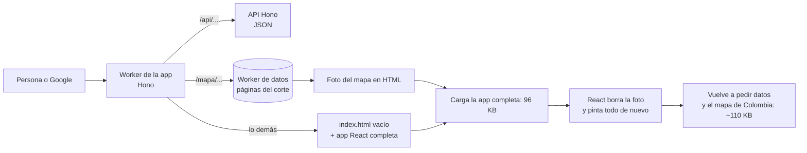
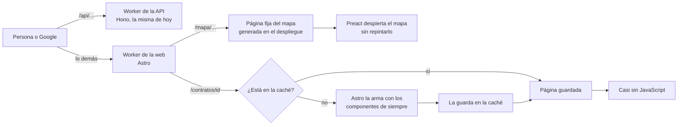
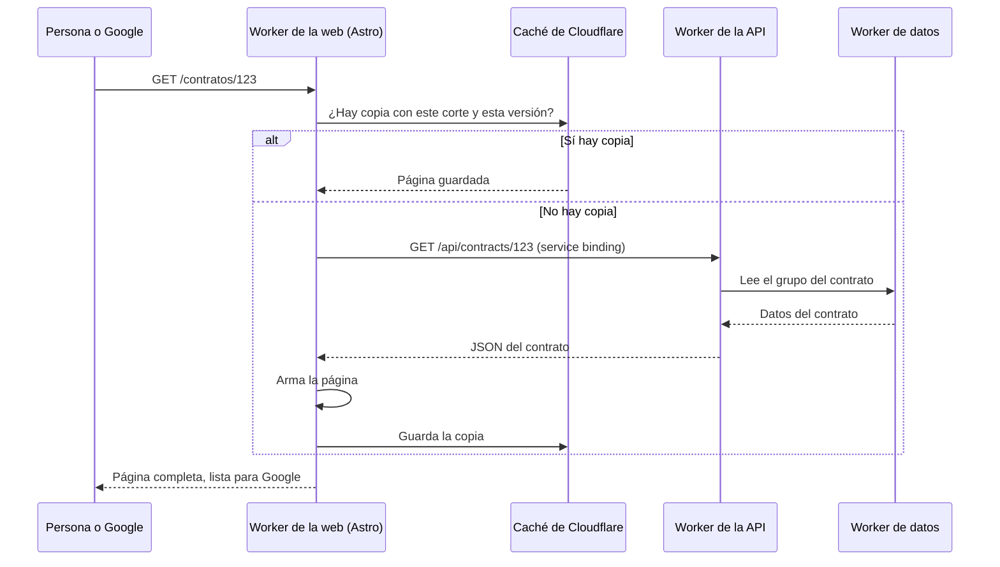

# ADR-0004 · Astro como entrada del sitio: mapa más liviano y contratos que salen en Google

- **Fecha:** 2026-11-21
- **Estado:** propuesto, pendiente de revisión del equipo.
- **Tareas:** TASK-11 ([#18](https://github.com/EKOU-Solutions/EKOU-Elephants/issues/18), contratos del municipio) y TASK-12 ([#19](https://github.com/EKOU-Solutions/EKOU-Elephants/issues/19), detalle de contrato).
- **Cambia:** [ADR-0003](0003-migracion-astro.md) en un punto: las páginas del mapa se generan en cada despliegue y no solo en el corte. **Complementa:** [ADR-0001](0001-arquitectura-inicial.md) (React y Hono se quedan) y [ADR-0002](0002-ingesta-de-datos.md) (el corte mensual).

## En 30 segundos

- **Hoy** la web es una app de React. Astro solo genera, una vez al mes, una «foto» de cada página del mapa para Google. Cuando llega el JavaScript, React borra esa foto y pinta la pantalla otra vez.
- **Problema 1:** el detalle de cada contrato no sale en Google. Son 6,78 millones de contratos y no caben como páginas fijas.
- **Problema 2:** la primera visita al mapa pesa ~250 KB (la meta es 200 KB) y, al borrar y repintar, a veces la página tarda ~2,8 s en verse completa (la meta es 2,5 s).
- **Decisión:** Astro pasa a ser la puerta de entrada de la web, **sin reescribir el código de React**, y la API queda en su propio Worker con Hono (por ahora se despliegan juntas). El mapa se genera en cada despliegue y React lo «despierta» en vez de repintarlo. Cada contrato se arma la primera vez que alguien lo pide y queda guardado en la caché de Cloudflare. React se cambia por Preact, que hace lo mismo y pesa mucho menos.
- **Costo:** se puede empezar en el plan gratuito. El plan de pago de Cloudflare Workers (USD 5 al mes) se activa si la prueba técnica o el consumo real lo piden (ver «Costo»).

## Palabras que se usan aquí

| Palabra | Qué significa |
| --- | --- |
| **SSG** (página fija) | La página se arma una vez, antes de publicar, y se guarda como archivo. Abre rapidísimo |
| **SSR** (página al pedirla) | La página se arma en el servidor en el momento en que alguien la pide |
| **CSR** (página en el navegador) | Llega una página vacía y el JavaScript la pinta. Google y WhatsApp la ven mal |
| **Hidratar** | El JavaScript «despierta» una página que ya llegó pintada: le conecta los clics sin repintarla |
| **Isla** | Una parte de la página que tiene JavaScript (el mapa). El resto es HTML quieto |
| **Caché** | Una copia guardada de la página para no tener que armarla otra vez |
| **Corte** | La actualización mensual de los datos (ADR-0002) |

## Cómo está hoy

| Qué | Cómo se arma hoy |
| --- | --- |
| Mapa (`/mapa`, departamentos, municipios) | Astro genera la foto en el corte (SSG) y después React la reemplaza (CSR) |
| Detalle de contrato (`/contratos/{id}`) | Solo en el navegador (CSR): Google no ve el contenido y un enlace por WhatsApp sale sin título |
| API (`/api/...`) | Hono en el Worker |

Las fotos del mapa no traen JavaScript propio a propósito: se generan una vez al mes y la app se despliega cuando sea. Si se hidrataran, una app nueva podría no coincidir con una foto vieja. Por eso hoy React las reemplaza.

### Lo que medimos (2026-11-21)

Lighthouse 13.6.0 en modo móvil (red lenta y procesador 4 veces más lento simulados), build de producción servido en local con las 1.155 páginas del corte 2026-11, tres corridas por página. No es un celular real ni pasa por el CDN de Cloudflare.

| Página | Rendimiento | LCP (cuándo se ve lo principal) | Peso de la primera visita |
| --- | --- | --- | --- |
| `/mapa/05001` | 100 | 0,76 s | ~250 KB |
| `/mapa` | 95–100 | **0,77 s, 2,74 s y 2,90 s** | ~253 KB |

Accesibilidad, SEO y buenas prácticas dieron 100 en todas las corridas. Los reportes completos, en HTML, están en [evidencias/0004-lighthouse](evidencias/0004-lighthouse/README.md).

De dónde sale el peso: la app (96 KB, de los que **~67 KB son React**), el mapa completo de Colombia (`mgn-2025.topojson`, 95 KB), la fuente (26 KB) y la lista de municipios de la API (17 KB). Lighthouse marca como no usada la mitad del JavaScript de la app. El LCP de 2,8 s ocurre cuando React borra el título de la hoja y lo vuelve a pintar: el navegador cuenta el título nuevo como si apareciera tarde.

## Hacia dónde vamos

**Astro se vuelve la puerta de entrada de la web y la API pasa a tener su propio Worker. Los componentes de React se quedan como están y Astro los usa.**

### Los cambios, uno por uno

1. **Dos puntos de entrada: la web con Astro y la API con Hono.** Ver «La web y la API, cada una con su Worker».
2. **El mapa se genera en cada despliegue, no solo en el corte.** Así la página y el JavaScript salen siempre de la misma versión y React puede **hidratar** en vez de repintar. Generar las 1.155 páginas tarda ~6,6 s (medido en local). El corte ya llega como un PR que cambia la referencia al corte vigente (ADR-0003); al hacer merge, es un despliegue más.
3. **El mapa es una isla.** Toda la pantalla del mapa (mapa, buscador y hoja) es una sola isla, porque sus partes comparten estado. La navegación entre lugares sigue igual que hoy, dentro de la isla.
4. **Los datos del lugar van dentro de la página.** La isla recibe los datos que la página ya trae y no los vuelve a pedir a la API. El mapa completo de Colombia (95 KB) se descarga solo cuando la persona sale del encuadre inicial.
5. **Preact en lugar de React.** Preact entiende el mismo código de React (modo `preact/compat`) y pesa ~7 KB frente a ~67 KB. Storybook también pasa a Preact, para que lo que se aprueba sea lo mismo que se publica.
6. **JavaScript por pantalla.** El mapa no descarga el código del contrato, y el contrato no descarga el del mapa.
7. **Cada contrato se arma al pedirlo y se guarda.** La primera vez que alguien (una persona o Google) pide `/contratos/{id}`, Astro le pide el contrato a la API (`GET /api/contracts/:id`) por un service binding y arma la página con el componente de siempre. La guarda en la caché de Cloudflare. Las siguientes visitas salen de la caché y no llaman a la API. Ver «Por qué el contrato pasa por la API».
8. **Alcance inicial: 2025 y 2026.** Solo esos años van en el sitemap, para que Google gaste su tiempo ahí. Los contratos anteriores también funcionan: se arman la primera vez que alguien los pide.

### La web y la API, cada una con su Worker

| Worker | Qué atiende | Punto de entrada |
| --- | --- | --- |
| `ekou-elephants-web` | Mapa (páginas fijas), contratos (armados al pedirlos, con caché), JS y CSS | Astro |
| `ekou-elephants-api` | `/api/*` | Hono (`crearApp`, el mismo de hoy) |
| `ekou-elephants-datos` | Archivos del corte | Sin cambios |

**Por qué separarlas:**

- **Son productos distintos.** La web es para personas y Google. La API es un contrato para nuestro cliente y, más adelante, para terceros (TASK-09 la documenta con OpenAPI para agentes). Una API pública necesita sus propias versiones y límites, y no debe cambiar porque cambie una pantalla.
- **Una falla no tumba a la otra.** Si una página de Astro se pasa de CPU o un despliegue de la web falla, la API sigue funcionando, y al revés.
- **La API no carga con Astro.** Cada llamada a `/api/*` va directo a Hono, sin el enrutado de Astro y con un paquete más pequeño.
- **Migrar la web a Astro no toca la API.** Se reduce el riesgo de la migración.

**No cuesta más:** cuando un Worker llama a otro por un service binding, Cloudflare cobra una sola petición más la CPU de los dos ([service bindings](https://developers.cloudflare.com/workers/runtime-apis/bindings/service-bindings/), [precios](https://developers.cloudflare.com/workers/platform/pricing/)). La excepción es Workers Cache, que no se usa. El tope diario del plan gratuito es por cuenta, así que lo comparten igual.

**Cómo llega cada petición a su Worker:**

- **En el dominio propio,** `dominio/api/*` va al Worker de la API y todo lo demás al de la web. Cloudflare elige la ruta más específica ([routes](https://developers.cloudflare.com/workers/configuration/routing/routes/)). Las direcciones públicas no cambian.
- **En los previews (`*.workers.dev`),** que no reparten por ruta, la web le pasa `/api/*` a la API por un service binding. Son unas pocas líneas, y no se cobra petición extra.

### Por qué el contrato pasa por la API

La web no lee los datos directamente: le pide cada contrato a la API, igual que la app y que cualquier tercero.

- **La API es la única puerta a los datos.** La web no necesita saber cómo se guardan los contratos (hoy, grupos `.ndjson` en el Worker de datos). Si mañana pasan a R2 o a Postgres, solo cambia la API.
- **Las reglas se aplican en un solo lugar.** Por ejemplo, nunca identificar a una persona natural (TASK-08): la página que ve Google pasa por las mismas reglas que la app.
- **Usamos nuestra propia API.** Si le falta algo para la página (objeto, valor, entidad, empresa, fuente, fecha del corte, enlace a SECOP), se agrega a la API y lo ganan también los terceros (TASK-09, OpenAPI).

**No agrega latencia apreciable ni costo:** con un service binding, por defecto los dos Workers corren en el mismo hilo del mismo servidor, sin pasar por internet ([service bindings](https://developers.cloudflare.com/workers/runtime-apis/bindings/service-bindings/), [buenas prácticas](https://developers.cloudflare.com/workers/best-practices/workers-best-practices/)). Se cobra una sola petición más la CPU de los dos Workers. El extra es convertir el contrato a JSON y de vuelta, y solo pasa cuando el contrato no está en la caché. La latencia se confirma en la prueba técnica.

**Lo que cuesta:** si la API falla, fallan los contratos que no estén en la caché. Los que sí están siguen saliendo.

**El código sigue en un solo repositorio.** Lo que se separa son los puntos de entrada y la configuración de cada Worker. Los módulos (`src/modules/...`) se comparten.

**Por el momento se despliegan juntos:** un mismo workflow despliega la web y la API en cada merge a `main`, y lo mismo en los previews de cada PR. Así nunca queda publicada una web que espere una API distinta. Desplegarlas por separado es otra decisión, para cuando la API tenga consumidores externos y una política de versiones.

### Cómo funciona la caché de un contrato

- **La llave de la copia** lleva el corte y la versión de la app (`/contratos/123` + `2026-11` + versión). Si llega un corte nuevo o se despliega código nuevo, la llave cambia y la página se arma de nuevo con lo último. Nada se borra a mano.
- **Es la Cache API de Cloudflare** (`caches.default`): gratis y estable. Guarda una copia en cada centro de datos de Cloudflare (por ejemplo, Bogotá), no una sola para el mundo.
- **El navegador también guarda la página unas horas**, porque los datos cambian una vez al mes. Si la persona vuelve, ni siquiera llega a Cloudflare.

### Qué no cambia

- Los componentes de React, sus historias y el flujo de diseño.
- El código de la API (`/api/*`) y sus rutas: solo cambia de Worker.
- El pipeline del corte y el Worker de datos.
- Las direcciones públicas (`/mapa/...`, `/contratos/{id}`).

## Qué pasa con un contrato cuando llega un corte nuevo

| Caso | Qué ocurre |
| --- | --- |
| Cambian sus datos | La llave de la caché cambia y la página se arma con los datos nuevos |
| Cambia de municipio | `/contratos/{id}` no lleva municipio, así que la dirección sigue funcionando |
| Sale del corte | Responde 404 y sale del sitemap, para que Google lo retire |
| No cambia | Su `lastmod` en el sitemap se queda igual, para que Google no lo vuelva a rastrear sin razón |

**Sitemaps:** 50.000 direcciones como máximo por archivo, así que se publica un índice de sitemaps (unos 44 archivos para 2025–2026). `lastmod` cambia solo cuando cambia el contrato, comparando una huella del registro con la del corte anterior ([guía de Google para sitios grandes](https://developers.google.com/search/docs/crawling-indexing/large-site-managing-crawl-budget)).

**Datos personales:** una persona natural nunca se identifica (TASK-08): ni en el HTML, ni en los metadatos, ni en el JSON-LD, ni en el sitemap. Las empresas salen con razón social y NIT.

## Por qué esta opción

| Opción | Por qué no |
| --- | --- |
| **Dejarlo como está** | El contrato no sale en Google y el mapa no cumple las metas de peso y LCP |
| **Todos los contratos como páginas fijas** | 6,78 M de archivos no caben: el límite es 100.000 archivos por versión en el plan de pago ([límites](https://developers.cloudflare.com/workers/platform/limits/)). Astro tampoco genera bien cientos de miles de páginas |
| **Armar el contrato con una plantilla de texto en Hono** (primera versión de este ADR) | Funciona, pero hay dos formas de pintar el contrato (plantilla y React) que pueden no coincidir. Además no arregla el mapa |
| **Guardar los contratos armados en KV o R2** | Hay que mantener y limpiar otra tienda de datos. Con la llave por corte, la caché se renueva sola. Si la caché no alcanza, R2 se agrega después |
| **Caché de rutas de Astro** (`Astro.cache` con `cacheCloudflare`) | Su conexión con Cloudflare todavía es experimental ([docs](https://docs.astro.build/en/guides/caching/)). Además, al activar Workers Cache, los archivos estáticos dejan de ser gratis ([docs](https://developers.cloudflare.com/workers/cache/)). Se puede adoptar después cambiando un solo archivo |
| **Reescribir todo en Astro o JavaScript sin React** | Ahorra unos 7 KB más que Preact, pero obliga a reescribir los componentes y Storybook deja de ser la referencia de lo que se publica. Queda como opción futura si Preact no alcanza en celulares de gama baja |
| **Otra plataforma con ISR propio** (Vercel, Netlify) | Habría que mover los datos del corte y la API. No se evaluó a fondo |

## Costo

| Qué | Plan gratuito | Plan de pago (USD 5 al mes) |
| --- | --- | --- |
| Peticiones al Worker | 100.000 al día | 10 M al mes; cada millón extra, USD 0,30 |
| CPU por petición | 10 ms | Hasta 30 s; 30 M de ms incluidos al mes |
| Cache API | Gratis | Gratis |
| Archivos estáticos (páginas del mapa, JS, CSS, fuentes) | Gratis y no cuentan como petición | Igual |
| Desplegar | Gratis | Gratis |

Fuentes: [precios](https://developers.cloudflare.com/workers/platform/pricing/) y [límites](https://developers.cloudflare.com/workers/platform/limits/), consultados el 2026-11-21.

### ¿Hay que pagar desde el principio?

**No es obligatorio.** Con este diseño, el mapa se sirve como archivos estáticos y no gasta peticiones del Worker. Solo cuentan la API y las visitas a contratos (también las que salen de la caché).

**Se pasa al plan de pago si pasa cualquiera de estas cosas:**

1. **Armar un contrato gasta más de ~5 ms de CPU** en la prueba técnica. El límite gratuito es 10 ms y, si se pasa, Cloudflare responde con error 1102. Con 5 ms queda margen para contratos grandes.
2. **El consumo pasa del 70 % del tope diario** (70.000 peticiones) varios días seguidos. Google rastrea un sitio nuevo de a poco, así que no se espera al principio, pero depende del tráfico real.
3. **El equipo prefiere no arriesgar caídas.** Si se agota el tope gratuito, el Worker responde con error 1027 hasta la medianoche UTC: se caen la API y todos los contratos, no solo lo que sobra. Por USD 5 al mes, el plan de pago funciona como un seguro.

**En cualquier caso,** se configura una alerta de consumo en Cloudflare desde el primer despliegue y se mide el consumo diario durante el primer mes.

## Riesgos

- **Dos Workers en vez de uno:** hay que mantener dos configuraciones, previews para los dos y el reparto de `/api/*` en los previews. Se acota desplegándolos juntos y probando el reparto en la prueba técnica.
- **Preact podría no soportar algo de React 19** que usen nuestros componentes. Se confirma corriendo `npm run test:stories` con Preact.
- **CPU al armar un contrato:** no está medida. Decide si se puede empezar en el plan gratuito (ver «¿Hay que pagar desde el principio?»).
- **Tope diario del plan gratuito:** si se agota, se cae la API y los contratos hasta la medianoche UTC. Se mitiga con la alerta de consumo y el paso al plan de pago al llegar al 70 %.
- **Peso de los datos:** nadie ha probado publicar los 7,9 GB de contratos en el Worker de datos. Si no se puede, los grupos de contratos pasan a R2, que costaría centavos al mes.
- **La caché es por centro de datos:** cada centro de datos arma su propia copia la primera vez. Si eso pesa en la CPU o en el tiempo de respuesta, se agrega R2 como copia compartida.
- **Pasar del mapa a un contrato recarga la página**, porque son páginas distintas. Dentro del mapa la navegación sigue igual. Este cambio de experiencia pasa por el flujo de diseño.
- **La lista paginada de contratos del municipio** necesita un export nuevo por municipio. Se define en el flujo de diseño de TASK-11.

## Qué cambia y quién lo hace

| Pieza | Cambio | Quién |
| --- | --- | --- |
| Worker de la web | Nuevo, con Astro y su adaptador de Cloudflare | PR posterior, después de la prueba técnica |
| Worker de la API | El Worker de hoy queda solo con Hono en `/api/*`; ya no sirve páginas | PR posterior |
| Páginas del mapa | Se generan en el build de cada despliegue; la pantalla es una isla hidratada | PR posterior, por el flujo de diseño |
| Detalle de contrato | `/contratos/{id}` armado al pedirlo, con caché por corte y versión | PR posterior, por el flujo de diseño |
| React → Preact | La app y Storybook | PR posterior |
| Pipeline | Huella por contrato e índice de sitemaps | PR posterior |
| Workflows (`corte-mensual.yml`, `app-deploy.yml`) | Generar las páginas en el build y publicar los sitemaps | Una persona del equipo (los agentes no tocan `.github/workflows/`) |
| Cloudflare | Alerta de consumo desde el primer despliegue; plan de pago si se cumple alguna condición | El equipo |

## Orden de trabajo

1. **Aprobar este ADR.**
2. **Prueba técnica corta:**
   - la web en Astro y la API en su Worker, con `/api/*` repartido en el dominio y en un preview;
   - un contrato armado con Astro a partir de la API (CPU y tiempo de respuesta, incluida la llamada a la API), con contratos reales, incluido Bogotá: decide si se empieza en el plan gratuito;
   - el mapa como isla hidratada con Preact (LCP y peso).
3. **Detalle de contrato** (TASK-12): es lo que más vale, porque hoy no sale en Google.
4. **Mapa como isla**, con Preact y JavaScript por pantalla.

## Verificación antes de producción

- `npm run check` en verde.
- Lighthouse móvil, con la misma configuración de este ADR, en `/mapa`, `/mapa/05001` y un contrato:
  - Rendimiento ≥ 90;
  - Accesibilidad y SEO = 100;
  - LCP ≤ 2,5 s en todas las corridas;
  - primera visita ≤ 200 KB.
- `/contratos/{id}` trae el objeto, el valor, la entidad y la fuente en el HTML sin JavaScript.
- Ningún HTML ni metadato identifica a una persona natural.
- El sitemap valida en Search Console.
- Consumo de peticiones y CPU medido durante el primer mes.

Lo que no se cumpla se reporta; no se marca como cumplido.
