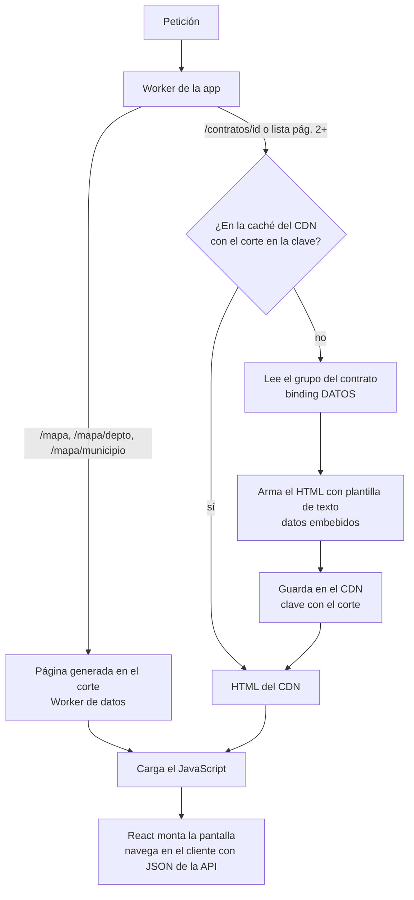

# ADR-0004 · Páginas de contratos armadas por el Worker al pedirlas, con caché por corte

- **Fecha:** 2026-11-20
- **Estado:** propuesto, pendiente de revisión de Jouler.
- **Tareas:** TASK-11 ([#18](https://github.com/EKOU-Solutions/EKOU-Elephants/issues/18), contratos del municipio) y TASK-12 ([#19](https://github.com/EKOU-Solutions/EKOU-Elephants/issues/19), detalle de contrato).
- **Complementa:** [ADR-0003](0003-migracion-astro.md) (páginas de cada lugar con Astro en el corte) y [ADR-0002](0002-ingesta-de-datos.md) (el corte mensual).

## Contexto

La navegación del producto es Colombia → departamento → municipio → lista de contratos del municipio → detalle del contrato. Los tres primeros niveles son 1.155 páginas y ya se generan como HTML fijo (ADR-0003). El detalle del contrato es distinto por su tamaño:

| Dato | Cifra | Fuente |
| --- | --- | --- |
| Contratos con detalle en el corte 2026-11 | 6.778.189 | Export medido en el PR #51 |
| Contratos por año | ~1,15 M | `docs/design/pages/contract-detail/data.md` |
| Archivos por versión del Worker de datos, plan gratuito | 20.000 | [Cloudflare: límites](https://developers.cloudflare.com/workers/platform/limits/) |
| Archivos por versión, plan de pago | 100.000 | [Cloudflare: más archivos estáticos](https://developers.cloudflare.com/changelog/2025-09-02-increased-static-asset-limits/) |
| CPU por petición, plan gratuito | 10 ms | [Cloudflare: límites](https://developers.cloudflare.com/workers/platform/limits) |
| Peticiones al día, plan gratuito (error 1027 al pasarse) | 100.000 | [Cloudflare: precios](https://developers.cloudflare.com/workers/platform/pricing/) |

Consultado el 2026-11-20. Los contratos ya se publican en 16.384 archivos de grupo (`datos/<corte>/contratos/<grupo>.ndjson`, unos 7,9 GB), y el grupo sale solo del identificador (`group_of`, en `pipeline/src/ekou_pipeline/contracts.py`).

**Se necesita que cada contrato salga en Google y se vea bien al compartirlo**, sin generar ni guardar millones de archivos, y sin pagar.

## Decisión

**El Worker de la app arma el HTML de cada contrato cuando se pide, lo guarda en la caché del CDN con el corte en la clave, y la navegación dentro de la app sigue en el cliente.**

1. **Niveles fijos (ADR-0003, sin cambios):** Colombia, departamentos y municipios son HTML generado en cada corte. A la página del municipio se le suma la **primera página de su lista de contratos**, para que quien llegue desde Google vea contratos reales.
2. **Detalle de cada contrato, armado al pedirlo:** para `/contratos/{id}` el Worker lee el grupo del contrato con el binding `DATOS` (servidor a servidor, como ya hace `GET /api/contracts/:id`), busca la línea del identificador y responde el HTML con los datos del contrato embebidos. Al cargar el JavaScript, React monta la pantalla con esos datos y no los vuelve a pedir.
3. **Páginas siguientes de la lista del municipio:** se piden a la API en el cliente (paginadas, porque Bogotá tiene 418.603 contratos en 2025–2026). La ruta `?pagina=N` también se arma en el Worker para que los enlaces de paginación sean rastreables.
4. **Navegación dentro de la app en el cliente:** pasar del municipio a un contrato y volver no recarga la página; React pide el JSON a la API.
5. **Caché con el corte en la clave:** el HTML y el JSON se guardan en el CDN con una clave que incluye el corte (`2026-11`). Cuando entra un corte nuevo la clave cambia y las respuestas se renuevan solas; nada se purga a mano. Es el patrón de «primer renderizado en el servidor, resultado en el CDN, invalidación cuando cambian los datos», con una invalidación más simple porque aquí todos los datos cambian a la vez, una vez al mes.
6. **Plantilla de texto, no React en el servidor:** para caber en los 10 ms de CPU, el HTML del contrato se arma con una plantilla de texto. El export deja cada contrato listo para pintar y el Worker busca su línea sin convertir el archivo completo.

## Mapa de navegación y cómo se sirve cada nivel

| Nivel | Dirección | Cómo llega la primera visita | Navegación dentro de la app |
| --- | --- | --- | --- |
| Colombia | `/mapa` | HTML fijo del corte | Cliente |
| Departamento | `/mapa/{depto}` | HTML fijo del corte | Cliente |
| Municipio y su lista de contratos (pág. 1) | `/mapa/{municipio}` | HTML fijo del corte | Cliente |
| Lista de contratos (pág. 2 en adelante) | `/mapa/{municipio}?pagina=N` | HTML armado por el Worker | Cliente, JSON de la API |
| Detalle de contrato | `/contratos/{id}` | HTML armado por el Worker | Cliente, JSON de la API |

## Qué pasa con un contrato cuando llega un corte nuevo

| Caso | Qué ocurre |
| --- | --- |
| Cambian sus datos (valor, estado, adiciones) | Con el corte nuevo la clave de caché cambia y el HTML se arma con los datos nuevos. No se regenera nada |
| Cambia de municipio | `/contratos/{id}` no lleva municipio, así que la dirección no se rompe. Sale de una lista y entra en otra, y «Volver» lleva al municipio nuevo. El grupo depende solo del identificador, así que se sigue encontrando |
| Sale del corte (la ventana 2021–2026 avanza o el municipio deja de ser confiable) | Responde 404 y sale del sitemap, para que Google lo retire |
| No cambia | Su `lastmod` en el sitemap no se mueve, para no pedirle a Google que vuelva a rastrearlo |

## Sitemaps

6,78 M de direcciones no caben en un archivo (máximo 50.000 por archivo): se publica un **índice de sitemaps** con unos 136 archivos, en el Worker de datos. El orden prioriza el año en curso. `lastmod` por contrato solo cuando cambia su contenido, comparando una huella del registro con la del corte anterior. Google recomienda `lastmod` y 404 o 410 limpios en sitios grandes ([guía de presupuesto de rastreo](https://developers.google.com/search/docs/crawling-indexing/large-site-managing-crawl-budget)).

## Datos personales

Una persona natural nunca se identifica (TASK-08): ni en el HTML, ni en los metadatos, ni en el JSON-LD, ni en el sitemap. Las empresas salen con razón social y NIT. Los títulos y descripciones nuevos los lee la gente y pasan por `/ajuste` con la revisión de `elephant-ux`.

## Alcance y metas

| Entra | Meta |
| --- | --- |
| HTML del contrato sin JavaScript | Objeto, valor, entidad, empresa (si es persona jurídica), fuente, fecha del corte y enlace a SECOP |
| Metadatos por contrato | `<title>`, `description` y `canonical` únicos, `lang="es-CO"`, Open Graph de texto |
| Índice de sitemaps y `robots.txt` | Todos los contratos del corte, con `lastmod` por cambio |
| Rendimiento | CPU del Worker por contrato ≤ 10 ms (medida con contratos reales); Lighthouse móvil: Rendimiento ≥ 90, Accesibilidad y SEO = 100 |
| Consumo | Peticiones al día por debajo del 70 % del tope durante el primer mes |

**Fuera:** imagen para compartir (flujo de diseño), el sistema de alertas y las señales (TASK-13), y las páginas de contratistas.

## Alternativas descartadas

| Opción | Por qué no |
| --- | --- |
| **A. Todo estático:** un HTML por contrato en el corte | No cabe: 6,78 M de archivos frente a 20.000 (gratis) o 100.000 (pago). Obliga a regenerar todo cada mes |
| **B. Estático el año actual y el resto solo con JavaScript** | No cabe: un año son ~1,15 M de archivos. Y lo que va solo con JavaScript se indexa tarde y mal |
| **C. ISR: guardar el HTML armado en KV o R2** | KV gratis admite 1.000 escrituras al día; R2 exige tarjeta. Habría que invalidar lo guardado en cada corte. Armar al pedirlo no guarda nada aparte |
| **D. Solo renderizado en el cliente** | Gasta las mismas peticiones del Worker (la llamada a la API) y pierde el SEO: Google ejecuta JavaScript tarde y WhatsApp o redes sociales no lo ejecutan, así que el enlace se comparte sin título |
| **E. «Dynamic rendering»** (HTML solo para robots) | Google ya no lo recomienda y duplica el trabajo |

## Riesgos

- **CPU del plan gratuito.** Armar el HTML puede pasar de 10 ms y Cloudflare responde el error 1102. **Condición antes de producción:** medirlo con contratos reales. Si no cabe, el plan de pago (USD 5 al mes) da hasta 30 s de CPU.
- **Tope de 100.000 peticiones al día.** Lo comparten la API, `/mapa` y los contratos; el Worker se ejecuta en cada petición aunque la respuesta esté en caché, y la llamada al Worker de datos probablemente cuenta aparte (no confirmado en la documentación). Un rastreo agresivo de Google puede agotarlo. **Mitigaciones:** sitemap con prioridad; responder 503 o 429 a Googlebot cerca del tope para que baje el ritmo; medir el consumo diario. **Disparador para pasar al plan de pago:** más del 70 % del tope varios días seguidos.
- **Peso de los datos.** Nadie ha probado que Cloudflare acepte publicar los 7,9 GB en el Worker de datos. Salida, ya prevista en el PR #51: limitar el detalle a 2025–2026 (2,2 M de contratos) y enlazar a SECOP los más antiguos.
- **Lista paginada por municipio.** Hoy los grupos se reparten por identificador, no por municipio. Hace falta un export nuevo con los contratos ordenados por municipio; se define en el flujo de diseño de TASK-11.
- **El HTML y la pantalla pueden diferir un poco** porque la plantilla de texto no es React. Se acota con una prueba que compara los datos clave (valor, entidad, estado) de ambos.

## Qué cambia y quién lo aprueba

| Pieza | Cambio | Quién |
| --- | --- | --- |
| Worker de la app | Ruta `/contratos/{id}` y lista con `?pagina=N` armadas al pedirlas, con caché por corte | Un PR posterior, tras aprobar este ADR |
| Pipeline | Export de contratos por municipio y huella por contrato; índice de sitemaps | Un PR posterior |
| Pantalla del municipio | La lista de contratos reemplaza la tabla de municipios al entrar a uno | Flujo de diseño (`/crear-pantalla`) |
| `corte-mensual.yml` | Publicar sitemaps y export por municipio | Una persona del equipo (los agentes no tocan `.github/workflows/`) |

## Verificación antes de producción

CPU medida por contrato en el Worker con contratos reales (incluido Bogotá); `/contratos/{id}` trae el objeto y el valor en el HTML sin JavaScript; las direcciones de la lista paginada son rastreables; el sitemap valida con Search Console; ningún HTML ni metadato contiene una persona natural; consumo diario de peticiones medido durante el primer mes. Lo que no se cumpla se reporta; no se marca como cumplido.
