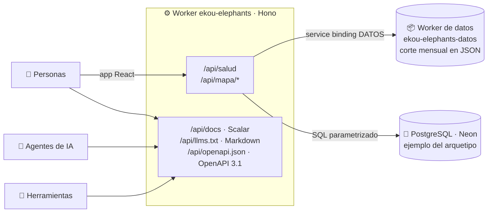
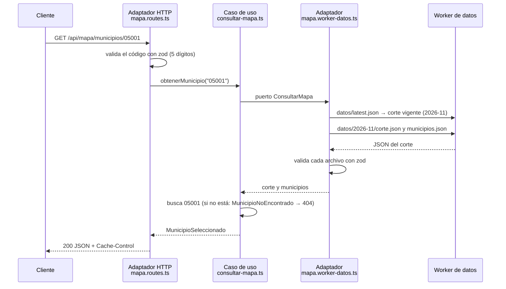
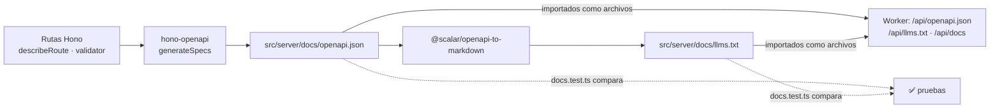

# API: arquitectura y documentación

> Cómo está construida la API de EKOU Elephants y cómo se documenta. Código en general: [arquitectura](arquitectura.md) · Datos: [arquitectura de datos](arquitectura-datos.md) · Despliegue: [CI/CD](ci-cd.md)

## En 30 segundos

La API es REST, de solo lectura y responde JSON. Vive en el mismo Worker de Cloudflare que sirve la interfaz: todo `/api/*` llega a Hono y el resto devuelve la SPA. Lee el corte mensual desde el Worker de datos `ekou-elephants-datos` y, para el ejemplo del arquetipo, desde PostgreSQL.

La documentación **no se escribe a mano**: se genera de las rutas registradas en Hono y el mismo Worker la publica en tres formatos, uno para cada lector.



## Cómo está construida

### Una petición, de punta a punta

Cada ruta sigue el patrón de puertos y adaptadores de [arquitectura](arquitectura.md#puertos-y-adaptadores). Ejemplo: `GET /api/mapa/municipios/05001`.



| Pieza | Dónde | Qué hace |
| --- | --- | --- |
| Entrada del Worker | `src/server/index.ts` | Crea las dependencias reales (base y Worker de datos) por petición. |
| App HTTP | `src/server/app.ts` · `crearApp(db, datos)` | Registra los módulos, los encabezados de seguridad, la documentación y el manejo de errores. Recibe sus dependencias como argumentos, así que las pruebas usan dobles en memoria. |
| Composición | `src/server/composition/<modulo>.ts` | Conecta casos de uso con sus adaptadores. |
| Adaptador HTTP | `src/modules/<modulo>/adapters/http/*.routes.ts` | Define las rutas, valida los parámetros con zod y fija la caché. No tiene reglas de negocio. |
| Caso de uso y dominio | `src/modules/<modulo>/application/` y `domain/` | Reglas y errores del dominio, sin Hono ni infraestructura. |
| Adaptadores de salida | `src/modules/<modulo>/adapters/worker-datos/`, `postgres/` | Leen el corte o la base y validan lo que llega. |

### De dónde sale cada respuesta

| Ruta | Origen | Sin datos |
| --- | --- | --- |
| `GET /api/salud` | El Worker mismo | — |
| `GET /api/mapa/corte`, `/municipios`, `/municipios/{codigo}`, `/departamentos` | Worker de datos `ekou-elephants-datos`: `datos/latest.json` apunta al corte vigente (`datos/AAAA-MM/`) | `503 corte_no_disponible` (por ejemplo, sin el binding `DATOS`, ver [CI/CD](ci-cd.md)) |
| `GET /api/mapa/territorios/{codigo}/resumen` | PostgreSQL: ejemplo ficticio del arquetipo ([alcance](arquitectura.md#alcance-del-ejemplo-y-refinamiento-del-mapa)) | `404 territorio_no_encontrado` |

### Convenciones

- **Rutas:** `/api/<modulo>/<recurso>`, solo `GET`. Un módulo monta sus rutas con `app.route('/api/<modulo>', …)`.
- **Campos:** los actuales están en español y en camelCase (`presupuestoAsignadoCentavos`), según el [contrato del mapa](design/pages/map/contract.md). El idioma de los campos nuevos sigue la regla de idioma de `AGENTS.md`.
- **Identificadores:** códigos DIVIPOLA como texto, con su cero inicial: departamento de 2 dígitos (`"05"`), municipio de 5 (`"05001"`).
- **Dinero:** enteros en centavos, nunca decimales de punto flotante ([importes](arquitectura.md#importes-exactitud-y-rechazo-de-datos-incorrectos)).
- **Fechas:** ISO 8601. El corte se identifica como `AAAA-MM`.
- **Caché:** las rutas del corte responden `Cache-Control: public, max-age=300, stale-while-revalidate=86400`, porque los datos cambian una vez al mes.
- **Seguridad y registros:** `secureHeaders()` en todas las respuestas. Los errores se registran sin mensaje ni traza, para no filtrar datos de conexión.

### Errores

Todo error responde JSON con la forma `{ "error": "<código>" }`. El código es estable y es lo que deben leer los clientes; el texto para las personas lo pone la interfaz.

| Estado | Código | Cuándo |
| --- | --- | --- |
| 400 | `codigo_invalido` | El código DIVIPOLA no tiene el formato esperado. |
| 404 | `territorio_no_encontrado` | No existe el territorio del resumen. |
| 404 | `municipio_no_encontrado` | El municipio no está en el corte vigente. |
| 404 | `no_encontrado` | La ruta no existe. |
| 503 | `corte_no_disponible` | No hay corte publicado o sus archivos no son coherentes. |
| 500 | `error_interno` | Error inesperado. |

Un error nuevo nace como clase en el dominio del módulo y se traduce a estado y código en `app.onError` (`src/server/app.ts`). Después se documenta en las respuestas de la ruta con `esquemaError('<código>')` (ver abajo).

## Cómo documentamos la API

### El principio: el código es la fuente

Cada ruta se documenta junto a su código, y de ahí se generan los documentos. Se versionan en el repositorio y una prueba falla si quedan desactualizados. Así la documentación no puede contradecir lo que está desplegado.

| Ruta | Para quién | Contenido |
| --- | --- | --- |
| `/api/docs` | Personas | Interfaz de Scalar que lee `/api/openapi.json`: rutas, parámetros, el body de cada respuesta, errores y un cliente para probarlas. |
| `/api/llms.txt` | Agentes de IA | El mismo OpenAPI en Markdown (`@scalar/openapi-to-markdown`), fácil de leer en un contexto de modelo. |
| `/api/openapi.json` | Herramientas | OpenAPI 3.1 generado con `hono-openapi`: clientes, validadores, importar en Postman o Insomnia. |

Cada preview de PR y producción las publican, así que se puede revisar la API de un PR en `<URL del preview>/api/docs`.

### Las piezas de una ruta documentada

```ts
// src/modules/mapa/adapters/http/mapa.routes.ts
.get(
  '/municipios/:codigo',
  describeRoute({                                   // 1. documentación de la ruta
    summary: 'Detalle de un municipio',
    tags: ['Mapa'],
    responses: {
      200: json('Municipio seleccionado.', esquemaMunicipioSeleccionado),
      404: json('El municipio no está en el corte vigente.', esquemaError('municipio_no_encontrado')),
    },
  }),
  validator('param', municipioParams, (r, c) => {   // 2. revisa y documenta los parámetros
    if (!r.success) return c.json({ error: 'codigo_invalido' }, 400);
  }),
  async (c) => {
    const municipio = await casos.obtenerMunicipio(c.req.valid('param').codigo);
    return responder(c, esquemaMunicipioSeleccionado, municipio);   // 3. responde con su esquema
  },
)
```

| Pieza | Dónde | Qué hace |
| --- | --- | --- |
| Esquemas de respuesta | `adapters/http/<modulo>.schemas.ts` | Describen con zod el body público de cada respuesta, `.strict()`, con descripciones y ejemplos en español (`.meta`). Son del adaptador HTTP: el dominio no los conoce. |
| `describeRoute` | En cada ruta | Resumen, descripción, etiqueta y el body de cada respuesta (200 y errores) con `json(descripción, esquema)`. |
| `validator` de `hono-openapi` | En cada ruta con parámetros, consulta o body | Revisa la entrada igual que `zValidator` y además la documenta (tipo y patrón). |
| `responder(c, esquema, valor)`, `json(descripción, esquema)`, `esquemaError(código)` | `src/server/http/respuestas.ts` | Compartidos por todos los módulos. `responder` envía el body y el typecheck falla si `valor` no trae un campo que el esquema promete; `json` y `esquemaError` describen una respuesta en `describeRoute`. |
| Pruebas de contrato | Junto a las pruebas de rutas (`src/server/*.test.ts`) | Llaman la ruta con datos en memoria y validan el body real contra su esquema `.strict()`. Fallan si la respuesta envía un campo que la documentación no muestra. |

**Regla del body:** la respuesta incluye como mínimo el tipo del dominio y puede agregar datos complementarios, siempre documentados en su esquema. Un dato del dominio que no deba salir no se manda en la respuesta: se traduce en el adaptador.

### Cómo se genera



- `npm run docs:api` (`scripts/generar-docs-api.mjs`) carga `src/server/docs/openapi.ts` con Vite, construye la app real sin base de datos y escribe `src/server/docs/openapi.json` y `src/server/docs/llms.txt`. `npm run build` lo ejecuta antes de `vite build`.
- El Worker (`src/server/docs/index.ts`) importa esos archivos como JSON y texto. No se sirven como assets estáticos porque `run_worker_first: ["/api/*"]` envía todo `/api/*` al Worker.
- Los dos archivos **se versionan**: las pruebas, el typecheck y `npm run dev` los necesitan antes de cualquier build, y el diff del PR muestra cómo cambia el contrato público.
- **Peso:** `describeRoute`, `validator` y los esquemas viajan en el Worker (~190 kB gzip en total, frente a ~101 kB sin ellos). Lo aceptamos a propósito: la documentación queda pegada a la ruta, que es más fácil de leer y mantener. El generador de Markdown sigue fuera del bundle. El límite de Cloudflare es 3 MB gzip.

### Qué lo protege

- **Typecheck:** `responder` falla si la respuesta no trae un campo documentado.
- **Pruebas de contrato:** fallan si el body real no coincide con su esquema, por ejemplo con un campo no documentado («Unrecognized key»).
- **`src/server/docs/docs.test.ts`** falla si:
  - `openapi.json` o `llms.txt` no coinciden con lo que se genera de las rutas actuales;
  - una ruta no tiene resumen, etiqueta o el body JSON de alguna de sus respuestas;
  - el OpenAPI documenta más o menos rutas `GET` de las que tiene la app, o incluye las rutas de documentación;
  - `/api/openapi.json`, `/api/llms.txt` o `/api/docs` dejan de responder lo esperado.

### Agregar o cambiar una ruta

El paso a paso completo está en la guía [Crear una API](how-to/crear-una-api.md).

### Contrato de página y OpenAPI

Son dos documentos con papeles distintos:

| | Contrato de página | OpenAPI |
| --- | --- | --- |
| Dónde | `docs/design/pages/<pagina>/contract.md` | `/api/openapi.json` (generado) |
| Cuándo | **Antes** de implementar: lo exige el paso 0 de la ruta *Construir una página* de `elephants-design` | **Después**: describe lo que está desplegado |
| Qué dice | Campos, tipos, nulos, unidades, fase y origen de cada dato | Rutas, parámetros, respuestas y errores |
| Quién lo cambia | El equipo, con aprobación | Nadie a mano: sale del código |

El contrato de página es la especificación; el código la implementa (tipos del dominio y esquemas zod), y el OpenAPI refleja el código.

## Para agentes de IA

- Para conocer la API, lee `/api/llms.txt` del entorno o `src/server/docs/llms.txt` en el repositorio. Para generar un cliente, usa `/api/openapi.json`.
- No edites `openapi.json` ni `llms.txt` a mano: cambia la ruta (su `describeRoute` o su esquema) y ejecuta `npm run docs:api`.
- El significado de cada campo está en su descripción dentro del OpenAPI. El contrato de la página explica de dónde sale cada dato.

## Limitaciones

- Las reglas que cruzan campos (por ejemplo, que el total nacional sea la suma de sus niveles) no se pueden expresar en JSON Schema: se explican en la descripción del campo.
- La interfaz de `/api/docs` carga el script de Scalar desde su CDN (jsDelivr).
