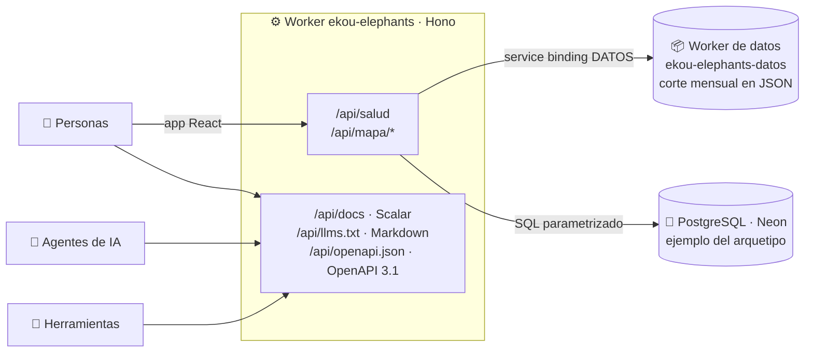
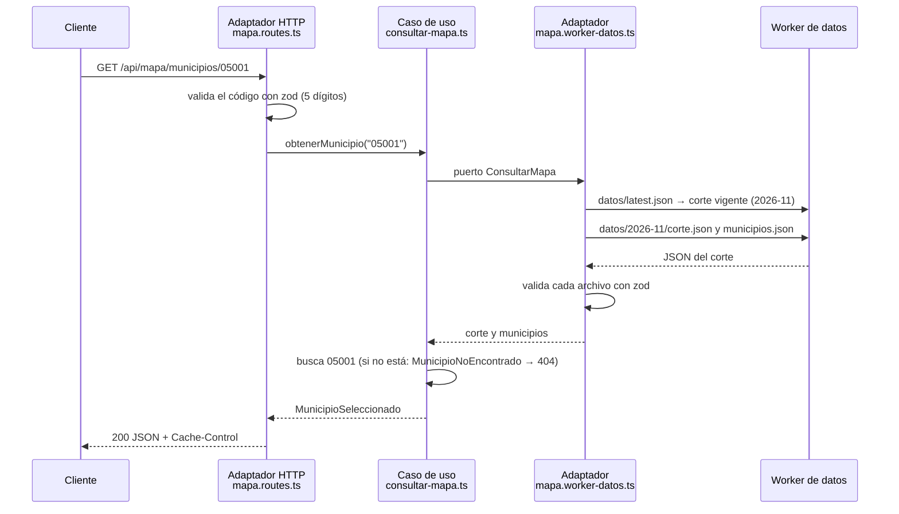
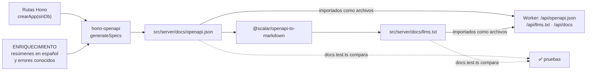

# API: arquitectura y documentación

> Cómo está construida la API de EKOU Elephants y cómo se documenta. Código en general: [arquitectura](arquitectura.md) · Datos: [arquitectura de datos](arquitectura-datos.md) · Despliegue: [CI/CD](ci-cd.md)

## En 30 segundos

La API es REST, de solo lectura y responde JSON. Vive en el mismo Worker de Cloudflare que sirve la interfaz: todo `/api/*` llega a Hono y el resto devuelve la SPA. Lee el corte mensual desde el Worker de datos `ekou-elephants-datos` y, para el ejemplo del arquetipo, desde PostgreSQL.

La documentación **no se escribe a mano**: se genera de las rutas registradas en Hono y el mismo Worker la publica en tres formatos, uno para cada lector.

## Cómo está construida

### Una petición, de punta a punta

Cada ruta sigue el patrón de puertos y adaptadores de [arquitectura](arquitectura.md#puertos-y-adaptadores). Ejemplo: `GET /api/mapa/municipios/05001`.

| Pieza | Dónde | Qué hace |
| --- | --- | --- |
| Entrada del Worker | `src/server/index.ts` | Crea las dependencias reales (base y Worker de datos) por petición. |
| App HTTP | `src/server/app.ts` · `crearApp(db, datos)` | Registra los módulos, los encabezados de seguridad, la documentación y el manejo de errores. Recibe sus dependencias como argumentos, así que las pruebas usan dobles en memoria. |
| Composición | `src/server/composition/<modulo>.ts` | Conecta casos de uso con sus adaptadores. |
| Adaptador HTTP | `src/modules/<modulo>/adapters/http/*.routes.ts` | Define las rutas, valida los parámetros con zod y fija la caché. No tiene reglas de negocio. |
| Caso de uso y dominio | `src/modules/<modulo>/application/` y `domain/` | Reglas y errores del dominio, sin Hono ni infraestructura. |
| Adaptadores de salida | `src/modules/<modulo>/adapters/worker-datos/`, `postgres/` | Leen el corte o la base y validan lo que llega. |

### De dónde sale cada respuesta

| Ruta | Origen | Sin datos |
| --- | --- | --- |
| `GET /api/salud` | El Worker mismo | — |
| `GET /api/mapa/corte`, `/municipios`, `/municipios/{codigo}`, `/departamentos` | Worker de datos `ekou-elephants-datos`: `datos/latest.json` apunta al corte vigente (`datos/AAAA-MM/`) | `503 corte_no_disponible` (por ejemplo, sin el binding `DATOS`, ver [CI/CD](ci-cd.md)) |
| `GET /api/mapa/territorios/{codigo}/resumen` | PostgreSQL: ejemplo ficticio del arquetipo ([alcance](arquitectura.md#alcance-del-ejemplo-y-refinamiento-del-mapa)) | `404 territorio_no_encontrado` |

### Convenciones

- **Rutas:** `/api/<modulo>/<recurso>`, solo `GET`. Un módulo monta sus rutas con `app.route('/api/<modulo>', …)`.
- **Campos:** los actuales están en español y en camelCase (`presupuestoAsignadoCentavos`), según el [contrato del mapa](design/pages/map/contract.md). El idioma de los campos nuevos sigue la regla de idioma de `AGENTS.md`.
- **Identificadores:** códigos DIVIPOLA como texto, con su cero inicial: departamento de 2 dígitos (`"05"`), municipio de 5 (`"05001"`).
- **Dinero:** enteros en centavos, nunca decimales de punto flotante ([importes](arquitectura.md#importes-exactitud-y-rechazo-de-datos-incorrectos)).
- **Fechas:** ISO 8601. El corte se identifica como `AAAA-MM`.
- **Caché:** las rutas del corte responden `Cache-Control: public, max-age=300, stale-while-revalidate=86400`, porque los datos cambian una vez al mes.
- **Seguridad y registros:** `secureHeaders()` en todas las respuestas. Los errores se registran sin mensaje ni traza, para no filtrar datos de conexión.

### Errores

Todo error responde JSON con la forma `{ "error": "<código>" }`. El código es estable y es lo que deben leer los clientes; el texto para las personas lo pone la interfaz.

| Estado | Código | Cuándo |
| --- | --- | --- |
| 400 | `codigo_invalido` | El código DIVIPOLA no tiene el formato esperado. |
| 404 | `territorio_no_encontrado` | No existe el territorio del resumen. |
| 404 | `municipio_no_encontrado` | El municipio no está en el corte vigente. |
| 404 | `no_encontrado` | La ruta no existe. |
| 503 | `corte_no_disponible` | No hay corte publicado o sus archivos no son coherentes. |
| 500 | `error_interno` | Error inesperado. |

Un error nuevo nace como clase en el dominio del módulo y se traduce a estado y código en `app.onError` (`src/server/app.ts`). Después se documenta en `ENRIQUECIMIENTO` (ver abajo).

## Cómo documentamos la API

### El principio: el código es la fuente

Las rutas de Hono son la única definición de la API. De ellas se generan los documentos, se versionan en el repositorio y una prueba falla si quedan desactualizados. Así la documentación no puede contradecir lo que está desplegado.

| Ruta | Para quién | Contenido |
| --- | --- | --- |
| `/api/docs` | Personas | Interfaz de Scalar que lee `/api/openapi.json`: rutas, parámetros, errores y un cliente para probarlas. |
| `/api/llms.txt` | Agentes de IA | El mismo OpenAPI en Markdown (`@scalar/openapi-to-markdown`), fácil de leer en un contexto de modelo. |
| `/api/openapi.json` | Herramientas | OpenAPI 3.1 generado con `hono-openapi`: clientes, validadores, importar en Postman o Insomnia. |

Cada preview de PR y producción las publican, así que se puede revisar la API de un PR en `<URL del preview>/api/docs`.

### Cómo se genera

- `npm run docs:api` (`scripts/generar-docs-api.mjs`) carga `src/server/docs/openapi.ts` con Vite, construye la app real sin base de datos y escribe `src/server/docs/openapi.json` y `src/server/docs/llms.txt`. `npm run build` lo ejecuta antes de `vite build`.
- El Worker (`src/server/docs/index.ts`) importa esos archivos como JSON y texto. No se sirven como assets estáticos porque `run_worker_first: ["/api/*"]` envía todo `/api/*` al Worker. Así, `hono-openapi` y el conversor a Markdown son dependencias de desarrollo y no entran al bundle (+6,1 kB gzip en lugar de +1,09 MB si se generaran en runtime).
- Los dos archivos **se versionan**: las pruebas, el typecheck y `npm run dev` los necesitan antes de cualquier build, y el diff del PR muestra cómo cambia el contrato público.
- Los resúmenes en español, las etiquetas y los errores conocidos se agregan en `ENRIQUECIMIENTO`, dentro de `src/server/docs/openapi.ts`, sobre lo generado. Las rutas de los módulos no llevan anotaciones de documentación.

### Qué lo protege

`src/server/docs/docs.test.ts` falla si:

- `openapi.json` o `llms.txt` no coinciden con lo que se genera de las rutas actuales;
- el OpenAPI documenta más o menos rutas `GET` de las que tiene la app, o incluye las rutas de documentación;
- `ENRIQUECIMIENTO` nombra una ruta que ya no existe;
- `/api/openapi.json`, `/api/llms.txt` o `/api/docs` dejan de responder lo esperado.

### Agregar o cambiar una ruta

1. Implementa la ruta en el adaptador HTTP de su módulo, con validación zod de los parámetros, y conéctala en `server/composition`.
2. Si hay un error nuevo, agrégalo al dominio y a `app.onError`.
3. Agrega la ruta a `ENRIQUECIMIENTO`: `summary` y `description` en español, `tags` y las respuestas de error que puede dar.
4. Ejecuta `npm run docs:api` y haz commit de `openapi.json` y `llms.txt` junto con el cambio.
5. `npm run check` y revisa `/api/docs` en el preview del PR.
6. Si una pantalla depende de la ruta, actualiza el contrato de su página en `docs/design/pages/<pagina>/contract.md`.

### Contrato de página y OpenAPI

Son dos documentos con papeles distintos:

| | Contrato de página | OpenAPI |
| --- | --- | --- |
| Dónde | `docs/design/pages/<pagina>/contract.md` | `/api/openapi.json` (generado) |
| Cuándo | **Antes** de implementar: lo exige el paso 0 de la ruta *Construir una página* de `elephants-design` | **Después**: describe lo que está desplegado |
| Qué dice | Campos, tipos, nulos, unidades, fase y origen de cada dato | Rutas, parámetros, respuestas y errores |
| Quién lo cambia | El equipo, con aprobación | Nadie a mano: sale del código |

El contrato de página es la especificación; el código la implementa (tipos del dominio y esquemas zod), y el OpenAPI refleja el código.

## Para agentes de IA

- Para conocer la API, lee `/api/llms.txt` del entorno o `src/server/docs/llms.txt` en el repositorio. Para generar un cliente, usa `/api/openapi.json`.
- No edites `openapi.json` ni `llms.txt` a mano: cambia la ruta o `ENRIQUECIMIENTO` y ejecuta `npm run docs:api`.
- Para el significado de cada campo, la fuente es el contrato de la página y los tipos del dominio (`src/modules/<modulo>/domain/`).

## Limitaciones

- `hono-openapi` no lee los esquemas de `@hono/zod-validator`, así que las respuestas no incluyen el esquema del cuerpo y `{codigo}` aparece como `string`, sin el patrón DIVIPOLA. Para mientras, el esquema de los campos está en el contrato de la página y en los tipos del dominio. Si hace falta, se puede pasar la validación a los ayudantes de `hono-openapi` (`describeRoute`, `validator`, `resolver`) para que los esquemas zod entren al OpenAPI.
- La interfaz de `/api/docs` carga el script de Scalar desde su CDN (jsDelivr).
