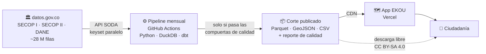
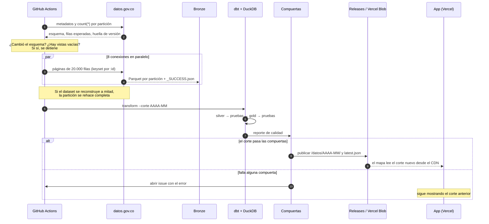
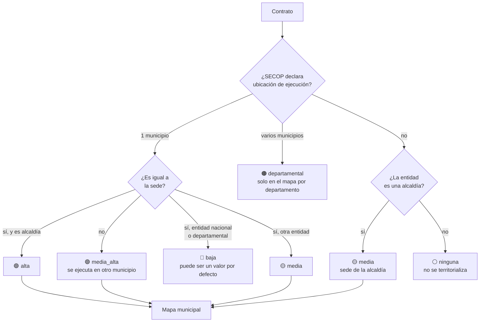
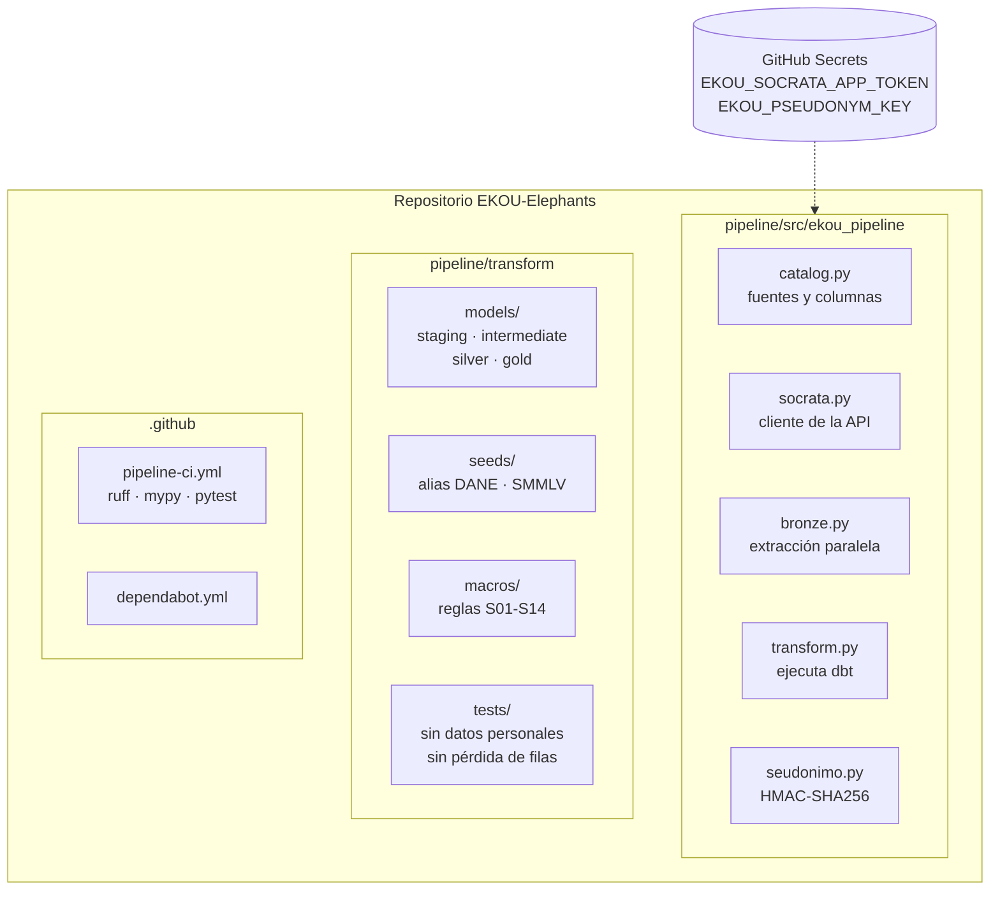

# Arquitectura de datos

> Cómo viajan los datos desde datos.gov.co hasta el mapa. Decisiones y alternativas: [ADR 0002](adr/0002-ingesta-de-datos.md) · Evidencia: [investigación de ingesta](investigacion-ingesta.md) · Fuentes: [fuentes de datos](fuentes-de-datos.md)

## En 30 segundos

Cada mes, un workflow de GitHub Actions descarga la contratación pública de Colombia, la limpia y la publica como archivos estáticos. La app en Vercel solo lee esos archivos: **no depende de datos.gov.co ni de un servidor propio** para mostrar el mapa.

## Capas de datos (medallón)

Cada capa tiene una responsabilidad y una regla de publicación distinta.

```mermaid
flowchart LR
    subgraph ORIGEN["Origen · datos.gov.co"]
        direction TB
        S2C["SECOP II Contratos<br/>jbjy-vk9h · 5,7 M"]
        S2P["SECOP II Procesos<br/>p6dx-8zbt · 9,4 M"]
        S2U["SECOP II Ubicaciones<br/>gra4-pcp2 · 6,5 M"]
        S1["SECOP I<br/>f789-7hwg · 6,5 M"]
        DV["DIVIPOLA<br/>gdxc-w37w · 1.122"]
    end

    subgraph BRONZE["🥉 Bronze · privado"]
        direction TB
        B["Parquet tal como llega<br/>todo como texto<br/>particionado por corte, fuente y año"]
    end

    subgraph SILVER["🥈 Silver · público"]
        direction TB
        ST["staging<br/>tipos de dato · deduplicación"]
        INT["intermediate<br/>diccionarios DANE · ubicación<br/>valor inicial del proceso"]
        CT["contratos<br/>1 fila por contrato<br/>reglas S01-S14 · seudónimos HMAC"]
        ST --> INT --> CT
    end

    subgraph GOLD["🥇 Gold · público"]
        direction TB
        MAP["mapa_municipios<br/>indicadores por municipio y año"]
        CAL["calidad_corte<br/>qué se pudo usar y qué no"]
    end

    ORIGEN -->|"extract"| BRONZE
    BRONZE -->|"transform<br/>dbt build"| SILVER
    CT --> MAP
    CT --> CAL
```

| Capa | Qué contiene | Quién la ve | Herramienta | Se garantiza que… |
|---|---|---|---|---|
| **Bronze** | Los datos tal como llegan, sin columnas bancarias ni de domicilio | **Nadie: nunca se publica** | Python + PyArrow | Cada partición cuadra con el `count(*)` del origen |
| **Silver** | Un contrato por fila, tipado, deduplicado, con municipio de ejecución y alertas | Público | dbt + DuckDB | Ninguna persona natural queda identificada; no se pierde ningún contrato |
| **Gold** | Agregados listos para el mapa y el reporte de calidad | Público | dbt + DuckDB | Las sumas excluyen valores atípicos y solo usan ubicaciones confiables |

## El corte mensual, paso a paso

## Dónde se ejecuta un contrato

La ciudad de SECOP es la sede de la entidad, no el lugar de la obra. La ubicación se asigna en cascada y cada contrato guarda su nivel de confianza.

Próximos niveles: el municipio del proyecto de inversión (BPIN, DNP) y el nivel de la entidad desde CHIP.

## Dónde vive cada cosa

## Estado

| Componente | Estado |
|---|---|
| Extracción a bronze (SECOP II Contratos, nacional) | ✅ 5.687.362 filas, 13 de 13 particiones idénticas al origen |
| Extracción de SECOP I, Procesos y Ubicaciones | 🔧 En catálogo, primera ejecución nacional pendiente |
| Silver y gold con dbt | 🔧 Modelos y pruebas escritos, primera ejecución pendiente |
| Workflow mensual en GitHub Actions | ⏳ Pendiente (necesita los secretos) |
| Publicación en GitHub Releases y Vercel Blob | ⏳ Pendiente |
| Ubicación por BPIN (DNP) y nivel de entidad por CHIP | ⏳ Fase siguiente |
| Buscador (PostgreSQL) | ⏳ Fase posterior |
