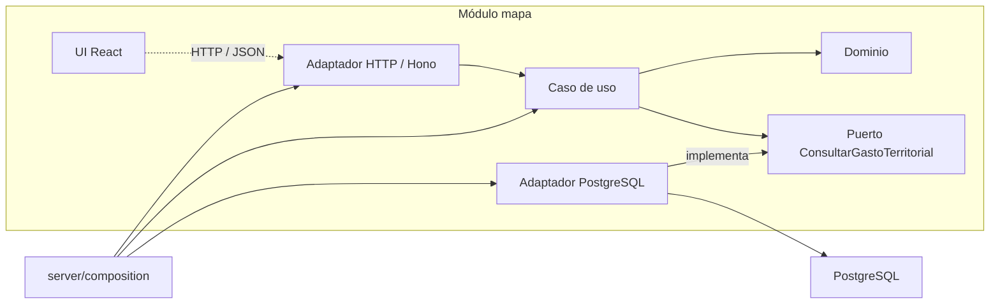
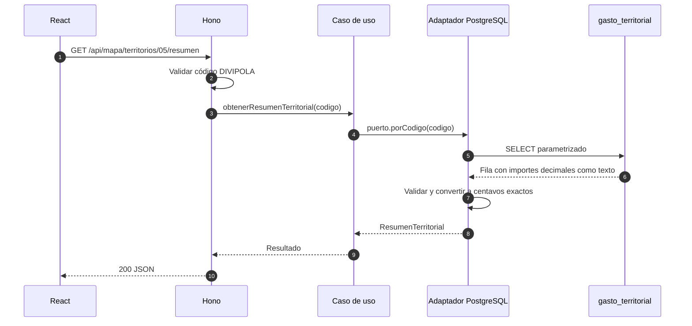

# Arquitectura y organización del código

Decisiones: [ADR-0001](adr/0001-arquitectura-inicial.md). Comandos: [Desarrollo local](desarrollo.md).

## Alcance del ejemplo y refinamiento del mapa

El módulo `mapa` y la tabla `gasto_territorial` son una demostración del recorrido UI → API → caso de uso → PostgreSQL, con cifras ficticias. No representan todavía el contrato definitivo del Mapa Interactivo ni se alimentan de la ingesta.

**Acuerdo con Esteban:** al tomar el módulo del mapa se refinarán sus reglas, indicadores, dimensiones y esquema con el contrato real de la ingesta. Esto incluye municipio/año, los datos disponibles y las señales que se pueden mostrar; los campos actuales de presupuesto y retrasos no se dan por validados. En este arquetipo mantenemos el ejemplo para explicar la arquitectura y resolvemos ya la precisión numérica.

## Módulos verticales

Cada capacidad agrupa su interfaz, reglas, casos de uso y adaptadores en `src/modules/<modulo>/`. Una entrega vertical recorre UI → API → caso de uso → persistencia → pruebas y produce un resultado usable. No implica otro repositorio ni otro despliegue.

```text
src/
  client/                         # Arranque de React y composición de pantallas
  modules/mapa/
    domain/                       # ResumenTerritorial y errores de negocio
    application/
      ports/                      # ConsultarGastoTerritorial
      obtener-resumen-territorial.ts
    adapters/
      http/                       # Rutas Hono
      postgres/                   # SQL, mapeo y validación de importes
    ui/                           # Componentes React de la funcionalidad
  server/
    index.ts                      # Entrada del Worker y entorno
    app.ts                        # Rutas, cabeceras y errores HTTP
    db.ts                         # Acceso técnico a PostgreSQL
    composition/mapa.ts            # Construcción y conexión de dependencias
migrations/                       # Historial SQL común
tests/integration/                # Pruebas con PostgreSQL real
```

## Puertos y adaptadores

| Parte | Responsabilidad | Ejemplo |
| --- | --- | --- |
| Dominio | Conceptos y errores sin dependencias técnicas. | [ResumenTerritorial](../src/modules/mapa/domain/resumen-territorial.ts). |
| Aplicación | Resolver una operación usando sus puertos. | [obtenerResumenTerritorial](../src/modules/mapa/application/obtener-resumen-territorial.ts). |
| Puerto de salida | Contrato de la información necesaria. | [ConsultarGastoTerritorial](../src/modules/mapa/application/ports/consultar-gasto-territorial.ts): `porCodigo(codigo)`. |
| Adaptador HTTP | Validar la petición e invocar el caso de uso. | [mapaRoutes](../src/modules/mapa/adapters/http/mapa.routes.ts). |
| Adaptador PostgreSQL | Implementar el puerto con SQL y mapear las filas. | [gastoTerritorialRepository](../src/modules/mapa/adapters/postgres/gasto-territorial.repository.ts). |
| Composición | Crear y conectar las implementaciones. | [componerMapa](../src/server/composition/mapa.ts). |

Las flechas sólidas muestran dependencias; la punteada representa la llamada HTTP desde el navegador.



### Reglas de dependencias

- `domain` no importa Hono, React, PostgreSQL ni configuración del servidor.
- `application` depende del dominio y de sus puertos; no importa `adapters` ni `server`.
- Los adaptadores dependen de los contratos del centro. El caso de uso no crea el repositorio ni conoce su SQL.
- `server/composition` conecta las piezas mediante argumentos, sin contenedor de inyección.
- La UI consulta la API por HTTP. Puede compartir tipos puros con `import type`; no importa repositorios, conexiones ni secretos.
- Los módulos colaboran mediante contratos explícitos de aplicación; no importan adaptadores ni acceden a tablas internas de otros módulos.

Un caso de uso puede ser una función. No hace falta una clase o interfaz por archivo.

## Ejemplo: consultar un resumen territorial

`GET /api/mapa/territorios/05/resumen`



Este es el orden de ejecución. El caso de uso solo importa el puerto; la composición decide qué implementación recibe:

```ts
const puerto = gastoTerritorialRepository(db);
const consultarResumen = obtenerResumenTerritorial(puerto);
const rutas = mapaRoutes({ obtenerResumenTerritorial: consultarResumen });
```

Un código inválido devuelve 400 antes de consultar; un territorio inexistente, 404. Una fila con un importe inválido o un error inesperado devuelve un 500 genérico. El servidor registra el tipo de error sin exponer el valor o credenciales al cliente. La UI contempla carga, vacío, resultado y error.

## Importes: exactitud y rechazo de datos incorrectos

Los importes se guardan como `NUMERIC(20,2)`. La API devuelve `presupuestoAsignadoCentavos` y `gastoActualCentavos`, enteros seguros de JavaScript con unidad explícita:

1. [importeACentavos](../src/modules/mapa/adapters/postgres/importe.ts) recibe el texto de PostgreSQL. Exige un decimal no negativo con hasta dos decimales.
2. Convierte las partes a centavos con `BigInt`, sin pasar antes por `Number`.
3. Comprueba que los centavos no superen `Number.MAX_SAFE_INTEGER`; solo entonces devuelve un `number`.

`"100.25"` → `10025`. El máximo por importe es `"90071992547409.91"` COP; un centavo más falla con `ImporteInvalido`. También se rechazan negativos, NaN, infinitos, exponentes, espacios, números ya convertidos y más de dos decimales. La nueva migración añade restricciones de rango a ambos campos sin reescribir la migración original. La UI formatea los centavos sin volver a un decimal de coma flotante.

`Number.isSafeInteger(Number(texto))` no basta: rechaza decimales válidos y puede recibir un valor ya redondeado. Aquí el rango se comprueba con `BigInt` antes de perder precisión.

PostgreSQL ajusta los valores a la escala de `NUMERIC(20,2)`. Si añadimos escrituras, validaremos la precisión original antes de guardar: el lector no puede recuperar decimales ya redondeados por la base. El límite de este ejemplo no determina qué valor es confiable en SECOP; el rango y la representación final del módulo real se refinarán con sus necesidades, sin permitir pérdida silenciosa.

## Cómo añadir una funcionalidad

1. Ubicarla en el módulo dueño de esa capacidad; crear otro si tiene una responsabilidad distinta.
2. Definir entrada, resultado y reglas; agregar los puertos necesarios.
3. Implementar adaptadores y conectarlos en `server/composition`.
4. Incorporar UI y una migración SQL si cambia el esquema.
5. Probar el caso de uso con un puerto en memoria, las rutas y la integración con PostgreSQL cuando corresponda.

Las pruebas unitarias viven junto al código (`*.test.ts`); la integración, en `tests/integration/`. Errores, seguridad y pruebas forman parte del DoD. La ingesta tiene su decisión y flujo separados.
