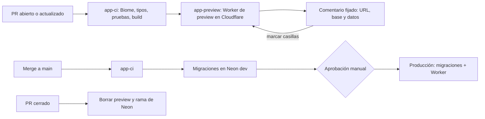

# CI/CD de la aplicación

Implementa [TASK-04 · Configurar CI y CD (#5)](https://github.com/EKOU-Solutions/EKOU-Elephants/issues/5) sobre el arquetipo React/Vite + Hono/Workers. El pipeline de datos en Python conserva su propio workflow (`pipeline-ci.yml`).

## En 30 segundos

| Workflow | Cuándo | Qué hace |
| --- | --- | --- |
| `app-ci.yml` | Lo llaman los otros dos; también manual | Lint y formato con Biome, tipos, pruebas (incluida integración con PostgreSQL 17 desechable), build y validación del paquete de Wrangler. No usa secretos, así que también corre en PRs desde forks. |
| `app-preview.yml` | PR abierto, actualizado, reabierto o cerrado; edición del comentario de control | Despliega el preview del PR, publica y actualiza el comentario fijado y limpia al cerrar. |
| `app-deploy.yml` | Push a `main` | CI, migraciones en la base compartida `dev` y despliegue a producción tras la aprobación. |

## Comprobaciones locales

| Comando | Qué hace |
| --- | --- |
| `npm run lint` | Reglas recomendadas de Biome; las advertencias hacen fallar. |
| `npm run format:check` / `npm run format` | Verifica o aplica el formato de Biome. |
| `npm run check` | Lint, formato, tipos, pruebas y build. Es lo mismo que CI, salvo la integración con PostgreSQL si no hay `TEST_DATABASE_URL`. |
| `npm run deploy:dry-run` | Valida el paquete del Worker sin subirlo (requiere `npm run build`). |
| `npm run datos:corte -- [AAAA-MM]` | Lanza el workflow `corte-mensual` en GitHub Actions (sin mes: el actual). |
| `npm run datos:descargar -- [AAAA-MM]` | Baja un corte publicado (por defecto el último Release) a `datos-locales/`, que git ignora. `--forzar` reemplaza la carpeta. |
| `npm run datos:preview -- <pr>` | Sube `datos-locales/` al Worker de datos de ese PR (`ekou-elephants-datos-pr-<pr>`). Requiere `wrangler login` en la cuenta de EKOU. |

Biome es la única herramienta de lint y formato de la app. Su alcance es `src/`, `tests/`, `scripts/` y la configuración TypeScript/JSON de la raíz. Markdown, SQL y HTML quedan fuera. El pipeline de Python usa Ruff.

## Preview por PR

Cada PR desde una rama de este repositorio (no forks ni Dependabot) despliega un **Preview de Cloudflare Workers** llamado `pr-<número>`, con la app y la API juntas. Al terminar, el workflow publica en el PR un comentario **«Preview de este PR»** e intenta fijarlo.

> Fijar comentarios está documentado para issues (GitHub, febrero de 2026). En PRs no está verificado. Si la API lo rechaza, el comentario queda sin fijar y el log lo avisa.

El comentario muestra la URL, el commit desplegado, la base de datos y los datos del corte que usa el preview. También tiene dos casillas. Al marcar o desmarcar una, se vuelve a desplegar el último commit del PR con esa configuración:

| Casilla | Sin marcar (por defecto) | Marcada |
| --- | --- | --- |
| **Copia propia de la base de datos** | Base compartida `dev` de Neon. No se aplican migraciones. | Rama de Neon `preview/pr-<n>` creada desde `dev`, con las migraciones del PR. Al desmarcarla se borra. |
| **Datos propios** | Datos del corte de producción (`ekou-elephants-datos`, solo lectura). Mientras `DATOS_CORTE_ENABLED` no esté activa, sin datos del corte. | Worker `ekou-elephants-datos-pr-<n>` con los datos que subiste desde tu máquina. Si no existe, el preview no se despliega y el comentario dice cómo subirlos. |

Casos de uso:

- **No cambiaste el backend:** no marques nada. El preview usa `dev`.
- **Cambiaste tablas o migraciones:** marca la copia de la base. Si el PR toca `migrations/` sin la copia, el preview **no se despliega** y el comentario explica por qué. Las migraciones de un PR nunca se aplican a `dev`.
- **Quieres probar con datos del corte modificados:** `npm run datos:descargar`, edita los JSON en `datos-locales/datos/`, `npm run datos:preview -- <n>` y marca «Datos propios». Los datos nunca entran al repositorio. Para subir otra versión, repite el comando y desmarca y vuelve a marcar la casilla.

Solo cuenta la edición de alguien con permiso de escritura en el repositorio. La lectura de opciones y la gestión del comentario usan el código de `main`, no el del PR. Al cerrar el PR se borran el preview de Cloudflare, la rama de Neon y el Worker de datos del PR.

## Datos del corte mensual

No se usa R2 (exige tarjeta de crédito). El corte mensual (TASK-15) publica los JSON (`datos/latest.json` y `datos/AAAA-MM/`) en un **Worker solo de archivos estáticos, `ekou-elephants-datos`**, sin URL pública, y guarda el histórico en los Releases `corte-AAAA-MM`. La API lo lee con el binding `DATOS` (`env.DATOS.fetch(...)`, TASK-09).

No pueden ir en el Worker de la app: los archivos estáticos pertenecen a cada versión desplegada, así que el siguiente merge a `main` los borraría. Con un Worker aparte, el corte despliega solo los datos y un merge despliega solo la app. Se validó el 2026-11-15 en la cuenta de EKOU: el binding funciona con un Worker solo de archivos estáticos, también sin URL pública, y un preview puede apuntar su binding a otro Worker. Un binding no puede apuntar al *preview* de otro Worker ([documentación](https://developers.cloudflare.com/workers/previews/)), por eso los datos propios de un PR van en un Worker aparte.

Cloudflare rechaza un despliegue con un binding a un Worker que no existe. Por eso existe la variable **`DATOS_CORTE_ENABLED`**:

| `DATOS_CORTE_ENABLED` | Producción | Previews |
| --- | --- | --- |
| Sin definir o distinta de `true` (hoy, sin corte publicado) | Se despliega **sin** binding `DATOS` y sin verificar datos. | Sin datos del corte, salvo «Datos propios». |
| `true` (cuando exista `ekou-elephants-datos`) | Verifica que el Worker de datos exista antes de migrar; si no, falla. Despliega con el binding. | Leen los datos de producción por defecto. |

El frontend no depende de los datos del corte: la app funciona sin el binding.

## Producción

Con cada push a `main` (tras el merge de un PR):

1. Se ejecuta `app-ci`.
2. Se aplican las migraciones nuevas en la base compartida `dev`, para que los previews siguientes la encuentren al día.
3. El job `produccion` espera la **aprobación manual** del environment `production`. Al aprobarlo, verifica los datos del corte (solo con `DATOS_CORTE_ENABLED=true`), aplica las migraciones en la rama `production` de Neon y despliega el Worker con `wrangler deploy`.

Una migración fallida detiene el despliegue. Un despliegue fallido **no revierte** las migraciones ya aplicadas, así que las migraciones deben ser aditivas y compatibles con la versión anterior. Para revertir código, haz un PR que revierta el cambio y vuelve a pasar por el pipeline. El rollback de Cloudflare restaura código, no datos. Tras el primer despliegue real, verifica a mano la SPA, `GET /api/salud` y una ruta que use la base.

## Configuración única (administración del repositorio)

Nada de esto lo crean los archivos del repositorio. Los secretos nunca se escriben en archivos ni en el chat.

1. **Cloudflare (cuenta de EKOU):** crea un token de API con permiso de edición de Workers Scripts, limitado a la cuenta (plantilla «Edit Cloudflare Workers», sin R2). No le des permisos de DNS.
2. **Neon:** crea una clave de API para crear y borrar ramas del proyecto. La rama `dev` **debe ser permanente** (sin TTL), porque es la base compartida y el origen de las copias.
3. **GitHub → Settings → Environments:**
   - `preview`: secretos `CLOUDFLARE_API_TOKEN`, `CLOUDFLARE_ACCOUNT_ID`, `NEON_API_KEY`, `DATABASE_URL_DEV` (pooler de `dev`) y `DATABASE_URL_DEV_UNPOOLED` (conexión directa de `dev`).
   - `production`: **revisores obligatorios** y despliegue solo desde `main`. Secretos `CLOUDFLARE_API_TOKEN`, `CLOUDFLARE_ACCOUNT_ID`, `DATABASE_URL` y `DATABASE_URL_UNPOOLED` de la rama `production`.
4. **Variables del repositorio:** `NEON_PROJECT_ID`, `NEON_DATABASE` y `NEON_ROLE`. Después, `PREVIEW_DEPLOY_ENABLED=true` y, solo cuando el paso 3 esté listo, `PRODUCTION_DEPLOY_ENABLED=true`. Sin estas banderas no se despliega nada. `DATOS_CORTE_ENABLED=true` se activa cuando el corte mensual haya publicado `ekou-elephants-datos`.
5. **Protección de `main`:** exige el check «Calidad de la app» y el del pipeline.

El primer PR que agrega estos workflows no puede desplegar su propio preview, porque los scripts de control se leen desde `main`. Los previews funcionan desde el merge del PR #31 (2026-11-15).

## Referencias

Verificado el 2026-11-15 con Biome 2.6.8 y Wrangler 4.158.0 instalados, actionlint 1.7.7 y las etiquetas de las acciones (`actions/checkout` v7.0.1, `actions/setup-node` v6.5.0, `neondatabase/create-branch-action` v6.4.0 y `delete-branch-action` v3.2.1, fijadas por SHA).

- [Configuración de Biome](https://biomejs.dev/reference/configuration/)
- [Secretos de Workers subidos con el código](https://developers.cloudflare.com/workers/configuration/secrets/)
- [Permisos de Wrangler](https://developers.cloudflare.com/workers/authorization/workers/#wrangler)
- [Environments y revisores en GitHub](https://docs.github.com/en/actions/how-tos/deploy/configure-and-manage-deployments/manage-environments)
- [Comentarios fijados en issues (changelog de GitHub, 2026-02-05)](https://github.blog/changelog/2026-02-05-pinned-comments-on-github-issues/)
- [neondatabase/create-branch-action](https://github.com/neondatabase/create-branch-action)
