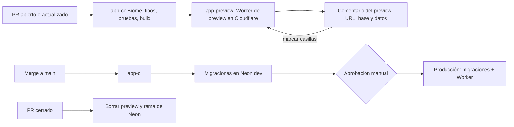
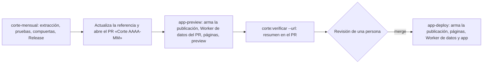

# CI/CD de la aplicación

Implementa [TASK-04 · Configurar CI y CD (#5)](https://github.com/EKOU-Solutions/EKOU-Elephants/issues/5) sobre el arquetipo React/Vite + Hono/Workers. El pipeline de datos en Python conserva su propio workflow (`pipeline-ci.yml`).

## En 30 segundos



| Workflow | Cuándo | Qué hace |
| --- | --- | --- |
| `app-ci.yml` | Lo llaman los otros dos; también manual | Lint y formato con Biome, tipos, pruebas (incluida integración con PostgreSQL 17 desechable), pruebas de las historias de Storybook en Chromium (`npm run test:stories`), build y validación del paquete de Wrangler. No usa secretos, así que también corre en PRs desde forks. |
| `app-preview.yml` | PR abierto, actualizado, reabierto o cerrado; edición del comentario de control | Despliega el preview del PR, publica y actualiza el comentario del preview y limpia al cerrar. |
| `app-deploy.yml` | Push a `main` | CI, migraciones en la base compartida `dev` y despliegue a producción tras la aprobación. |

## Comprobaciones locales

| Comando | Qué hace |
| --- | --- |
| `npm run lint` | Reglas recomendadas de Biome; las advertencias hacen fallar. |
| `npm run format:check` / `npm run format` | Verifica o aplica el formato de Biome. |
| `npm run check` | Lint, formato, tipos, pruebas y build (que incluye el Storybook estático). Es lo mismo que CI, salvo la integración con PostgreSQL si no hay `TEST_DATABASE_URL`. |
| `npm run deploy:dry-run` | Valida el paquete del Worker sin subirlo (requiere `npm run build`). |
| `npm run datos:corte -- [AAAA-MM]` | Lanza el workflow `corte-mensual` en GitHub Actions (sin mes: el actual). |
| `npm run datos:descargar -- [AAAA-MM]` | Baja un corte publicado (por defecto el último Release) a `datos-locales/`, que git ignora. `--forzar` reemplaza la carpeta. |
| `npm run datos:preview -- <pr>` | Sube `datos-locales/` al Worker de datos de ese PR (`ekou-elephants-datos-pr-<pr>`). Requiere `wrangler login` en la cuenta de EKOU. |
| `npm run paginas -- --sitio <URL> [--carpeta <ruta>]` | Genera con Astro la página de cada lugar y `sitemap.xml` en `<carpeta>/paginas/` (por defecto `datos-locales/`). Ver [páginas de cada lugar](#páginas-de-cada-lugar-en-el-corte-adr-0003). |
| `npm run corte:referencia -- <AAAA-MM> --publicado <ISO>` | Pone ese corte como vigente en `pipeline/worker-datos/corte-vigente.json` (lo hace el workflow del corte). Ver [publicación del corte](#publicación-del-corte-con-pr-y-preview). |
| `npm run corte:armar -- [--carpeta <ruta>]` | Arma la publicación del Worker de datos desde los Releases según esa referencia (por defecto en `pipeline/worker-datos/publicacion`). Requiere `gh` autenticado. |
| `npm run corte:verificar -- [--carpeta <ruta>] [--url <sitio>]` | Bot de verificación del corte: conteos, cambios frente al corte anterior, páginas y, con `--url`, el sitio desplegado. Sale con 1 si algo falla. |
| `npm run datos:local -- [AAAA-MM]` | Copia a `datos-locales/` un corte exportado en tu máquina (`ekou-pipeline export-mapa`), con la misma estructura que el Worker de datos. Con `datos-locales/`, `npm run dev` también sirve esos datos por el binding `DATOS`. |

Biome es la única herramienta de lint y formato de la app. Su alcance es `src/`, `.storybook/`, `tests/`, `scripts/`, los `.ts` y `.mjs` de `pages-site/` y la configuración TypeScript/JSON de la raíz. Markdown, SQL y HTML quedan fuera. El pipeline de Python usa Ruff.

## Preview por PR

Cada PR desde una rama de este repositorio (no forks ni Dependabot) despliega un **Preview de Cloudflare Workers** llamado `pr-<número>`, con la app y la API juntas. Al terminar, el workflow publica en el PR un comentario **«Preview de este PR»**. Es uno solo por PR y se actualiza en su lugar en cada despliegue.

> GitHub no permite fijar comentarios en PRs: solo en issues (la API responde «issue cannot be a pull request», verificado el 2026-11-15).

El comentario muestra la URL, el commit desplegado, la base de datos y los datos del corte que usa el preview. También tiene dos casillas. Al marcar o desmarcar una, se vuelve a desplegar el último commit del PR con esa configuración:

| Casilla | Sin marcar (por defecto) | Marcada |
| --- | --- | --- |
| **Copia propia de la base de datos** | Base compartida `dev` de Neon. No se aplican migraciones. | Rama de Neon `preview/pr-<n>` creada desde `dev`, con las migraciones del PR. Al desmarcarla se borra. |
| **Datos propios** | Datos del corte de producción (`ekou-elephants-datos`, solo lectura). Mientras `DATOS_CORTE_ENABLED` no esté activa, sin datos del corte. | Worker `ekou-elephants-datos-pr-<n>` con los datos que subiste desde tu máquina. Si no existe, el preview no se despliega y el comentario dice cómo subirlos. |

Casos de uso:

- **No cambiaste el backend:** no marques nada. El preview usa `dev`.
- **Cambiaste tablas o migraciones:** marca la copia de la base. Si el PR toca `migrations/` sin la copia, el preview **no se despliega** y el comentario explica por qué. Las migraciones de un PR nunca se aplican a `dev`.
- **Quieres probar con datos del corte modificados:** `npm run datos:descargar`, edita los JSON en `datos-locales/datos/`, `npm run datos:preview -- <n>` y marca «Datos propios». Los datos nunca entran al repositorio. Para subir otra versión, repite el comando y desmarca y vuelve a marcar la casilla.

Solo cuenta la edición de alguien con permiso de escritura en el repositorio. La lectura de opciones y la gestión del comentario usan el código de `main`, no el del PR. Al cerrar el PR se borran el preview de Cloudflare, la rama de Neon y el Worker de datos del PR.

## Storybook en el preview y en producción

`npm run build` genera la app y, después, la versión estática de Storybook en `dist/client/storybook/` (`npm run build:storybook-app`). El mismo Worker la sirve como archivos estáticos, así que no hay workflow, secreto ni proyecto aparte:

| Entorno | Dónde |
| --- | --- |
| Preview del PR | `<URL del preview>/storybook/`. El comentario «Preview de este PR» y el resumen del job traen el enlace. |
| Producción | `/storybook/` del dominio de producción. |
| Local | `npm run build && npm run preview`, luego `/storybook/`; o `npm run storybook` para desarrollar. |

Como sale del mismo commit, cada preview muestra el sistema de diseño de su PR y producción muestra el de `main`. CI ya construye Storybook dentro de `npm run build`: una historia rota hace fallar el PR. Storybook muestra solo datos ficticios; no lee la API ni la base.

Cloudflare sirve `/storybook/iframe.html` como `/storybook/iframe` (redirección 307 que conserva la consulta); Storybook funciona igual.

Un PR abierto antes de este cambio no trae Storybook en su build: su enlace muestra la app hasta que se actualice desde `main`.

## Datos del corte mensual

No se usa R2 (exige tarjeta de crédito). El corte mensual (TASK-15) publica los JSON (`datos/latest.json` y `datos/AAAA-MM/`) en un **Worker solo de archivos estáticos, `ekou-elephants-datos`**, sin URL pública, y guarda el histórico en los Releases `corte-AAAA-MM`. Desde el ADR 0003 no lo publica directamente: abre un PR que cambia la referencia al corte vigente y `app-deploy` lo publica al hacer merge (ver [publicación del corte](#publicación-del-corte-con-pr-y-preview)). La API lo lee con el binding `DATOS` (`env.DATOS.fetch(...)`, TASK-09).

No pueden ir en el Worker de la app: los archivos estáticos pertenecen a cada versión desplegada, así que el siguiente merge a `main` los borraría. Con un Worker aparte, el corte despliega solo los datos y un merge despliega solo la app. Se validó el 2026-11-15 en la cuenta de EKOU: el binding funciona con un Worker solo de archivos estáticos, también sin URL pública, y un preview puede apuntar su binding a otro Worker. Un binding no puede apuntar al *preview* de otro Worker ([documentación](https://developers.cloudflare.com/workers/previews/)), por eso los datos propios de un PR van en un Worker aparte.

Cloudflare rechaza un despliegue con un binding a un Worker que no existe. Por eso existe la variable **`DATOS_CORTE_ENABLED`**:

| `DATOS_CORTE_ENABLED` | Producción | Previews |
| --- | --- | --- |
| Sin definir o distinta de `true` (hoy, sin corte publicado) | Se despliega **sin** binding `DATOS` y sin verificar datos. | Sin datos del corte, salvo «Datos propios». |
| `true` (cuando exista `ekou-elephants-datos`) | Verifica que el Worker de datos exista antes de migrar; si no, falla. Despliega con el binding. | Leen los datos de producción por defecto. |

El frontend no depende de los datos del corte: la app funciona sin el binding.

El Worker de datos es un espejo de los Releases: `datos/AAAA-MM/` tiene los JSON del Release `corte-AAAA-MM` con el mismo nombre (los del mapa: `corte.json`, `municipios.json` y `departamentos.json`, de `ekou-pipeline export-mapa`), y `datos/latest.json` apunta al corte vigente. La geometría del mapa no va ahí: casi nunca cambia, así que es un archivo estático de la app (`public/geometria/mgn-2025.topojson`, generado con `scripts/geometria-mgn.mjs`), con caché inmutable (`public/_headers`). Una versión nueva del MGN usa otro nombre.

## Páginas de cada lugar en el corte (ADR 0003)

Con cada corte, `npm run paginas` genera con Astro una página HTML por lugar del mapa (`/mapa`, 32 departamentos —Bogotá, D.C. abre 11001— y 1.122 municipios: 1.155) y `sitemap.xml`, a partir de los mismos JSON que lee la API. Las escribe en `pages-site/` dentro de la carpeta de publicación del Worker de datos, que las sube junto a los datos con el mismo `wrangler deploy`:

| Archivo en `publicacion/` | Lo sirve el Worker de datos en | Lo entrega la app en |
| --- | --- | --- |
| `paginas/mapa.html` | `/paginas/mapa` | `/mapa` |
| `paginas/mapa/departamento/05.html` | `/paginas/mapa/departamento/05` | `/mapa/departamento/05` |
| `paginas/mapa/05001.html` | `/paginas/mapa/05001` | `/mapa/05001` (y `/mapa/departamento/11` → 11001) |
| `paginas/sitemap.xml` | `/paginas/sitemap.xml` | `/sitemap.xml` |

El Worker de la app atiende primero esas rutas (`assets.run_worker_first` en `wrangler.jsonc`), pide la página por el binding `DATOS`, le agrega los `<script type="module">`, `<link rel="modulepreload">` y `<link rel="stylesheet">` de su `index.html` actual (binding `ASSETS`) y la entrega con `Cache-Control: public, no-cache` y un `ETag` que une la versión de la página (su `ETag` en el Worker de datos) y la de la app (un resumen de las etiquetas de su `index.html`). Así el navegador nunca usa una página con los scripts de otro despliegue: siempre revalida y, mientras no cambien ni el corte ni la app, recibe un 304 sin cuerpo. Las etiquetas de la app se leen una vez por despliegue (por el `ETag` del `index.html`) y el `index.html` ni se pide si no hay página. `sitemap.xml` no lleva scripts y conserva `public, max-age=60, s-maxage=300, stale-while-revalidate=600`. Si no hay página, si `DATOS` falla o si no hay binding, entrega la SPA de siempre. La API no cambia.

Con el corte de noviembre de 2026: 1.155 páginas, 28,8 MB en total (25,5 KB de media, 4,1 KB con Brotli; la más grande, 37,8 KB). Generarlas tarda unos 40 s.

**URL del sitio.** El repositorio no fija todavía el dominio de producción, así que la URL base (canonical, `og:url` y `sitemap.xml`) es obligatoria: `--sitio https://<dominio>` o la variable `EKOU_SITIO_URL`. En el workflow sale de la variable del repositorio `EKOU_SITIO_URL` (Settings → Secrets and variables → Actions → Variables), que hay que crear. Cuando exista el dominio, también hay que activar la línea `Sitemap:` de `public/robots.txt` con la URL completa (Google no acepta una relativa).

### Publicación del corte con PR y preview

Decisión del equipo (ADR 0003, 2026-11-17): **ningún corte llega solo a producción.** El corte mensual abre un PR «Corte AAAA-MM»; su preview arma el Worker de datos del PR con las páginas, el bot de verificación deja su resumen y una persona revisa y aprueba. Al hacer merge, `app-deploy` publica el corte y la app.



**La referencia al corte vigente** es `pipeline/worker-datos/corte-vigente.json`, lo único que cambia el PR del corte (los JSON siguen en los Releases y las páginas no entran a Git):

```json
{
  "corte": "2026-11",
  "publicado": "2026-11-16T00:29:23Z",
  "cortes": ["2026-11"]
}
```

| Campo | Qué es |
| --- | --- |
| `corte` | El corte vigente: el que apunta `datos/latest.json`. |
| `publicado` | `publicadoEn` del `corte.json` de su Release. Cambia al reprocesar el mismo mes, así que un reproceso también abre su PR; y `armar` se niega a publicar un Release que cambió después de la revisión. |
| `cortes` | Los cortes que publica el Worker de datos, del más reciente al anterior (a lo sumo 2, como hoy: una petición que leyó el `latest.json` previo encuentra todavía sus archivos). |

Sin este archivo, ni el preview ni el despliegue tienen cómo saber qué corte se aprobó: hoy el único registro del corte vigente es el `latest.json` que `corte-mensual` despliega directo en `ekou-elephants-datos`, y el Release más reciente no es necesariamente uno revisado.

| Comando | Qué hace |
| --- | --- |
| `node scripts/cut.mjs referencia <AAAA-MM> --publicado <ISO>` (`npm run corte:referencia`) | Pone ese corte como vigente y conserva el anterior. Un mes anterior al vigente no cambia nada (solo su Release, como antes). |
| `node scripts/cut.mjs armar [--carpeta <ruta>]` (`npm run corte:armar`) | Lo que hacía en línea «armar la publicación»: borra la carpeta (por defecto `pipeline/worker-datos/publicacion`), baja de los Releases los JSON de `cortes` (menos `reporte-extraccion.json`) y escribe `datos/latest.json` con `punteroLatest`. Falla si el Release vigente no trae `corte.json`, `departamentos.json` y `municipios.json`, o si su `publicadoEn` no es el de la referencia. Requiere `gh` con `GH_TOKEN`. |
| `npm run paginas -- --carpeta <ruta> --sitio <URL>` | Las 1.155 páginas y el sitemap en `<ruta>/paginas/`. |
| `npm run corte:verificar -- --carpeta <ruta> [--url <sitio>]` | El bot de verificación (abajo). |

**Pendiente antes del primer PR de corte:** el Release `corte-2026-11` publicado no trae los JSON del mapa (`export-mapa` llegó después; solo tiene `calidad_corte.json` y `mapa_municipios.json`). `armar` falla con ese Release. Hay que reprocesar 2026-11 (o esperar el corte de diciembre) para que el PR del corte traiga una referencia publicable. El `publicado` del archivo inicial es el del `corte.json` de `datos-locales/` (exportado en local) y lo reemplaza el primer PR de corte.

#### Bot de verificación (`npm run corte:verificar`)

Revisa una publicación armada y escribe un resumen en Markdown (en la salida y, si existe, en `GITHUB_STEP_SUMMARY`). Sale con 1 si algo falla.

| Revisa | Falla si |
| --- | --- |
| Lugares y totales | No son 33 departamentos y 1.122 municipios sin repetidos; un municipio no tiene su departamento; el total nacional no cuadra con sus niveles ni con la suma de municipios y departamentos; los tres JSON no son del mismo corte. |
| Frente al corte anterior | Una cifra (nacional, de un departamento o de un municipio) cambia más del umbral (`--umbral`, por defecto 0,25 = 25 %) entre cifras desde `--minimo` (por defecto 100 contratos); pasar a «Sin datos» cuenta como −100 %; o falta un lugar del corte anterior. Siempre lista las 10 mayores variaciones. El anterior es el otro corte de la misma publicación o `--anterior <carpeta>`; sin él, no compara. Si la ventana cambió (enero), lo advierte. |
| Páginas generadas | La lista de lugares con página no son 1.155 (sale de `sitePages`, la misma regla con la que se generan, cargada con Vite); no hay una página por lugar, el sitemap no tiene 1.155 URL, o hay títulos o descripciones repetidos o vacíos. |
| Sitio (`--url`) | `/mapa`, `/mapa/05001` o `/mapa/11001` (la que abre el enlace de Bogotá, D.C.) no responden 200 con la página generada (con `canonical`) y su nombre y cifra en el HTML; `/api/salud` no responde; `/api/mapa/corte` no da el mismo corte. Reintenta 3 veces cada petición. |

El umbral es una primera propuesta: el corte acumula desde el 1 de enero de la ventana, así que de un mes a otro una cifra sube pocos puntos. Ajústalo con lo que muestren los primeros cortes revisados.

### Cambios pendientes en los workflows

Los agentes no tocan `.github/workflows/`: una persona del equipo aplica estos cambios. Nada de esto se ha ejecutado en GitHub Actions; lo marcado **(sin verificar)** depende de Actions o de Cloudflare y hay que comprobarlo en el primer corte.

**Configuración nueva**

| Qué | Dónde | Para qué |
| --- | --- | --- |
| Variable `EKOU_SITIO_URL` | Settings → Secrets and variables → Actions → Variables | URL del sitio para `canonical`, `og:url` y `sitemap.xml` en producción. |
| Secreto `EKOU_CORTE_TOKEN` | Environment o secretos del repositorio | Token de una GitHub App (o PAT de grano fino) con `contents: write` y `pull-requests: write`. Un PR creado con `GITHUB_TOKEN` **no dispara** `pull_request`, así que sin él el PR del corte no tendría preview. **(sin verificar)** |
| Protección de `main` | Settings → Branches | Que el PR del corte exija el check «Desplegar preview» (incluye el bot) y una aprobación. |

#### `corte-mensual.yml`: abrir el PR en lugar de publicar

1. En el job `corte`, quitar el paso `cortes del Worker de datos` (id `desplegar`) y las salidas `cortes` y `vigente`; ya no se usan.
2. Reemplazar el job `datos` (publicar en el Worker de datos) por `pr`:

```diff
-  datos:
-    name: publicar en el Worker de datos
-    needs: corte
-    if: needs.corte.outputs.cortes != ''
-    ...                                   # todo el job, hasta «desplegar ekou-elephants-datos»
+  pr:
+    name: abrir el PR del corte
+    needs: corte
+    # Solo cortes que se publican (los de main), como antes el Release.
+    if: github.ref == 'refs/heads/main' && (github.event_name == 'schedule' || inputs.publicar)
+    runs-on: ubuntu-latest
+    timeout-minutes: 10
+    permissions:
+      contents: read # el push y el PR van con EKOU_CORTE_TOKEN
+    defaults:
+      run:
+        shell: bash
+        working-directory: .
+    steps:
+      - uses: actions/checkout@3d3c42e5aac5ba805825da76410c181273ba90b1 # v7.0.1
+        with:
+          token: ${{ secrets.EKOU_CORTE_TOKEN }}
+
+      - uses: actions/setup-node@249970729cb0ef3589644e2896645e5dc5ba9c38 # v6.5.0
+        with:
+          node-version-file: .nvmrc
+          package-manager-cache: false
+
+      - name: actualizar la referencia y abrir el PR «Corte AAAA-MM»
+        env:
+          CORTE: ${{ needs.corte.outputs.corte }}
+          GH_REPO: ${{ github.repository }}
+          GH_TOKEN: ${{ secrets.EKOU_CORTE_TOKEN }}
+          EJECUCION: ${{ github.server_url }}/${{ github.repository }}/actions/runs/${{ github.run_id }}
+        run: |
+          # El Release de esta ejecución ya está publicado: su corte.json dice cuándo.
+          publicado=$(gh release download "corte-$CORTE" --pattern corte.json --output - | jq -r .publicadoEn)
+          node scripts/cut.mjs referencia "$CORTE" --publicado "$publicado"
+          if git diff --quiet -- pipeline/worker-datos/corte-vigente.json; then
+            echo "El corte $CORTE no cambia la referencia: no se abre PR." | tee -a "$GITHUB_STEP_SUMMARY"
+            exit 0
+          fi
+          rama="corte/$CORTE"
+          git config user.name "ekou-corte[bot]"
+          git config user.email "ekou-corte[bot]@users.noreply.github.com"
+          git switch -C "$rama"
+          git commit -m "datos(corte): corte $CORTE" -- pipeline/worker-datos/corte-vigente.json
+          # Un reproceso del mismo mes reemplaza la rama y actualiza el PR abierto.
+          git push --force origin "$rama"
+          if [[ -z "$(gh pr list --head "$rama" --state open --json number --jq '.[0].number')" ]]; then
+            gh pr create --base main --head "$rama" --title "Corte $CORTE" --body "Corte $CORTE publicado en el Release \`corte-$CORTE\` ($publicado). Ejecución: $EJECUCION
+
+          El preview de este PR arma el Worker de datos con este corte y sus páginas y deja el resumen del bot de verificación. Revisa el preview y el resumen antes de aprobar: al hacer merge se publica en producción (ADR 0003)."
+          fi
+          echo "PR del corte $CORTE: rama $rama" >> "$GITHUB_STEP_SUMMARY"

   avisar:
     name: avisar del fallo
-    needs: [corte, datos]
+    needs: [corte, pr]
```

También hay que cambiar el texto del issue de `avisar` («…o despliegue del Worker de datos») por «…o apertura del PR del corte», y el comentario de cabecera del archivo (`… → Release → PR del corte`).

**(sin verificar)** el permiso del token para crear la rama y el PR, y que el PR creado con él dispare `app-preview`.

#### `app-preview.yml`: el preview del PR del corte

En el job `desplegar`, después de `npm run build` y antes de «Migrar (solo con copia propia) y desplegar». El preview de un PR que cambia la referencia usa siempre su propio Worker de datos (`ekou-elephants-datos-pr-<n>`), que se arma desde los Releases, aunque la casilla «Datos propios» no esté marcada:

```diff
       - run: npm run build
         working-directory: app
+      - name: ¿Es un PR de corte?
+        id: corte
+        run: |
+          if cmp -s app/pipeline/worker-datos/corte-vigente.json base/pipeline/worker-datos/corte-vigente.json; then
+            echo "cambia=false" >> "$GITHUB_OUTPUT"
+          else
+            echo "cambia=true" >> "$GITHUB_OUTPUT"
+          fi
+      - name: Worker de datos del PR con el corte (sin páginas todavía)
+        # Tiene que existir antes de desplegar la app: Cloudflare rechaza un binding a un Worker que no existe.
+        if: steps.corte.outputs.cambia == 'true'
+        working-directory: app
+        env:
+          GH_TOKEN: ${{ github.token }}
+          GH_REPO: ${{ github.repository }}
+          CLOUDFLARE_API_TOKEN: ${{ secrets.CLOUDFLARE_API_TOKEN }}
+          CLOUDFLARE_ACCOUNT_ID: ${{ secrets.CLOUDFLARE_ACCOUNT_ID }}
+        run: |
+          npm run corte:armar
+          npm run datos:preview -- "$PR" --carpeta pipeline/worker-datos/publicacion
       - name: Migrar (solo con copia propia) y desplegar
         id: despliegue
         working-directory: app
         run: node ../base/scripts/despliegue.mjs preview
         env:
           ...
-          DATOS_SERVICIO: ${{ needs.opciones.outputs.datos_propios == 'true' && format('ekou-elephants-datos-pr-{0}', needs.opciones.outputs.pr) || '' }}
+          DATOS_SERVICIO: ${{ (needs.opciones.outputs.datos_propios == 'true' || steps.corte.outputs.cambia == 'true') && format('ekou-elephants-datos-pr-{0}', needs.opciones.outputs.pr) || '' }}
           ...
+      - name: Páginas con la URL del preview y verificación del corte
+        id: verificar
+        if: steps.corte.outputs.cambia == 'true' && steps.despliegue.outcome == 'success'
+        working-directory: app
+        env:
+          URL: ${{ steps.despliegue.outputs.url }}
+          CLOUDFLARE_API_TOKEN: ${{ secrets.CLOUDFLARE_API_TOKEN }}
+          CLOUDFLARE_ACCOUNT_ID: ${{ secrets.CLOUDFLARE_ACCOUNT_ID }}
+        run: |
+          # Ya con la URL del preview: canonical y sitemap apuntan a él. Se vuelve a subir el
+          # Worker de datos del PR, ahora con las páginas (el binding apunta a él por nombre).
+          npm run paginas -- --carpeta pipeline/worker-datos/publicacion --sitio "$URL"
+          npm run datos:preview -- "$PR" --carpeta pipeline/worker-datos/publicacion
+          set +e
+          npm run --silent corte:verificar -- --carpeta pipeline/worker-datos/publicacion --url "$URL" > ../resumen-corte.md
+          resultado=$?
+          set -e
+          cat ../resumen-corte.md >> "$GITHUB_STEP_SUMMARY"
+          exit $resultado
+      - name: Comentar el resumen del bot en el PR
+        if: always() && steps.verificar.outcome != 'skipped'
+        env:
+          GH_TOKEN: ${{ github.token }}
+          GH_REPO: ${{ github.repository }}
+        run: gh pr comment "$PR" --body-file resumen-corte.md --edit-last --create-if-none
       - name: Publicar resultado
```

Notas:

- `npm run datos:preview` sube la carpeta que se le indica con la configuración del Worker de datos del PR (`scripts/datos.mjs`, `configWorkerPr`), y `limpiar` ya borra ese Worker al cerrar el PR.
- El paso «Publicar resultado» sigue mostrando el estado del despliegue; si el bot falla, el job queda en rojo y el resumen explica por qué.
- `--edit-last` edita el último comentario del token (`github-actions[bot]`). Ese bot también publica el comentario de control «Preview de este PR»; si el último fuera ese, lo reemplazaría. **(sin verificar)** Si pasa, cambia este paso por un comentario con su propia marca (`<!-- ekou-corte-resumen -->`), como hace `scripts/preview/github.mjs`.
- El `design:check` de siempre no corre en CI hoy (`app-ci.yml` hace lint, formato, tipos, pruebas, build y `deploy:dry-run`); el ADR lo menciona como parte de la revisión: córrelo en local sobre el preview si el corte llega con cambios de pantalla.
- **(sin verificar)** que la URL que devuelve `wrangler preview --json` sirva como `--sitio` y que el preview ya responda en el primer intento del bot (reintenta 3 veces).

#### `app-deploy.yml`: publicar el corte al hacer merge

En el job `produccion`, después de `npm run build` y antes de «Migrar producción y desplegar». Se arma y se despliega el Worker de datos en cada push a `main`: así las páginas se regeneran también cuando cambia la pantalla, con los nombres de clase de la app que se despliega en el mismo job.

```diff
       - run: npm ci
       - run: npm run build
+      - name: Publicación del corte vigente (ADR 0003)
+        # La referencia aprobada en el PR del corte; páginas con la URL de producción.
+        if: vars.DATOS_CORTE_ENABLED == 'true'
+        env:
+          GH_TOKEN: ${{ github.token }}
+          GH_REPO: ${{ github.repository }}
+          EKOU_SITIO_URL: ${{ vars.EKOU_SITIO_URL }}
+        run: |
+          if [ -z "$EKOU_SITIO_URL" ]; then echo "::error::Falta la variable EKOU_SITIO_URL"; exit 1; fi
+          npm run corte:armar
+          npm run paginas -- --carpeta pipeline/worker-datos/publicacion
+          npm run --silent corte:verificar -- --carpeta pipeline/worker-datos/publicacion >> "$GITHUB_STEP_SUMMARY"
+      - name: Desplegar ekou-elephants-datos
+        # Antes que la app: su binding DATOS necesita que el Worker de datos exista.
+        if: vars.DATOS_CORTE_ENABLED == 'true'
+        env:
+          CLOUDFLARE_API_TOKEN: ${{ secrets.CLOUDFLARE_API_TOKEN }}
+          CLOUDFLARE_ACCOUNT_ID: ${{ secrets.CLOUDFLARE_ACCOUNT_ID }}
+        run: npx --no-install wrangler deploy --config pipeline/worker-datos/wrangler.jsonc
       - name: Migrar producción y desplegar
         run: node scripts/despliegue.mjs produccion
         env:
           ...
+      - name: Verificar producción
+        if: vars.DATOS_CORTE_ENABLED == 'true'
+        env:
+          EKOU_SITIO_URL: ${{ vars.EKOU_SITIO_URL }}
+        run: npm run --silent corte:verificar -- --carpeta pipeline/worker-datos/publicacion --url "$EKOU_SITIO_URL" >> "$GITHUB_STEP_SUMMARY"
```

Notas:

- El job `produccion` ya tiene `permissions: contents: read` (heredado), suficiente para `gh release download` con `github.token`. Los secretos de Cloudflare ya están en el environment `production`.
- Si alguien reprocesa el mes vigente, su Release cambia y `armar` falla en `main` hasta que se apruebe el PR del reproceso: producción nunca publica datos sin revisar, pero tampoco se despliega la app mientras tanto. Si eso molesta, la alternativa es saltar los dos pasos del corte cuando el push no cambia `corte-vigente.json` ni la pantalla del mapa (y perder la regeneración de páginas en cada despliegue).
- El verificador sin `--url` antes del despliegue y con `--url` después. Si el segundo falla, el despliegue ya ocurrió: se revierte con un PR que restaure la referencia anterior.
- **(sin verificar)** el tiempo del job: armar (~10 s), páginas (~40 s) y subir unas 1.160 entradas al Worker de datos.

Para probar con datos propios en un preview, como antes: `npm run datos:descargar`, `npm run paginas -- --sitio <URL del preview>` y `npm run datos:preview -- <pr>`, que sube `datos-locales/` completa, páginas incluidas, y marcar «Datos propios».

### Detalle de los contratos (TASK-12): pendiente de activar

`GET /api/contracts/:id` lee `datos/AAAA-MM/contratos/<grupo>.ndjson` del Worker de datos: 16.384 archivos por corte, 7,9 GB con el corte 2026-11 ([contrato](design/pages/contract-detail/contract.md#archivos-publicados)). El pipeline ya los genera, pero **el corte mensual todavía no los publica**: mientras tanto, la ruta responde `404 contract_not_found`. Activarlo exige cambiar `corte-mensual.yml` y el armado de la publicación (`scripts/cut.mjs armar`, ADR 0003), y lo hace una persona del equipo:

1. **Exportar:** después de `export-mapa`, correr `uv run ekou-pipeline export-contracts --corte AAAA-MM --pack`. Deja `contratos-0.tar.gz` a `contratos-3.tar.gz` (300 MB cada uno) en la carpeta de publicación, y suben al Release con los demás archivos.
2. **Desplegar:** después de `npm run corte:armar` (que solo baja los `*.json` del Release), bajar esos cuatro archivos **solo del corte vigente** y descomprimirlos en `datos/AAAA-MM/contratos/` de la carpeta de publicación. Con dos cortes se pasa el límite de 20.000 archivos por Worker; con uno, los 16.384 grupos más las 1.155 páginas de cada lugar y los JSON quedan cerca de 17.550.

```bash
gh release download "corte-$VIGENTE" --dir "$RUNNER_TEMP/contratos" --pattern 'contratos-*.tar.gz'
mkdir -p "$raiz/datos/$VIGENTE/contratos"
for paquete in "$RUNNER_TEMP"/contratos/contratos-*.tar.gz; do
  tar -xzf "$paquete" -C "$raiz/datos/$VIGENTE/contratos"
done
```

Antes de activarlo en producción, pruébalo una vez con un Worker de datos de PR: no está comprobado que Cloudflare acepte 7,9 GB de archivos estáticos en el plan gratuito ni cuánto tarda en subirlos. Si no pasa, la salida acordada es publicar solo los contratos de 2025 y 2026.

En local, `npm run dev` sirve los grupos que copies a `datos-locales/datos/AAAA-MM/contratos/`. Copia solo unos pocos: el Worker local los incluye al compilar.

## Producción

Con cada push a `main` (tras el merge de un PR):

1. Se ejecuta `app-ci`.
2. Se aplican las migraciones nuevas en la base compartida `dev`, para que los previews siguientes la encuentren al día.
3. El job `produccion` espera la **aprobación manual** del environment `production`. Al aprobarlo, verifica los datos del corte (solo con `DATOS_CORTE_ENABLED=true`), aplica las migraciones en la rama `production` de Neon y despliega el Worker con `wrangler deploy`.

Una migración fallida detiene el despliegue. Un despliegue fallido **no revierte** las migraciones ya aplicadas, así que las migraciones deben ser aditivas y compatibles con la versión anterior. Para revertir código, haz un PR que revierta el cambio y vuelve a pasar por el pipeline. El rollback de Cloudflare restaura código, no datos. Tras el primer despliegue real, verifica a mano la SPA, `GET /api/salud`, una ruta que use la base y `/storybook/`.

## Configuración única (administración del repositorio)

Nada de esto lo crean los archivos del repositorio. Los secretos nunca se escriben en archivos ni en el chat.

1. **Cloudflare (cuenta de EKOU):** crea un token de API con permiso de edición de Workers Scripts, limitado a la cuenta (plantilla «Edit Cloudflare Workers», sin R2). No le des permisos de DNS.
2. **Neon:** crea una clave de API para crear y borrar ramas del proyecto. La rama `dev` **debe ser permanente** (sin TTL), porque es la base compartida y el origen de las copias.
3. **GitHub → Settings → Environments:**
   - `preview`: secretos `CLOUDFLARE_API_TOKEN`, `CLOUDFLARE_ACCOUNT_ID`, `NEON_API_KEY`, `DATABASE_URL_DEV` (pooler de `dev`) y `DATABASE_URL_DEV_UNPOOLED` (conexión directa de `dev`).
   - `production`: **revisores obligatorios** y despliegue solo desde `main`. Secretos `CLOUDFLARE_API_TOKEN`, `CLOUDFLARE_ACCOUNT_ID`, `DATABASE_URL` y `DATABASE_URL_UNPOOLED` de la rama `production`.
4. **Variables del repositorio:** `NEON_PROJECT_ID`, `NEON_DATABASE` y `NEON_ROLE`. Después, `PREVIEW_DEPLOY_ENABLED=true` y, solo cuando el paso 3 esté listo, `PRODUCTION_DEPLOY_ENABLED=true`. Sin estas banderas no se despliega nada. `DATOS_CORTE_ENABLED=true` se activa cuando el corte mensual haya publicado `ekou-elephants-datos`.
5. **Protección de `main`:** exige el check «Calidad de la app» y el del pipeline.

El primer PR que agrega estos workflows no puede desplegar su propio preview, porque los scripts de control se leen desde `main`. Los previews funcionan desde el merge del PR #31 (2026-11-15).

## Referencias

Verificado el 2026-11-15 con Biome 2.6.8 y Wrangler 4.158.0 instalados, actionlint 1.7.7 y las etiquetas de las acciones (`actions/checkout` v7.0.1, `actions/setup-node` v6.5.0, `neondatabase/create-branch-action` v6.4.0 y `delete-branch-action` v3.2.1, fijadas por SHA).

- [Configuración de Biome](https://biomejs.dev/reference/configuration/)
- [Secretos de Workers subidos con el código](https://developers.cloudflare.com/workers/configuration/secrets/)
- [Permisos de Wrangler](https://developers.cloudflare.com/workers/authorization/workers/#wrangler)
- [Environments y revisores en GitHub](https://docs.github.com/en/actions/how-tos/deploy/configure-and-manage-deployments/manage-environments)
- [neondatabase/create-branch-action](https://github.com/neondatabase/create-branch-action)
