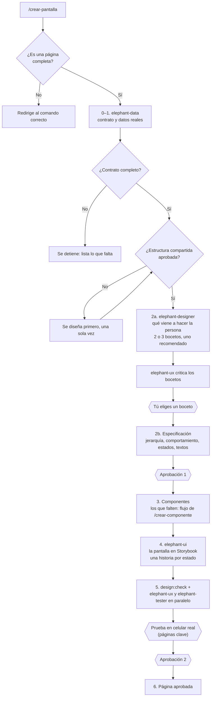
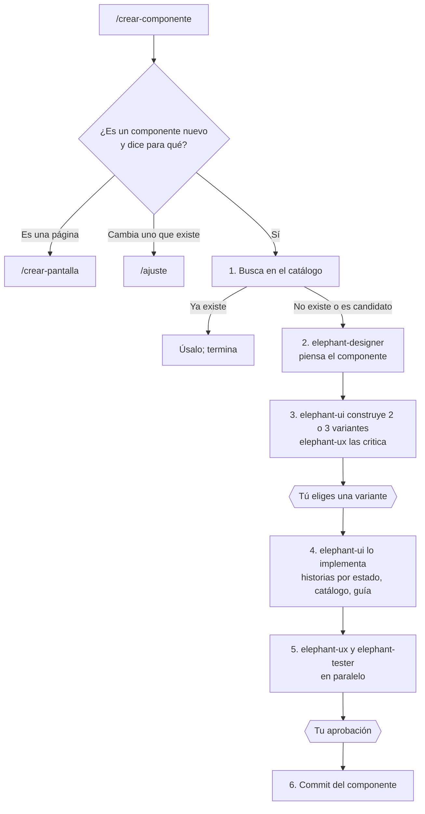
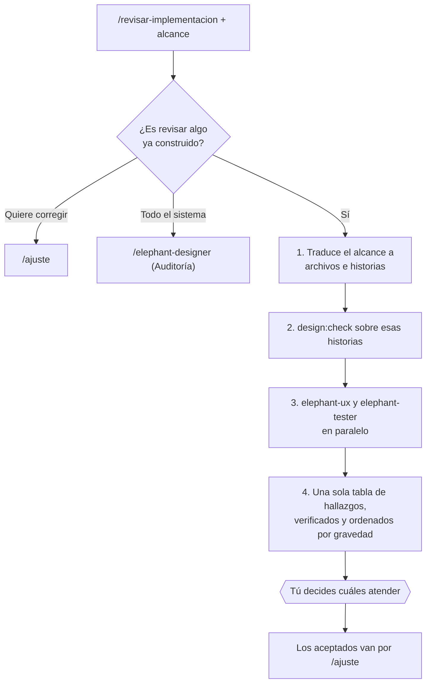
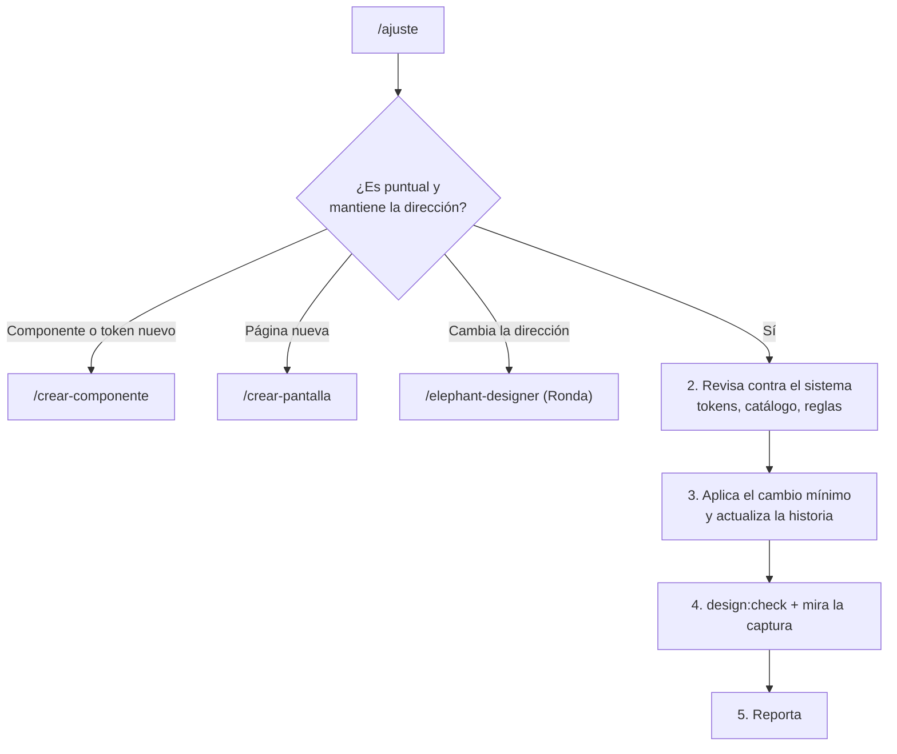

# Comandos de diseño

Qué hace cada comando del flujo de diseño, paso a paso, quién hace cada paso y dónde se detiene a pedirte una decisión. Las instrucciones detalladas para los agentes viven en `.claude/skills/`; este documento es la versión para personas.

Regla del proyecto (`AGENTS.md`): todo cambio visual o de experiencia pasa por uno de estos flujos. Si le pides un cambio a un agente sin usar un comando, igual carga `elephant-designer` y sigue el flujo que corresponda.

## Cuál usar

| Quiero… | Comando |
| --- | --- |
| Una página o pantalla completa | `/crear-pantalla` |
| Un componente nuevo | `/crear-componente` |
| Revisar algo que ya está hecho | `/revisar-implementacion` |
| Un cambio pequeño a algo que existe | `/ajuste` |
| Otra cosa, o no sé cuál | `/elephant-designer` |

**Si te equivocas de comando, no pasa nada.** Cada comando comprueba primero que el pedido es suyo. Si no lo es (por ejemplo, `/crear-componente` para una página), te lo dice en una línea y te manda al comando correcto o a `elephant-designer`.

En Codex los comandos se llaman con `$` (`$ajuste`); en Antigravity, pidiendo usar la skill por su nombre.

## Quién hace qué: los roles

| Rol | Hace | ¿Cambia archivos? |
| --- | --- | --- |
| `elephant-designer` | Orquesta. Analiza qué viene a hacer la persona, propone opciones con una recomendada, cuida la jerarquía visual y habla contigo | Documentos de la página |
| `elephant-data` | Revisa el contrato de nuestra API y explora los datos reales | Solo `contract.md` y `data.md` |
| `elephant-ui` | Implementa en React un componente o una pantalla ya definidos, con sus historias. Escribe el menor código que resuelve el encargo (skill Ponytail) y con las reglas de calidad del proyecto: una responsabilidad por componente, composición, estado mínimo, constantes con nombre | Solo la carpeta de su encargo |
| `elephant-ux` | Critica la experiencia sobre capturas: tarea, jerarquía, prueba de 10 segundos, textos | No |
| `elephant-tester` | Revisa tokens, catálogo, accesibilidad, movimiento reducido, contrato, peso y código | No |

Quien construye no juzga: `elephant-ux` y `elephant-tester` siempre revisan con ojos frescos. En Claude Code los roles corren como sub-agentes; en las demás herramientas, el mismo agente los ejecuta uno por uno. Cada rol también se puede llamar suelto (`/elephant-data`, `/elephant-ux`…).

Lo mecánico lo hace un comando, no un agente: `npm run design:check` renderiza cada historia en claro y oscuro a 320, 390, 768 y 1280 px, corre axe, detecta desplazamiento horizontal y guarda capturas.

## `/crear-pantalla`

Para una página completa, del contrato de la API a la pantalla aprobada en Storybook. Una página a la vez.

| Paso | Qué pasa | Quién | Te pide |
| --- | --- | --- | --- |
| 0. Contrato | Comprueba que el contrato de nuestra API existe y está completo. Sin contrato, no hay diseño | `elephant-data` | Que el contrato exista |
| 1. Datos | Explora los datos reales: qué campos vienen vacíos, valores extremos, datos sensibles | `elephant-data` | — |
| Estructura compartida | Encabezado, navegación, filtro de territorio y pie. Se diseña una sola vez, antes de la primera página | `elephant-designer` | Su aprobación, la primera vez |
| 2a. Experiencia | Analiza qué viene a hacer la persona y propone dos o tres bocetos en baja fidelidad (`bocetos.html`), con uno recomendado. Cada boceto dice qué se ve primero, segundo y tercero, cómo se comporta, y qué favorece y sacrifica. `elephant-ux` los critica | `elephant-designer`, `elephant-ux` | **Que elijas un boceto** |
| 2b. Especificación | `spec.md`: contenido en orden de lectura, comportamiento (toques, navegación, URL que se puede compartir, foco), estados, maquetación y textos | `elephant-designer` | **Aprobación 1** |
| 3. Componentes | Usa el catálogo. Cada componente que falte pasa por el flujo de `/crear-componente` | `elephant-designer`, `elephant-ui` | Variante y aprobación por componente |
| 4. Pantalla | Construye la pantalla real en Storybook (`Módulos/<Módulo>/<Page>Page`), junto a sus componentes, con datos de muestra del contrato y una historia por estado | `elephant-ui` | — |
| 5. Validación | `design:check` y dos revisiones en paralelo: experiencia y calidad técnica (incluye el peso de la página) | `elephant-ux`, `elephant-tester` | — |
| Prueba real | En páginas clave: alguien del equipo la prueba en un celular real, ojalá con una persona que no conozca el producto | Tú o Esteban | El resultado |
| 6. Entrega | La página queda «Aprobada». Desarrollo conecta la pantalla a los datos; no la vuelve a construir | `elephant-designer` | **Aprobación 2** |

**Produce:** `docs/design/pages/<pagina>/` (`contract.md`, `data.md`, `bocetos.html`, `spec.md`, `validation.md`) y las historias del módulo en Storybook. **Commit:** no hace commit de la página sin que lo pidas (los componentes nuevos sí traen el suyo).

## `/crear-componente`

Para un componente nuevo, o para confirmar un candidato del catálogo. El pedido debe decir para qué página o necesidad es.

| Paso | Qué pasa | Quién | Te pide |
| --- | --- | --- | --- |
| 0. Confirmar | Comprueba que es un componente y para qué se necesita | `elephant-designer` | El motivo, si falta |
| 1. Catálogo | Si ya existe uno que sirve, lo usa y termina. Si es un candidato, este flujo lo confirma | `elephant-designer` | — |
| 2. Pensarlo | Propósito, lugar (UI puro o de un módulo), partes, variantes y estados, comportamiento, contenido real, tokens, accesibilidad | `elephant-designer` | — |
| 3. Variantes | Dos o tres variantes en Storybook, con la recomendada primero; capturas en claro y oscuro; crítica de `elephant-ux` | `elephant-ui`, `elephant-ux` | **Que elijas una** |
| 4. Implementar | Componente React, sus estilos, una historia por estado, entrada en el catálogo y versión de la guía | `elephant-ui` | — |
| 5. Revisar | Experiencia y calidad técnica, por separado de quien lo construyó | `elephant-ux`, `elephant-tester` | **Tu aprobación** |
| 6. Commit | Un commit solo con los archivos del componente, en una rama (nunca en `main`). Sin push | `elephant-designer` | — |

**Produce:** la carpeta del componente (`Component.tsx`, `Component.module.css`, `Component.stories.tsx`), su entrada en `components.json` y un commit. **Commit:** sí, es el único flujo que lo hace sin pedirlo aparte; ocurre solo después de tu aprobación y con `design:check` y `npm run check` en verde.

## `/revisar-implementacion`

Para revisar algo ya construido. Tú defines el alcance; no cambia nada.

| Alcance que puedes dar | Ejemplo |
| --- | --- |
| Una página o un módulo | `/revisar-implementacion la página del mapa` |
| Un componente | `/revisar-implementacion el componente Alert` |
| Los cambios sin confirmar | `/revisar-implementacion mis cambios sin commit` |
| Un commit | `/revisar-implementacion el commit a7068cd` |
| Una rama o un PR | `/revisar-implementacion esta rama contra main` |

**Produce:** una tabla de hallazgos con evidencia (captura o archivo y línea), gravedad y cambio propuesto; el resultado de `design:check`; qué funciona y qué no se comprobó. **Commit:** no.

## `/ajuste`

Para un cambio puntual que mantiene la dirección visual: un texto, un espaciado, un estado que falta, un bug visual, un contraste, o un hallazgo aceptado de una revisión.

| Paso | Qué pasa | Quién |
| --- | --- | --- |
| 1. Clasificar | Confirma que es un ajuste; si no, redirige | `elephant-designer` |
| 2. Revisar | Qué se toca y si respeta tokens, catálogo y reglas | `elephant-designer` |
| 3. Aplicar | El cambio mínimo en la fuente; actualiza la historia | `elephant-designer` (o `elephant-ui` si es más que una línea) |
| 4. Validar | `design:check` sobre lo tocado y revisión de la captura. Si tocó un componente UI compartido, `elephant-tester` | — |
| 5. Reportar | Qué cambió, qué se verificó y qué no | `elephant-designer` |

**Produce:** el cambio y su historia actualizada. **Commit:** no, hasta que lo pidas.

## `/elephant-designer`

El orquestador. Úsalo cuando no sepas qué comando es, y para lo que no tiene comando propio:

| Flujo | Para qué |
| --- | --- |
| Auditoría | Juzgar todo el sistema, la guía o una ronda contra el brief |
| Ronda | Cambiar la dirección: paleta, tipografía, lenguaje visual |
| Descubrimiento | Crear o actualizar el brief cuando cambia el negocio o la audiencia |

## Pendiente

- **Pruebas visuales** (comparar las capturas de Storybook contra la versión anterior): se harán con una herramienta de código abierto y alojada por nosotros (decidido el 2026-11-16; Chromatic se descartó por cobrar por captura). Falta elegirla.
- **Límite de peso por página:** hoy se reporta la cifra; el equipo no ha fijado un máximo.
- **`design:check` en CI:** hoy se ejecuta en local; agregarlo a los workflows lo hace una persona.
