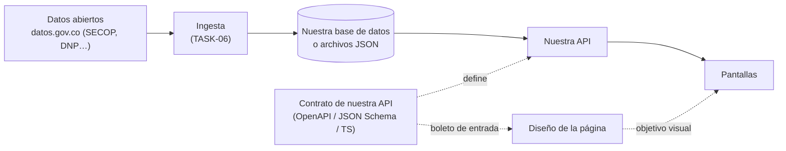
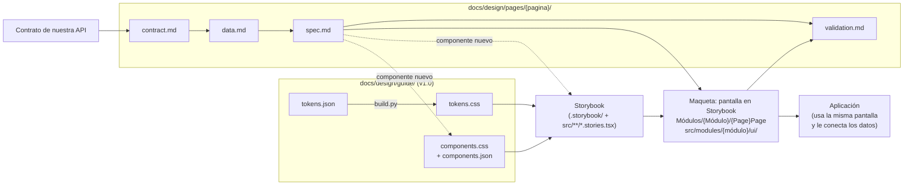
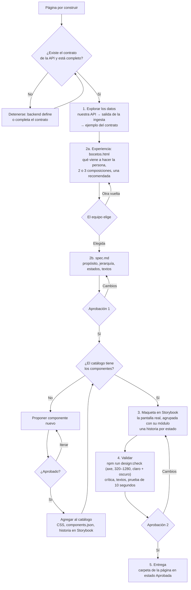
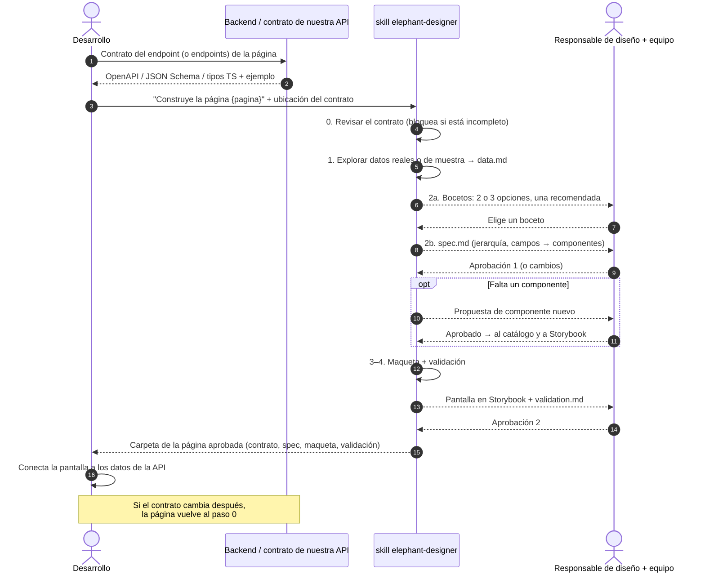

# Flujo de diseño

Cómo pasa una página de los datos a un diseño aprobado, y cómo trabaja desarrollo con la skill `elephant-designer`. Las instrucciones detalladas para agentes están en la skill: [Construir una página](../../.claude/skills/elephant-designer/references/build-page.md). Para los cambios pequeños que mantienen la dirección existe la ruta [Ajuste](../../.claude/skills/elephant-designer/references/ajuste.md). Todo cambio de diseño pasa por la skill (regla global de `AGENTS.md`).

## En un minuto

- **Una página a la vez (vertical).** No diseñamos todas las páginas por adelantado. Cada página va de su contrato de API a un diseño aprobado antes de que empiece la siguiente.
- **Sin contrato, no hay diseño.** El boleto de entrada es el contrato de **nuestra API**, el que consumen las pantallas. No es el contrato de la fuente de datos abiertos. La API en sí puede seguir en construcción.
- **Nada inventado.** Cada elemento de una página se rastrea hasta un campo del contrato, un componente aprobado y tokens aprobados.
- **Primero la experiencia.** Antes de la especificación, la skill analiza qué viene a hacer la persona y propone dos o tres bocetos con uno recomendado; el equipo elige.
- **Dos aprobaciones humanas por página:** la especificación sobre el boceto elegido (qué y en qué orden) y luego el diseño final. Los componentes nuevos necesitan su propia aprobación.
- **Todo componente queda en Storybook** (`npm run storybook`), con su historia y sus estados.

## De dónde vienen los datos

El diseño depende solo del último tramo: lo que devuelve nuestra API. Los conjuntos de datos de origen importan solo como el origen de cada campo, para que cada cifra pueda citar su fuente y su fecha.

## Dónde vive cada pieza

`tokens.json` es la fuente; `tokens.css` se genera, así que nunca se edita a mano. El catálogo se consulta en Storybook y su fuente es la [guía del sistema de diseño v1.0](guide/README.md); las reglas están en [design-system.md](guide/design-system.md).

## El flujo de una página

## Qué hace la persona de desarrollo

## Lista de verificación del contrato (boleto de entrada)

Para cada endpoint que usa una página:

- [ ] Método, ruta y parámetros (incluido el filtro de territorio DANE).
- [ ] Cada campo: tipo, unidad o formato (COP, %, fecha), y si puede ser nulo o faltar.
- [ ] Al menos una respuesta de ejemplo que cumpla el esquema.
- [ ] Fase de cada campo: MVP o fase 2.
- [ ] Origen de cada campo: el id del conjunto de datos del que lo toma la ingesta (ver [fuentes de datos](../fuentes-de-datos.md)), o «calculado» con el dueño de la regla (por ejemplo, TASK-07 para el nivel de riesgo).

## Qué recibe desarrollo

| Archivo | Para qué sirve |
| --- | --- |
| `contract.md` | La versión exacta del contrato de la que depende el diseño |
| `spec.md` | Orden de construcción y jerarquía; la tabla campo → componente → token; cada estado (carga, vacío, «Sin datos», error, fase 2 oculta); textos finales |
| La pantalla en Storybook (`Módulos/<Módulo>/<Page>Page`) | El objetivo visual, ya construido en React: una historia por estado, con datos de muestra del contrato. Desarrollo le conecta los datos; no la vuelve a construir |
| `validation.md` | Qué se verificó y qué falta comprobar en la aplicación real |
| Las demás historias del módulo y de `Componentes/UI/` | Cada componente que usa la página, con sus estados y su accesibilidad |

## Reglas que nunca cambian

- Importa `tokens.css`; usa solo variables `--el-*`. Nunca un hex suelto.
- Usa las clases del catálogo (`.el-*`, listadas en `components.json` y documentadas en Storybook). Si falta algo, pídelo a través del flujo; no improvises un componente.
- «Sin datos» nunca se muestra como 0 ni como riesgo bajo. Los datos faltantes usan la trama gris.
- Una señal pide revisar; no es un veredicto. Nada de «corrupción», «robo» ni «sospechoso» en la interfaz. Ningún nombre de persona natural hasta que TASK-08 lo decida.
- Toda cifra muestra su fuente y su fecha.
