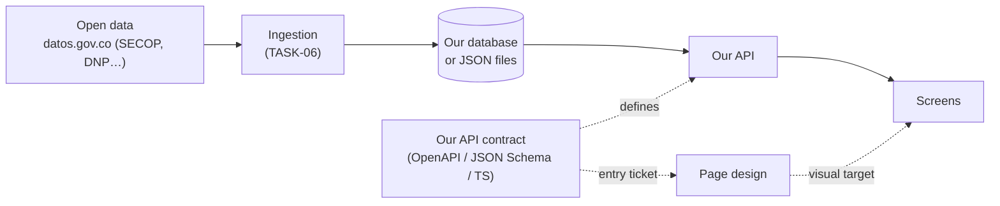
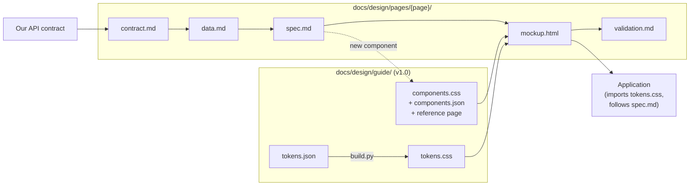
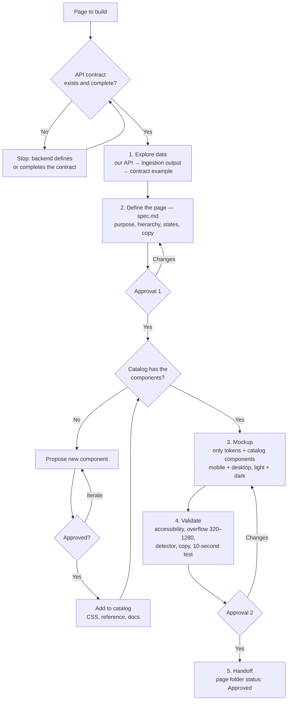
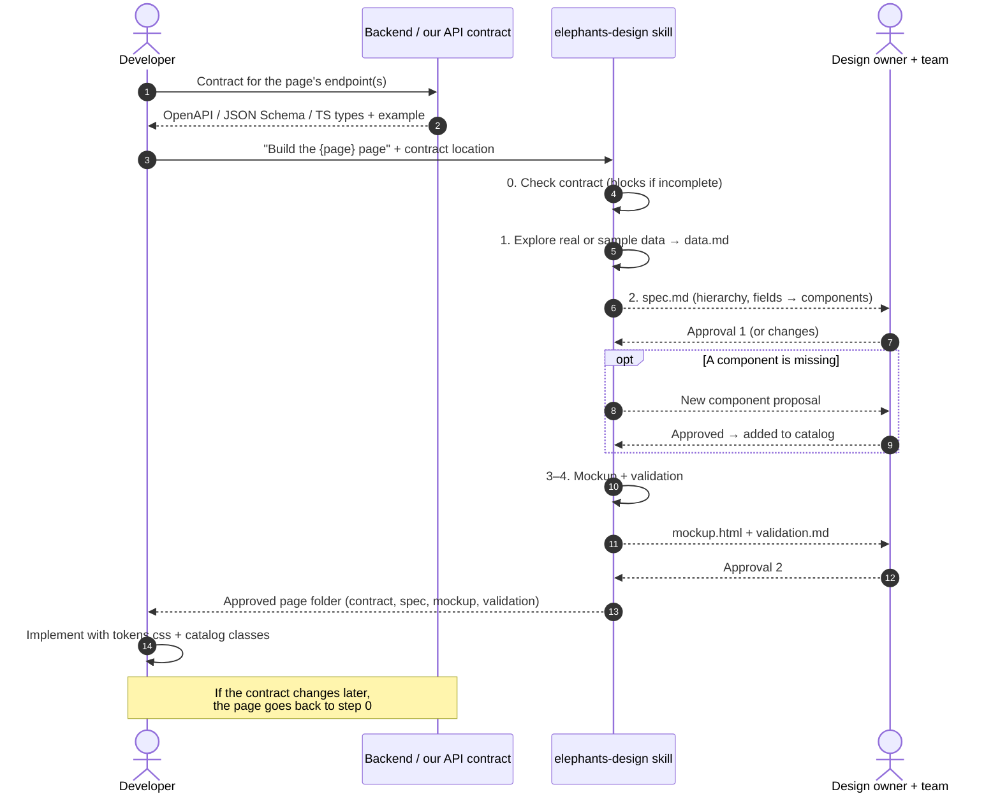

# Design flow

How a page goes from data to an approved design, and how developers work with the `elephants-design` skill. The detailed agent instructions live in the skill: [Build a page](../../.claude/skills/elephants-design/references/build-page.md).

## In one minute

- **One page at a time (vertical).** We do not design every page up front. Each page goes from its API contract to an approved design before the next one starts.
- **No contract, no design.** The entry ticket is the contract of **our API**, the one the screens consume. It is not the open-data source's contract. The API itself may still be under construction.
- **Nothing invented.** Every element on a page traces back to a contract field, an approved component and approved tokens.
- **Two human approvals per page:** the spec (what and in which order), then the final design. New components need their own approval.

## Where the data comes from

The design depends only on the last hop: what our API returns. The upstream datasets matter only as each field's origin, so every figure can cite its source and date.

## Where each piece lives

`tokens.json` is the source; `tokens.css` is generated, so never edit it by hand. The catalog is the [design system guide v1.0](guide/README.md); the rules are in [design-system.md](guide/design-system.md).

## The flow for one page

## What the developer does

## Contract checklist (entry ticket)

For each endpoint a page uses:

- [ ] Method, path and parameters (including the DANE territory filter).
- [ ] Every field: type, unit or format (COP, %, date), and whether it can be null or missing.
- [ ] At least one example response that conforms to the schema.
- [ ] Phase of each field: MVP or phase 2.
- [ ] Origin of each field: the upstream dataset id that ingestion maps it from (see [fuentes de datos](../fuentes-de-datos.md)), or "computed" with its rule owner (for example TASK-07 for risk level).

## What the developer receives

| File | Use it for |
| --- | --- |
| `contract.md` | The exact contract version the design depends on |
| `spec.md` | Build order and hierarchy; the field → component → token table; every state (loading, empty, "Sin datos", error, phase 2 hidden); final copy |
| `mockup.html` | Visual target in mobile and desktop, light and dark |
| `validation.md` | What was verified, and what still needs checking in the real app |

## Rules that never change

- Import `tokens.css`; use `--el-*` variables only. Never a raw hex value.
- Use catalog classes (`.el-*`, listed in `components.json`). If something is missing, ask through the flow; do not improvise a component.
- "Sin datos" is never shown as 0 or as low risk. Missing data uses the grey hatch.
- A signal asks for review; it is not a verdict. No "corrupción", "robo" or "sospechoso" in the interface. No natural persons' names until TASK-08 decides.
- Every figure shows its source and date.
