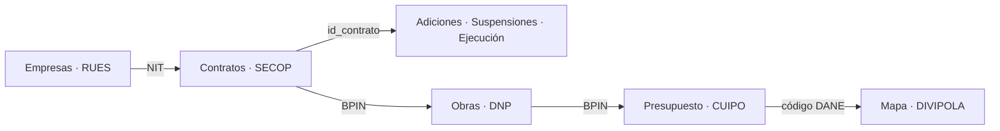

# Fuentes de datos

APIs públicas que usa EKOU-Elephants, para qué sirve cada una y en qué fase entra.

> Última verificación: 2026-11-07

## En 30 segundos

- **Una sola plataforma:** todas las APIs son de [datos.gov.co](https://www.datos.gov.co), son gratuitas y no piden autenticación.
- **Cuatro grupos de datos:** **contratos** (SECOP), **presupuesto** (CUIPO), **obras** (DNP) y **empresas** (RUES).
- **El MVP usa 7 APIs**, casi todas de SECOP II. El resto entra en la fase 2.
- **Todo se cruza** por NIT, `id_contrato`, BPIN o código DANE del municipio.

Pruébalo ya:

```bash
curl "https://www.datos.gov.co/resource/jbjy-vk9h.json?\$limit=5"
```



---

## Acceso

Todas las APIs son de **[datos.gov.co](https://www.datos.gov.co)** (Socrata SODA). Usan el mismo formato de URL y se consultan con SoQL (`$select`, `$where`, `$group`, `$order`, `$limit`, `$offset`).

```
https://www.datos.gov.co/resource/{id}.json   → datos en JSON
https://www.datos.gov.co/resource/{id}.csv    → datos en CSV
https://www.datos.gov.co/api/views/{id}.json  → metadatos y columnas
```

- No hace falta autenticación para leer. Hay que registrar un **App Token** gratuito para evitar límites de uso.
- Documentación: https://dev.socrata.com/docs/endpoints

---

## APIs

### MVP

| API | Endpoint | Sirve para |
|---|---|---|
| SECOP II – Contratos | [`jbjy-vk9h`](https://www.datos.gov.co/resource/jbjy-vk9h.json) | **Buscador de contratos**, monto y número de contratos, contratación directa frente a licitación, principales contratistas, mapa de inversión |
| SECOP II – Procesos | [`p6dx-8zbt`](https://www.datos.gov.co/resource/p6dx-8zbt.json) | **Alertas:** procesos con un solo oferente, precio base frente a valor adjudicado |
| SECOP II – Adiciones | [`cb9c-h8sn`](https://www.datos.gov.co/resource/cb9c-h8sn.json) | **Sobrecostos:** valor inicial frente a valor final del contrato |
| SECOP II – Suspensiones | [`u99c-7mfm`](https://www.datos.gov.co/resource/u99c-7mfm.json) | **Obras paralizadas:** contratos suspendidos y sus motivos |
| SECOP II – Multas y Sanciones | [`it5q-hg94`](https://www.datos.gov.co/resource/it5q-hg94.json) | **Alertas:** contratistas sancionados que siguen contratando |
| SECOP I – Multas y Sanciones | [`4n4q-k399`](https://www.datos.gov.co/resource/4n4q-k399.json) | **Alertas:** sanciones históricas de contratistas |
| DIVIPOLA (DANE) | [`gdxc-w37w`](https://www.datos.gov.co/resource/gdxc-w37w.json) | **Mapa:** códigos, latitud y longitud de los 1.122 municipios |

### Fase 2

| API | Endpoint | Sirve para |
|---|---|---|
| CUIPO – Programación de Gastos | [`d9mu-h6ar`](https://www.datos.gov.co/resource/d9mu-h6ar.json) | **Presupuesto asignado** de cada municipio y departamento |
| CUIPO – Ejecución de Gastos | [`4f7r-epif`](https://www.datos.gov.co/resource/4f7r-epif.json) | **Presupuesto ejecutado** (compromisos, obligaciones, pagos) por municipio y departamento |
| Ejecución Presupuestal del PGN | [`xjxk-qhsc`](https://www.datos.gov.co/resource/xjxk-qhsc.json) | **Presupuesto asignado frente a ejecutado** de entidades nacionales |
| OVCF – SGR Ejecución de Gastos | [`qkv4-ek54`](https://www.datos.gov.co/resource/qkv4-ek54.json) | **Presupuesto de regalías** ejecutado |
| SECOP II – Ejecución de Contratos | [`mfmm-jqmq`](https://www.datos.gov.co/resource/mfmm-jqmq.json) | **Obras retrasadas:** avance esperado frente a real |
| SECOP II – Compromisos Presupuestales | [`skc9-met7`](https://www.datos.gov.co/resource/skc9-met7.json) | Conectar cada contrato con el presupuesto de la entidad |
| SECOP Integrado | [`rpmr-utcd`](https://www.datos.gov.co/resource/rpmr-utcd.json) | **Histórico** de contratación (SECOP I + II) para tendencias y totales |
| DNP – Seguimiento de Proyecto | [`7mxf-bp6x`](https://www.datos.gov.co/resource/7mxf-bp6x.json) | **Seguimiento de obras:** avance físico y financiero de cada proyecto |
| DNP – Proyectos | [`cf9k-55fw`](https://www.datos.gov.co/resource/cf9k-55fw.json) | Ficha de cada proyecto de inversión: nombre, sector, valor, estado |
| DNP – Proyectos ↔ Contratos | [`uwns-mbwd`](https://www.datos.gov.co/resource/uwns-mbwd.json) | Conectar cada **proyecto con sus contratos** de SECOP |
| DNP – Producto por Localización | [`nf48-7qwf`](https://www.datos.gov.co/resource/nf48-7qwf.json) | **Mapa:** metas y avance de proyectos por municipio |
| DNP – Proyectos SGR | [`mzgh-shtp`](https://www.datos.gov.co/resource/mzgh-shtp.json) | **Seguimiento de obras de regalías:** ejecución física, financiera e interventor |
| RUES (Confecámaras) | [`c82u-588k`](https://www.datos.gov.co/resource/c82u-588k.json) | **Alertas:** empresas recién creadas, actividad que no corresponde al contrato, matrícula cancelada, representante legal compartido |
| SIRI (Procuraduría) | [`iaeu-rcn6`](https://www.datos.gov.co/resource/iaeu-rcn6.json) | **Alertas:** personas con sanciones disciplinarias |
| Conflictos de interés (Función Pública) | [`83qu-fqy5`](https://www.datos.gov.co/resource/83qu-fqy5.json) | **Indicador por entidad:** qué porcentaje de servidores declaró y cuántos reportaron posibles conflictos |
| ITA (Procuraduría) | [`im79-n45d`](https://www.datos.gov.co/resource/im79-n45d.json) | **Contexto:** nivel de transparencia de cada entidad |

---

## Llaves de cruce

| Llave | Conecta |
|---|---|
| `nit` / `documento_proveedor` | SECOP ↔ RUES ↔ Multas y Sanciones |
| `id_contrato` | Contratos ↔ Adiciones ↔ Ejecución ↔ Suspensiones ↔ Compromisos |
| `bpin` | DNP ↔ CUIPO ↔ SECOP (vía `uwns-mbwd`) |
| Código DANE del municipio | CUIPO ↔ DNP ↔ DIVIPOLA |

---

## Limitaciones

1. **Obras inconclusas:** el registro oficial de la Contraloría no es público. Se aproxima con suspensiones, avance real frente a esperado y el avance físico del DNP. En la app se presenta como **"obras con señales de retraso"**.
2. **CUIPO:** solo cubre desde 2023 y llega con alrededor de un trimestre de rezago.
3. **Calidad de SECOP:** hay valores irreales, nombres de proveedores escritos de distintas formas y campos vacíos. Hace falta una capa de limpieza.
4. **Volumen:** hay datasets de hasta 23 M de registros. Los datos se copian a una base propia; no se consultan en vivo.
5. **Datos personales:** RUES, SIRI, conflictos de interés y las cédulas de contratistas que son personas naturales. Se usan para calcular alertas, pero en la interfaz solo se muestran personas jurídicas o datos agregados (Ley 1581 de 2012).
6. **Alertas:** se comunican como **"señales de riesgo"** con una metodología pública, no como pruebas de corrupción.
7. **Licencias:** la mayoría usa CC BY-SA 4.0, que obliga a citar la fuente y a compartir los datos derivados con la misma licencia.

---

## Próximos pasos

- [ ] Registrar el App Token de datos.gov.co
- [ ] Sacar una muestra de cada API del MVP para medir su calidad real
- [ ] Definir las reglas de alertas a partir de [Red Flags for Integrity](https://www.open-contracting.org/resources/red-flags-integrity-giving-green-light-open-data-solutions/) (Open Contracting Partnership)
- [ ] Diseñar el modelo de datos y el pipeline de ingesta, con exportación en formato [OCDS](https://standard.open-contracting.org/latest/es/)
- [ ] Revisión legal del uso de datos personales
- [ ] Radicar un derecho de petición a la Contraloría por el Registro Nacional de Obras Civiles Inconclusas
